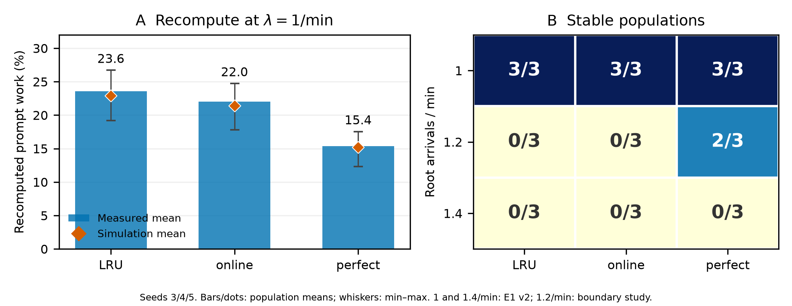
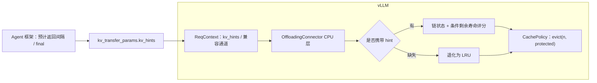

# AgentKV：面向 Agent 负载的 vLLM CPU 层 KV Cache 驱逐

AgentKV uses orchestrator hints to guide CPU-tier KV cache eviction in vLLM for agent workloads on H200 with Qwen3-8B.
It provides event-anchored replay with steady-state initialization, a two-tier simulator, and a hint-aware CachePolicy plugin.
At one new root session per minute, recomputation falls from 23.6% (LRU) to 22.0% (online) and 15.4% (perfect); P99 TTFT changes by −11.3% and −28.0%, respectively.
Results average three held-out workloads; perfect hints use future information, and the long-run scheduler overhead target remains unmet.

Agent 等待工具结果时，当前推理请求已经结束，但后续会话仍会带着大段相同前缀回来。显存紧张时，LRU 不知道哪些会话即将返回；前缀从 GPU 和 CPU 两层丢失后，下一轮需要重新 prefill。

AgentKV 让 Agent 框架通过 vLLM 的 `kv_hints` 信封提供预计返回间隔和结束信号，据此在 CPU 卸载层选择驱逐对象。

主实验使用负载样本（种子 3/4/5 生成的三组会话负载），各策略在同一负载上配对比较。

## 做了什么

- **问题验证**：用 SemiAnalysis AgentX trace 构建保持前缀结构的事件锚定、稳态会话回放器。基线测量（E0）的稳定负载样本中，约 **87%–92% 的总重算**来自间隙期间（含排队）的触发前缀损失。[口径与结构原因](docs/REPORT.md#41-e0稳定负载存在可避免的间隙前缀损失)
- **驱逐策略**：基于剩余寿命打分的 CPU `CachePolicy` 插件，以链为单位评分并保留原 rank 次序，hint 全部缺失时退化为 LRU。
- **两层模拟器**：包含 LRU、hint 和 Oracle；在下述 λ=1 的三组负载样本上，三种策略各自的每组负载样本重算预测误差均小于 **1 个百分点**。[校准](docs/REPORT.md#44-模拟器校准稳定区间较接近过载区间不可信)
- **vLLM 补丁**：补齐 GPU 前缀命中时的完整请求归属元数据，涉及 **2 个实现文件和 1 个测试文件**；存档后端测试 **1,395 通过、10 项原有跳过**。[最终补丁](docs/patches/README.md)

## 主要结果

H200、Qwen3-8B、16K 上下文；GPU KV 池 182,880 token，CPU 层 274,320 token。每分钟 1 个新根会话，三组留出负载样本均稳定；下表为 **主实验（E1 v2）的三组负载样本均值**，差值相对同一负载样本 LRU。

**有效重算比例**＝统计窗口内成功且非 `is_entry` 请求的实际 prompt 前向计算 token 数（含末 token replay 和重复计算），除以这些请求的 prompt token 总数。

| hint 来源 | 有效重算比例 | TTFT P50 | TTFT P99 |
|---|---:|---:|---:|
| vLLM 内置 LRU（忽略 hint） | 23.6% | 66.7 ms | 1,073 ms |
| online：按会话历史预测 | 22.0%（−6.6%） | +1.9 ms | −121 ms（−11.3%） |
| perfect：真实间隔对照 | 15.4%（**−34.8%**） | −3.1 ms | −300 ms（**−28.0%**） |

表内相对百分比按“策略三组负载样本均值 / LRU 三组负载样本均值 − 1”计算。[原始报告](results/e1-gpu-v2-config11-20261106/README.md) · [逐项核算](results/final-summary-20261108/README.md)



- **扩大部分负载样本的稳定范围**：负载边界实验中，λ=1.2 时 LRU/online 各 0/3 稳定，perfect 为 2/3；perfect 的三组负载样本平均窗口完成数为 10,546.7，比 LRU 的 9,412.7 多 **12.0%**，该完成数包含不稳定运行。[负载边界实验](results/e1-gpu-stable-limit-12-20261107/README.md)
- **online hint 仍有改进空间**：固定服务模型的 λ=1 留出评估中，perfect 捕获 Oracle 改进空间的 **94.28%**，online 为 **18.20%**；捕获率按三组负载样本均值之差求比。[CPU 留出原值](results/m5-scoring-evaluation-20261104/README.md) · [统一口径核算](results/final-summary-20261108/README.md)

## 工作原理



## 代码导览

- [chain_policy.py](agentkv/policy/chain_policy.py)：以链为单位更新分数，保留冻结版本的块 rank 驱逐次序。
- [prefix_adapter.py](agentkv/policy/prefix_adapter.py)：解析 ReqContext 中的 hint，并登记完整前缀的链归属。
- [agentkv/hints/](agentkv/hints/)：构造和校验带版本的 `agentkv.tool_gap` 信封。
- [two_tier.py](agentkv/sim/two_tier.py)：模拟 GPU/CPU 两层缓存，比较 LRU、hint 策略与 Oracle。
- [replay.py](agentkv/bench/replay.py)：执行事件锚定、稳态初始化和带安全阀的流式回放。
- [vLLM 补丁](docs/patches/README.md)：提供完整前缀元数据补丁、观测补丁及各文件的源码入口。

## 快速开始（CPU）

已在 Python 3.12 上测试；先创建并激活全新 venv，再从仓库根目录执行以下三条命令；输出目录须不存在。

```bash
python -m pip install -e '.[cpu]'
python -m pytest tests -q
python -m agentkv.analysis.final_report --input-mode summary --output-dir ../agentkv-report
```

重算后的首页表格位于 `../agentkv-report/homepage-table.md`，完整汇总与图也写入该目录。仅安装CPU依赖时，后端集成测试明确跳过；原始证据另取，详见[复现说明](docs/REPRODUCING.md)。

## 局限

- 单一 trace 子集、模型和容量配置；token 由前缀哈希合成，不含真实文本；perfect 使用未来信息。
- λ=1.4 三种策略均未稳定；模拟器不包含实际服务时间和排队反馈，不能外推稳定负载上限。
- 最新 40 分钟验证的调度 P99 增量为 **3.277 ms**，未达到 2 ms 目标。λ=1 主实验 online 的 TTFT P50 配对差为 +1.9 ms，范围 −1.45 至 +4.25 ms；未做显著性检验，不宣称“无可测量影响”。[开销与边界](docs/REPORT.md#45-开销短时通过不构成长时保证)

## 文档

[完整报告](docs/REPORT.md) · [复现说明](docs/REPRODUCING.md) · [结果索引](results/INDEX.md) · [数据来源与许可](docs/DATASET.md) · [Apache-2.0](LICENSE) · [发布目录说明](docs/RELEASE.md) · [原始证据](docs/EVIDENCE.md)
