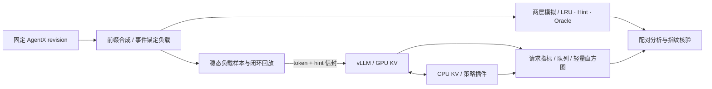
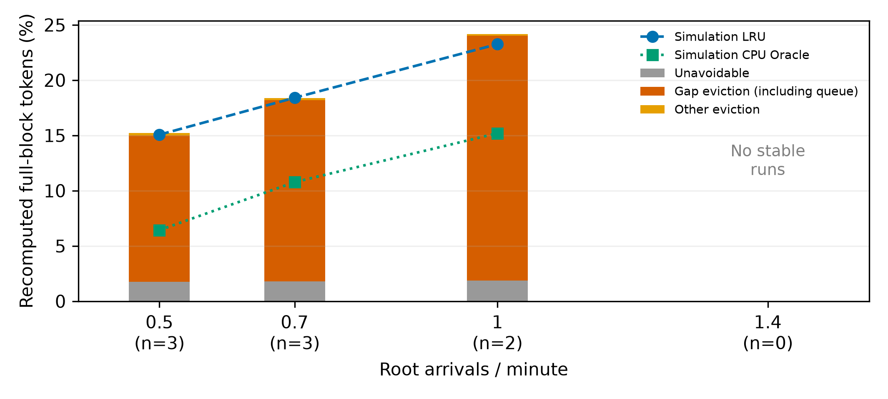
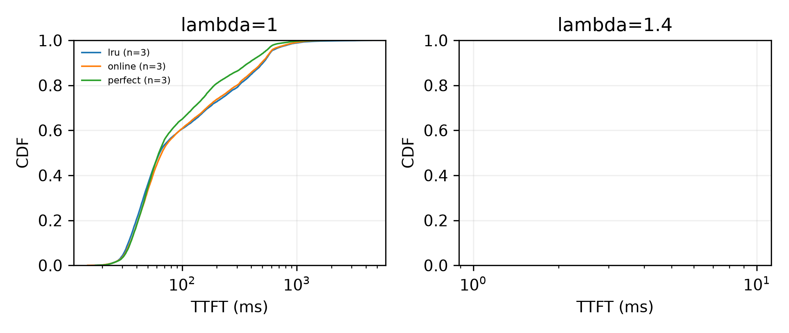
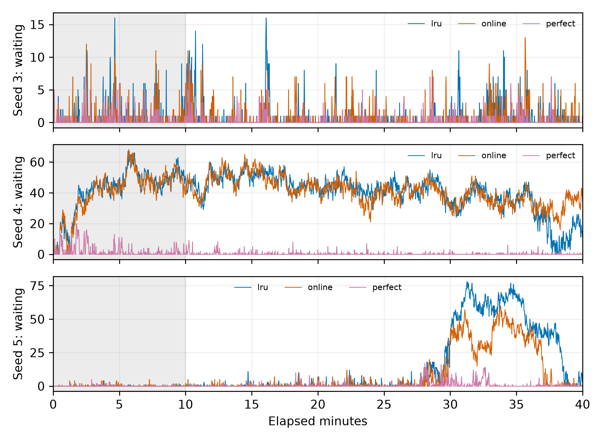

# AgentKV 实验报告（审阅稿）

主实验使用负载样本（种子 3/4/5 生成的三组会话负载）；基线测量（E0）使用种子 0/1/2。各批次保持独立，所有配对都比较同一组会话负载。

实验阶段已结束，不再启动新的 GPU 运行。本文按已保存报告整理事实；各目录的 `run.json`、生产者清单和指纹提供来源。旧版、失败和不稳定结果继续保留，证据角色见[最终结果索引](../results/INDEX.md)。

## 主要结论

- **请求间隙中的前缀损失是主要重算来源。** 稳定E0负载样本中，间隙驱逐占总重算的86.9%–91.6%，占可避免重算的98.291%–99.250%。长前缀复用、较小的新增上下文、有限缓存容量和连续前缀匹配共同形成这一结构。[E0](../results/m1-e0-config11-20261103/README.md)、[新增比例核算](../results/final-summary-20261108/README.md)
- **准确hint带来更大收益。** λ=1的v2三组负载样本均值下，online/perfect分别相对LRU减少重算6.6%/34.8%，TTFT P99降低11.3%/28.0%；P50配对差为+1.9/−3.1ms。[E1 v2](../results/e1-gpu-v2-config11-20261106/README.md)、[均值比例](../results/final-summary-20261108/README.md)
- **perfect在较高负载下保住部分负载样本。** λ=1.2时LRU/online各0/3、perfect 2/3稳定，perfect三组负载样本平均完成数较LRU增加12.0%。没有稳定LRU配对，因此该批次不报告稳定主指标差值。[边界实验](../results/e1-gpu-stable-limit-12-20261107/README.md)
- **校准和开销各有边界。** v2的λ=1九个每组负载样本预测误差均小于1个百分点；过载时偏差扩大。最终40分钟调度P99增量仍为3.276799ms，未达到2ms目标。[v2校准核算](../results/final-summary-20261108/README.md)、[开销](../results/m5-chain-growth-20261107/README.md)

## 1. 问题与动机

请求结束不等于会话结束。Agent 在请求外间隔后复用前缀，CPU 层 LRU 却只能看到过去的访问顺序。两层都丢失的前缀需要重新 prefill，因此可以用会话是否结束、预计何时返回来辅助 CPU 驱逐。[生命周期与动机证据](../results/m0-lifecycle-20261102/README.md)

稳定E0负载样本中，间隙期间（含排队）的触发前缀损失占**总重算的86.9%–91.6%**，占可避免重算的98.291%–99.250%。长会话每轮复用的历史前缀远多于新增内容，LRU却把请求外等待表现为较久未访问；容量竞争和连续前缀匹配约束会放大前缀丢失后的重算。因此，损失主要落在已有上下文，而非纯新增token。这里的间隙包含客户端调度和服务端排队，公开trace没有逐工具标注，全文使用“请求外间隔”。[E0报告](../results/m1-e0-config11-20261103/README.md)、[总重算占比核算](../results/final-summary-20261108/README.md)

项目同时检验减少重算的收益与策略自身的调度成本，通过同一负载样本对照和真实回调核验分别评估。[E1 v1](../results/e1-gpu-config11-20261105/README.md)、[E1 v2](../results/e1-gpu-v2-config11-20261106/README.md)、[开销复核](../results/m5-chain-growth-20261107/README.md)

## 2. 系统设计

### 2.1 回放、策略和观测共用可追溯的请求身份

离线负载位于 `agentkv.bench`，hint 信封位于 `agentkv.hints`，两层模拟器位于 `agentkv.sim`。回放器携带 `agentkv.tool_gap` action，经 `kv_transfer_params.kv_hints` 传给固定后端；插件优先读 `ReqContext.kv_hints`，再读兼容通道。[回放设计](m1_replayer_design.md)、[真实回调与完整前缀适配](../results/m5-vllm-integration-20261104/README.md)

### 2.2 CPU 驱逐使用链状态，并保留冻结的块顺序

策略登记完整前缀的块归属和深度，共享块使用最受保护拥有者的预计返回时间。online/noisy 使用条件剩余寿命查找表，perfect 沿用已冻结的 deadline 逻辑；final 优先驱逐，缺失 hint 时退化为 LRU。尾部优先在最终配置中关闭。[冻结选型](m5_scoring_frozen.json)、[留出模拟报告](../results/m5-scoring-evaluation-20261104/README.md)

链级实现只更新链的时间分数，使用块的原 rank 破同分，不把深度尾序强加给冻结版本。驱逐跳过 `protected` 和不就绪、正在拷贝的块，返回恰好所需数量，否则原子返回 `None`。完整前缀枚举和位置登记依赖 vLLM fork 的独立补丁。[链级实现](../results/m5-chain-implementation-20261106/README.md)、[后端验证](../results/m5-vllm-integration-20261104/README.md)

### 2.3 两层模拟提供同一负载样本对照，不模拟实际服务速度

模拟器先匹配 GPU 连续前缀，再从 CPU 延伸，中间缺块后不计后续命中。运行 KV 不可驱逐，CPU 镜像不因 GPU 淘汰才插入。CPU LRU、hint 和 Oracle 使用同一策略接口；Oracle 按未来访问选择块，在前缀约束和重复写入模型下不宣称全局最优。[两层模型](../results/m1-two-tier-seed0/README.md)、[Oracle 对照](../results/m1-oracle-seed0/README.md)

## 3. 实验方法

### 3.1 负载构造保留前缀关系，不恢复原文语义

AgentX 固定输入包含 393 个根会话、98,827 次请求和 10,130 条推断链。它提供块哈希、长度与时间，不提供原始文本或 token，也没有真实工具名。固定种子抽取 100 根后，v3 包含 2,274 条链、28,812 次请求；正式服务使用同根重新缩放的 16K 派生负载。[数据审计](../results/m1-agentx-data-20261102/README.md)、[v3](../results/m1-workload-seed0-v3/README.md)、[16K 派生](../results/m1-workload-seed0-v3-16k/README.md)

合成器按根和块哈希生成确定性 token，根内统一缩放，并独立检查块位置和 LCP。间隔截断上限为 120 秒，压缩系数为 1.0；链首锚定同根其他链中此前结束最晚的请求，实际等待其完成后再启动。`chain_offset_s` 只作参考。[v3 构造与验证](../results/m1-workload-seed0-v3/README.md)

实例使用独立词表置换，保持实例内 LCP，降低跨实例意外共享；同一负载样本跨策略核对共同逻辑请求的 token 哈希、置换种子和长度。实际服务时间改变闭环发送顺序和截止前发送集合，因此同一负载样本不等于同一实际访问交错。[稳态验证](../results/m1-steady-state-seed0/README.md)、[E1 v2 核验](../results/e1-gpu-v2-config11-20261106/README.md)

### 3.2 稳态初始化覆盖长会话的后期

先用固定服务时间 0.5 秒的独立调度估算根时长。初始数量按泊松分布抽取，均值为到达率乘平均时长；初始根按时长加权、有放回抽样，进度点在根时长内均匀抽取。后续根按泊松到达、均匀有放回抽样，从头开始。[稳态初始化报告](../results/m1-steady-state-seed0/README.md)

进度前已发出的请求不回放；触发请求保留时继续事件驱动，否则按预计剩余时间定时触发。人工冷入口标为 `is_entry`，照常发送以建立缓存，但不进入主指标。该构造是固定服务模型的稳态初始化，不能保证真实排队系统从精确稳态开始。[设计 §5.5](m1_replayer_design.md#55-稳态初始化)

λ=1 的离线检查中，稳态窗口 prompt CDF 距离为 0.0358，空初始化为 0.0772；稳态覆盖 557 个所定义长会话的后期请求，空初始化为 0。λ=0.5 的空初始化中位 prompt 没有更短，报告保留了这个有限样本反例。[初始化对照](../results/m1-steady-state-seed0/README.md)

### 3.3 主指标同时约束分母和稳定性

config-11 固定为 Qwen3-8B、16K、8 个槽位、GPU 182,880 / CPU 274,320 token。正式窗口总长 40 分钟，预热 10 分钟。E0 三分类按完整块和名义来源计算；E1 主指标为实际 prompt 前向工作量占入窗成功、非 entry 请求 prompt token 的比例，末 token replay 和重复工作不能用名义命中抵消。[E0 口径](../results/m1-e0-config11-20261103/README.md)、[E1 预注册](e1_gpu_preregistration.md)

稳定性沿用 `a81dd86` 的判据，全部同时满足：

1. 等待队列为零的采样占比至少 80%，且队列 P99 不超过槽位数。
2. 队列对时间做含截距 OLS 回归，拟合的 30 分钟增量严格小于 1。
3. 后半窗口 TTFT 中位数与前半窗口之比不超过 1.5。
4. 有 KV 不足阻塞证据时，运行数至少为槽位数减 1；缺少必要观测记为无法判定。

完整定义见[设计 §7.6](m1_replayer_design.md#76-稳定性判据后续运行统一使用)。不稳定运行保留完成数、队列和原值，不进入稳定主均值；策略与同一负载样本 LRU 都稳定时才计算配对差值。

### 3.4 先预注册，再冻结，再打开留出负载样本

校准只使用未入选的 293 根会话，online/noisy 各自建桶。选型使用负载样本种子 0/1/2；候选为 deadline、条件剩余期望和视界概率。先要求 online 在每个开发负载样本上都不差于 LRU，再按平均 Oracle 空间捕获率选择。冻结后只在种子 3/4/5 上报告最终模拟结果；这是同一 trace 子集的负载样本留出，不是新 trace 留出。[CPU 预注册](m5_scoring_selection_design.md)、[开发报告](../results/m5-scoring-development-20261104/README.md)、[留出报告](../results/m5-scoring-evaluation-20261104/README.md)

后续 GPU v1/v2 和实现开销复核复用这些负载样本或实录。留出标签针对评分选型，不能把重复测量当作新增独立负载样本，也不能将各批次合并以扩大有效样本量。[v1/v2 对照](../results/e1-gpu-v2-config11-20261106/README.md)、[开销复核](../results/m5-chain-growth-20261107/README.md)

| GPU 批次 | 预注册提交 | 有效测量提交 | 保留情况 |
|---|---|---|---|
| E1 v1 | `502ca060` | `def5ee43` | 原始丢失批次排除；完整重跑为依据 |
| E1 v2 | `52ab4ded` | `52ab4ded` | 首次运行全部完成 |
| λ=1.2 | `daeb439` | `daeb439` | 首次运行全部完成 |

E1 按负载样本分组，组内固定种子打乱策略顺序，顺序提前登记。共同后端为 vLLM fork `4749dd5961`，评分语义冻结记录不变。每负载样本先算 token 加权比例和 TTFT 分位数，再对负载样本等权报告均值与范围；样本只有三个，不做显著性检验。[v1 来源](../results/e1-gpu-config11-20261105/README.md)、[v2 来源](../results/e1-gpu-v2-config11-20261106/README.md)、[上限实验来源](../results/e1-gpu-stable-limit-12-20261107/README.md)

## 4. 结果

### 4.1 E0：稳定负载存在可避免的间隙前缀损失

下表的原值来自[E0统计窗口汇总](../results/m1-e0-config11-20261103/README.md)；新增“间隙/总重算”列按同组稳定负载样本的间隙份额均值除以总重算份额均值计算，见[独立核算](../results/final-summary-20261108/README.md)。λ单位为根会话/分钟；λ=1只有两组稳定负载样本，未把不稳定负载样本加入该比例。

| λ | 稳定 / 登记 | 名义重算 | 同一负载样本 LRU 模型 | CPU Oracle | 间隙 / 总重算 | 间隙 / 可避免 | 间隙请求平均排队 ms |
|---:|---:|---:|---:|---:|---:|---:|---:|
| 0.5 | 3/3 | 15.205% | 15.069% | 6.436% | 86.921% | 98.291% | 13.23 |
| 0.7 | 3/3 | 18.364% | 18.407% | 10.773% | 89.145% | 98.859% | 21.33 |
| 1 | 2/3 | 24.168% | 23.255% | 15.198% | 91.629% | 99.250% | 51.97 |
| 1.4 | 0/3 | NA | NA | NA | NA | NA | NA |

这个比例有结构性原因：下一轮主要重复长前缀，新增上下文只贡献较小的不可避免项；LRU没有返回时间和final信息，会让暂时间隔中的会话与一次性干扰请求竞争相同容量。较早的前缀块一旦两层都丢失，连续前缀匹配还会使后续块不能单独计为命中。因此触发前缀损失同时主导可避免重算和总重算，CPU会话hint有明确的优化空间。[E0来源分解与口径](../results/m1-e0-config11-20261103/README.md)、[两层模型约束](../results/m1-two-tier-seed0/README.md)

### 4.2 E1 v1 与 v2：相同评分的重算收益保留，时延代价缩小

下表摘自 [v1/v2 并列报告](../results/e1-gpu-v2-config11-20261106/README.md)。λ=1，全部列出的策略各 3/3 稳定；Δ 为相对本版本、同一负载样本 LRU 的配对差，单位分别为百分点和 ms，负值表示降低。

| 版本 / 策略 | 有效重算% | Δ重算 pp | ΔTTFT P50 ms | ΔTTFT P99 ms |
|---|---:|---:|---:|---:|
| v1 / online | 22.1853 | −1.3856 | +51.8313 | +124.9003 |
| v1 / perfect | 15.4169 | −8.1540 | +6.1002 | −172.1177 |
| v2 / online | 22.0083 | −1.5466 | +1.8990 | −121.4932 |
| v2 / perfect | 15.3649 | −8.1899 | −3.1246 | −300.0742 |

v2 online 的配对重算减少范围为 1.2643–1.9902 pp，P50 差值范围为 −1.4479 至 +4.2502 ms；perfect 分别为 6.8716–9.1761 pp 和 −5.0001 至 +0.5913 ms。三个种子上的重算改善一致，P50 并非每次改善。[v2 主表](../results/e1-gpu-v2-config11-20261106/README.md)

v2保持固定回调实录上的有序驱逐决策；跨时段LRU分位数也有变化，两个版本按各自基线报告。λ=1.4 时 v1 四种策略、v2 三种策略全部 0/3 稳定，稳定主指标均为 NA。[v1](../results/e1-gpu-config11-20261105/README.md)、[v2](../results/e1-gpu-v2-config11-20261106/README.md)

### 4.3 稳定负载上限：perfect在λ=1.2保住部分负载样本并增加完成数

九次首次运行全部完成。下表摘自[上限实验报告](../results/e1-gpu-stable-limit-12-20261107/README.md)，完成数按结束时刻入窗，与主指标的发送窗口分母分开。

| 策略 | 稳定 / 登记 | 稳定有效重算 | 完成数：种子3 / 4 / 5 |
|---|---:|---:|---|
| LRU | 0/3 | NA | 10397 / 7523 / 10318 |
| online | 0/3 | NA | 10396 / 7107 / 10845 |
| perfect | 2/3 | 16.2233% | 10436 / 9693 / 11511 |

perfect 稳定运行的 TTFT P50/P99 均值为 100.6751/1098.5610 ms，样本数为 2。没有同一负载样本稳定 LRU，因此所有主配对差值均为 NA。种子3 online 的零等待占比 79.703%，即使接近阈值也按原判据判不稳定。[完整判据与原值](../results/e1-gpu-stable-limit-12-20261107/README.md)

按全部三个已登记负载样本平均，perfect窗口完成数为10,546.7，LRU为9,412.7，online为9,449.3。perfect比LRU多1,134个请求（+12.0%），online多36.7个（+0.4%）；相对比例同样使用三组负载样本均值之比。完成数包含稳定和不稳定运行，不能与仅稳定负载样本的TTFT主指标混为一谈。准确间隔提示在本批次同时表现为更多稳定负载样本和更多窗口完成请求。[逐次完成数](../results/e1-gpu-stable-limit-12-20261107/README.md)、[均值与相对比例](../results/final-summary-20261108/README.md)

### 4.4 模拟器校准：稳定区间较接近，过载区间不可信

CPU 留出组 λ=1 时，online 减少重算 1.492 pp，捕获 Oracle 空间 18.20%；noisy 为 6.792 pp、82.88%，perfect 为 7.726 pp、94.28%。本次捕获率统一按三组负载样本均值之差求比；原报告每组负载样本比值均值分别为18.02%、83.06%、94.32%，保留作口径对照。以上来自固定服务模型。[CPU 留出原值](../results/m5-scoring-evaluation-20261104/README.md)、[统一口径核算](../results/final-summary-20261108/README.md)

v2的λ=1三种策略各自三个稳定负载样本均满足每组负载样本误差小于1个百分点。以下为实测有效重算率减固定服务模拟值，均值和范围按负载样本计算；原始逐次值见[v2报告](../results/e1-gpu-v2-config11-20261106/README.md)，新增均值见[校准核算](../results/final-summary-20261108/README.md)。

| 策略 | v2平均差 pp | 三组负载样本最小–最大 pp |
|---|---:|---:|
| LRU | 0.6326 | 0.4561–0.9686 |
| online | 0.5776 | 0.3989–0.7938 |
| perfect | 0.1684 | 0.0054–0.2930 |

v1的λ=1策略均值差为0.2203–0.7546pp，与v2的稳定区间结论一致。过载差距明显扩大：v1在λ=1.4的LRU/online均值差为48.9111/58.1510pp；λ=1.2种子4的LRU/online差为64.0157/70.6646pp。固定服务和零搬运模型缺少实际排队与服务时间反馈，这些失配保留作模型边界，不用模拟值替代真实稳定性判断。[v1校准表](../results/e1-gpu-config11-20261105/README.md)、[上限实测与预测](../results/e1-gpu-stable-limit-12-20261107/README.md)

### 4.5 开销：短时通过不构成长时保证

无 hint 专用退化路径的 20 分钟对照中，TTFT P50 差为 −0.5802 ms，满足当时的 2% 门槛；该路径使用原生 LRU，不能代表通用 hint 评分成本。[无 hint 开销报告](../results/m5-policy-overhead-20261104/README.md)

链级实现的 20 分钟验证，online/perfect 调度 P99 保守增量为 1.802/1.343 ms；正式 40 分钟 λ=1 三组负载样本的 online 增量却为 2.294/3.736/4.588 ms。后来清理状态并优化热路径，最终同一负载样本 40 分钟验证仍增加 3.276799 ms，未达到 2 ms 目标。[链级门槛](../results/m5-chain-implementation-20261106/README.md)、[正式窗口](../results/e1-gpu-v2-config11-20261106/README.md)、[最终复核](../results/m5-chain-growth-20261107/README.md)

80 分钟 CPU 诊断找到空 final 链和历史共享关系的累积：第10至80分钟，空 final 链从 2 增至 44，邻接边从 110 增至 976；修复后分别为 0、22→16。真实 online 录制的关闭插桩回放中，最终 evict P99 为 1.869715 ms。CPU 决策一致性和时延通过，不等于 GPU 调度目标通过。[状态增长与全部尝试](../results/m5-chain-growth-20261107/README.md)

## 5. 反面结果与修正过程

| 发现 | 修正或保留方式 | 依据 |
|---|---|---|
| 绝对链偏移把长空闲带进有限窗口 | 改为事件锚定，旧偏移保留为参考 | [v3](../results/m1-workload-seed0-v3/README.md) |
| 空初始化无法覆盖长会话后期，有限窗口仍有波动 | 按时长加权抽取进度，保留反例 | [稳态初始化](../results/m1-steady-state-seed0/README.md) |
| deadline 的 online 出现负收益，视界概率未胜出 | 按预注册选择剩余期望，冻结后不回看留出调参 | [开发选型](../results/m5-scoring-development-20261104/README.md) |
| 回调 keys 不是完整 prompt；父 final 可错误压低共享子链优先级 | 补充完整前缀归属，独立后端提交、位置表回归及完整回放 | [key 诊断](../results/m5-vllm-key-diagnosis-20261104/README.md)、[适配验收](../results/m5-vllm-integration-20261104/README.md) |
| 严格深度尾序改变冻结驱逐顺序 | 拒绝该实现，改为链级评分并保留 rank | [反例](../results/m5-chain-scoring-20261106/README.md)、[链级实现](../results/m5-chain-implementation-20261106/README.md) |
| 首批 E1 数据因重启丢失 | 排除聊天摘要，完整持久目录重跑，不补造原始数据 | [v1 恢复说明](../results/e1-gpu-config11-20261105/README.md) |
| v1 online 减少重算却拖慢 TTFT | 只优化实现，逐次核验有序 key 后重跑 v2 | [v1/v2 对照](../results/e1-gpu-v2-config11-20261106/README.md) |
| 垃圾状态增长修复后 GPU 开销仍超标 | 保留全部未达标尝试，停止新增实验，如实结案 | [最终诊断](../results/m5-chain-growth-20261107/README.md) |

## 6. 局限

- **负载和信息范围。** 同一AgentX子集、合成token、推断链、截断间隔，一个模型与容量配置；perfect使用未来信息，Oracle是固定服务模型内的启发式。[负载](../results/m1-workload-seed0-v3/README.md)、[CPU留出](../results/m5-scoring-evaluation-20261104/README.md)
- **统计与归因。** 只有三组负载样本，未做显著性检验；v1/v2跨时段，未因果分离全部实现开销。间隙分类包含排队，不等于纯工具时间的驱逐归因。[E0口径](../results/m1-e0-config11-20261103/README.md)、[v1/v2对照](../results/e1-gpu-v2-config11-20261106/README.md)
- **适用负载。** λ=1.4没有稳定主值；无稳定LRU时不填主配对差；模拟器只在已验证稳定区间校准。[边界实验](../results/e1-gpu-stable-limit-12-20261107/README.md)、[开销复核](../results/m5-chain-growth-20261107/README.md)
- **分发与复现。** 元数据足以重绘汇总；端到端重跑还需另取原始AgentX、模型和外置回调。干净发布目录不含Git历史和外置载荷，但历史生产者元数据仍保留环境路径及原SHA。[复现说明](REPRODUCING.md)、[本地发布说明](RELEASE.md)

## 7. 后续方向

1. **首先提升online预测质量。** λ=1的CPU留出评估中，按三组负载样本均值之差求比，online只捕获18.20%的Oracle空间，perfect为94.28%。优先研究更好的历史特征、条件分桶与尾部校准，并使用新的独立开发/留出划分，不能继续按已见负载样本调参。后续用独立预测误差消融检验收益来源。[CPU留出](../results/m5-scoring-evaluation-20261104/README.md)、[统一口径核算](../results/final-summary-20261108/README.md)
2. 降低真实调度路径的批量归属登记和驱逐开销，重新检验长窗口目标。
3. 引入服务时间和搬运反馈，改善模拟器在高负载下的校准。
4. 扩展独立trace、容量、模型规模和输出回填消融，再研究GPU层预取组合。

实验已经停止；上述方向需要另行立项，本次不启动任何新的GPU运行。
