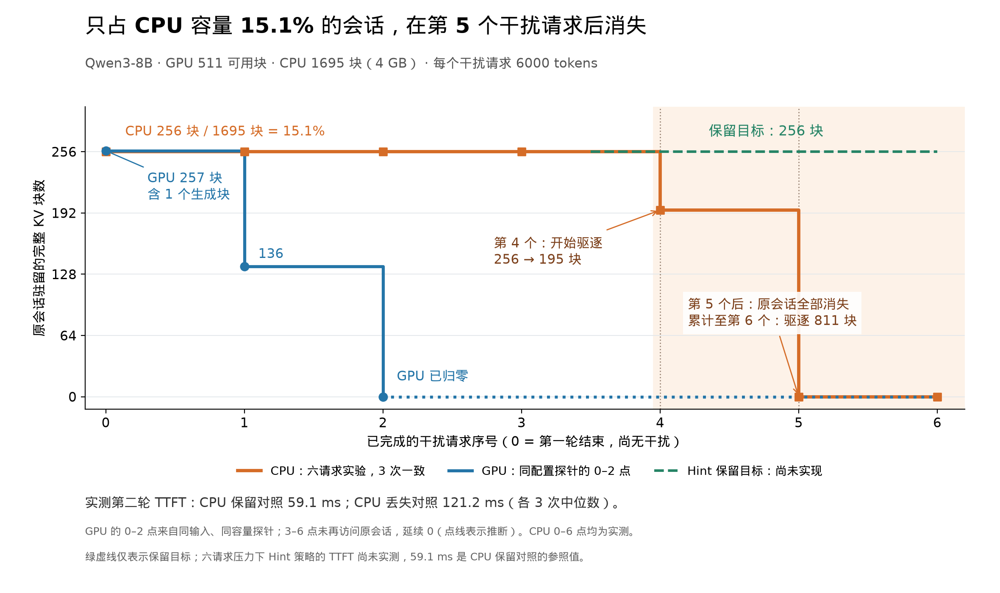
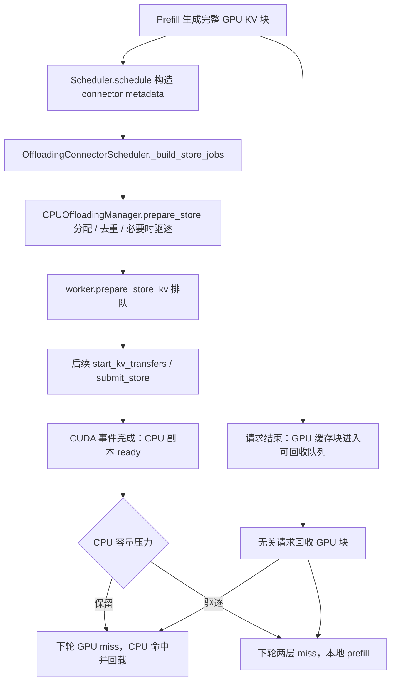

# Week 1：跑通分层 KV 基线，复现会话缓存丢失

记录范围：2026-10-26 至 2026-11-01。项目为 AgentKV，固定 vLLM 基线为 `v0.32.0` / `5df63a7203cdb9328d824a27b682e77c7b9928be`。

**本周建立了一个可复现的动机场景：原会话只需要 CPU 层 15.1% 的容量，LRU 仍会在连续的一次性请求之后丢掉它。** 六个 6000-token 干扰请求使原会话的 CPU 副本从 256 块降到 0，第二轮客户端 TTFT 为 121.22 ms；CPU 副本仍在的对照为 59.05 ms。两者差 62.17 ms，说明保留正确的 CPU 副本有明确的延迟价值。Hint 策略尚未实现，59.05 ms 是保留副本的实测参照，不能直接当成策略在六请求压力下已经取得的结果。

本周还完成了 CPU offload 服务、官方 benchmark、指标清点、尾块复用核验，以及锁页 H2D 带宽与 10000-token prefill 的成本对照。完整原始记录见 [EXPERIMENT_LOG.md](EXPERIMENT_LOG.md)，后文按结论组织这些探索。

## 1. 环境与原始证据已经固定

| 项目 | 固定值 |
| --- | --- |
| 解释器 / uv 环境 | `../vllm/.venv/bin/python`，Python 3.12.3 |
| vLLM | `0.32.0+precompiled`，本地源码可编辑安装 |
| AgentKV | `0.1.0`，与 vLLM 共用上述环境；当前为模块骨架 |
| PyTorch / CUDA runtime | `2.13.0+cu130` / 13.0 |
| Transformers / 驱动 | `5.19.0` / 580.178.04 |
| GPU | 2 × H200 NVL，每卡 143771 MiB |
| 模型 | `../models/Qwen3-8B`，BF16，TP=1 |
| 模型 revision | `b968826d9c46dd6066d109eabc6255188de91218` |
| 原服务 | GPU 1，端口 8000，CPU offload 32 GB |
| 隔离诊断 | GPU 0，短生命周期实例；H2D/对照实验绑定 NUMA 2 |

已在 `../models/Qwen3-8B` 找到完整本地模型，本轮直接使用，没有重复下载。GPU 0 的 UUID 为 `GPU-48956eb2-4037-09c5-2e94-39989b4d2e0d`；GPU 1 为 `GPU-667cc66c-113c-1591-1ec1-f4762d255186`。共享主机上 GPU 1 同时有其他任务；环境文件保存了前后 `nvidia-smi` 快照。

AgentKV 仓库初始化后尚无提交；vLLM tracked 引擎源码未改动。各实验目录归档 commit、完整命令、环境、源码 diff，以及 AgentKV 未提交文件的 patch。仅凭空的 tracked diff，不能判断 AgentKV 的未跟踪文件已经提交。

证据索引：日志中的 `ENV-001`、`BASELINE-001`，以及各目录的 `environment.json` / `parquet-manifest.json`。

## 2. 32 GB CPU offload 服务与 smoke 请求均正常

原服务启动配置为：

```bash
CUDA_VISIBLE_DEVICES=1 ../vllm/.venv/bin/vllm serve ../models/Qwen3-8B \
  --served-model-name Qwen/Qwen3-8B \
  --gpu-memory-utilization 0.3 \
  --kv-transfer-config '{"kv_connector":"OffloadingConnector","kv_role":"kv_both","kv_connector_extra_config":{"cpu_bytes_to_use":32000000000}}' \
  --port 8000
```

启动日志确认加载了 `OffloadingConnector` 与 `CPUOffloadingSpec`，并创建 32.00 GB CPU mmap。实际容量核对如下：

| 对象 | 实测 / 核对值 |
| --- | ---: |
| 模型权重 | 15.27 GiB |
| GPU KV 池 | 23.58 GiB |
| GPU KV blocks / 每块 token | 10732 / 16 |
| GPU KV 容量 | 171712 tokens |
| CPU chunks | 13563 |
| CPU 实际映射 | 31999131648 bytes |
| CPU KV 容量 | 217008 tokens |

CPU chunk 数由预算与单块 payload 核算，并用进程 mmap 长度交叉验证。启动日志里的“36 CPU tensors”对应层数，不能当成 36 个缓存块；`num_cpu_blocks=None` 也不能据此判断 connector 未开启。

```text
KV bytes/token = 36 层 × 2(K,V) × 8 KV heads × 128 head_dim × BF16 2 bytes
               = 147456 bytes = 144 KiB
KV bytes/block = 16 × 147456 = 2359296 bytes = 2.359296 MB = 2.25 MiB
CPU chunks     = floor(32000000000 / 2359296) = 13563
```

向 `/v1/completions` 发送 `Hello, my name is`、`max_tokens=32`，得到 HTTP 200、5 个输入 token 和 32 个输出 token。完整请求与响应在 [五步基线目录](EVIDENCE.md#external-inputs)。**服务、模型与 CPU 卸载链路已具备继续实验的条件。**

## 3. 突发 benchmark 与 4 req/s 共同构成环境参照

两次官方 benchmark 均使用 random 数据集、200 个请求、2048 输入与 128 输出 token，成功 200、失败 0。核心命令如下；完整归档命令还指定本地 tokenizer 和结果文件。

```bash
../vllm/.venv/bin/vllm bench serve \
  --model Qwen/Qwen3-8B \
  --tokenizer ../models/Qwen3-8B \
  --dataset-name random \
  --random-input-len 2048 \
  --random-output-len 128 \
  --num-prompts 200
# 低排队参照另加 --request-rate 4 --save-result --save-detailed
```

| 指标 | 默认突发，rate=inf | 平均 rate=4 req/s |
| --- | ---: | ---: |
| 完成吞吐 req/s | 13.02 | 3.93 |
| 输出吞吐 token/s | 1666.18 | 503.03 |
| 输入+输出吞吐 token/s | 28325.08 | 8551.53 |
| 平均 TTFT ms | 6974.95 | 92.04 |
| 中位数 TTFT ms | 7231.73 | 81.91 |
| P99 TTFT ms | 14138.26 | 186.11 |
| 平均 TPOT ms/token | 36.93 | 7.90 |
| P99 TPOT ms/token | 51.75 | 11.39 |
| 峰值并发请求 | 200 | 19 |

10 月 27 日首次突发基线为 12.86 req/s、1646.16 输出 token/s、平均 TTFT 7172.02 ms、平均 TPOT 36.84 ms/token，11 月 1 日复核与其接近。

默认 `request_rate=inf` 同时发出全部请求，TTFT 包含大量排队。`--request-rate 4` 对应平均 4 req/s 的 Poisson 到达，不是固定每 250 ms 一个请求，也不是固定并发 4。本轮服务端平均 WAITING 仅 0.01447 ms；GPU 与 CPU 命中增量均为 0，409600 个输入 token 全部走本地计算。平均 TTFT 92.04 ms 因而是低排队、随机输入的客户端参照。

首轮突发运行未保存逐请求 TTFT/TPOT，相关 parquet 字段保持 null；不能由全局平均数反推个体。rate=4 运行保存了全部 200 条逐请求详情。客户端与服务端计时边界不同，例如该轮服务端平均 TTFT 为 85.63 ms，不能与客户端 92.04 ms 混用。

**突发结果用于核对饱和吞吐，rate=4 用于核对低排队延迟。** 后者输出吞吐较低由请求供给限制，不能据此判定引擎容量下降。两组均为环境参照，不作为 Hint 策略实验。

证据：[突发基线](EVIDENCE.md#external-inputs)、[rate=4 详细结果](EVIDENCE.md#external-inputs)。

## 4. 重复长 prompt 命中了缓存，尾块还要重放一个 token

两次发送完全相同的 4560-token prompt，第一次 GPU/CPU 均不命中；第二次原生指标报告 GPU 命中 4544、CPU 命中 16、本地计算 0。完成的 CPU→GPU payload 增加 2359296 bytes，正好一个 16-token 块。两请求窗口内 GPU→CPU store 为 672399360 bytes；store 异步上报，未强行拆分为相邻请求的精确增量。

这个结果不是“大量 GPU 缓存被挤出”。4560 正好是 285 个整块；GPU 本地前缀查询为最后一个 token 的 logits 留出计算空间，按整块截断后只报告前 284 块。connector 将最后一整块补回，于是出现 GPU 4544 + CPU 16 的名义来源。

独立运行时探针确认了回载块的真实使用：

1. CPU chunk 284 回载到 GPU physical block 286；36 层整页逐字节一致。
2. 完成回载后，computed frontier 从 4560 回退到 4559。
3. 下一步只对 position 4559 执行前向，attention 的 seq_len=4560，末块表项仍指向刚回载的 block 286。
4. 前 15 个 KV 位置保持并进入上下文复用，末位置 KV 由当前 token 前向覆盖。

| 统计口径 | GPU tokens | CPU tokens | 本地前向 tokens | 总和 |
| --- | ---: | ---: | ---: | ---: |
| 原生准入 / 名义来源 | 4544 | 16 | 0 | 4560 |
| 有效复用 / 实际 prompt 前向 | 4544 | 15 | 1 | 4560 |

**回载整块确实有用：复用其中 15 个 token，最后 1 个重新计算 logits。** 两种口径都满足来源和等于 prompt 长度，因此恒等式只检查一致性，不能独自证明计数语义正确。M2 应保留原始 nominal 字段，另记 effective reuse、实际前向与 replay reason；不能悄悄覆写 Prometheus 原值。

该探针包含 GPU→CPU 同步读取，只用来证明正确性，不采用其延迟。证据：[尾块探针、events 与 token-accounting parquet](EVIDENCE.md#external-inputs)。

## 5. 1 万 token 的连续回载成本约 27 ms，prefill 前向约 292 ms

在 GPU 0 / H200 上测量 NUMA 2 本地锁页内存到 GPU 的连续 H2D。链路为 PCIe 32 GT/s ×16，分配验证 `is_pinned=True`，实际页分布全部在 N2。每个大小测 3×20 个 direct 样本和 3×20 个 CUDA Graph 样本，分配、填充、预热与正确性校验不计时。没有安装 CUPTI，本次采用 CUDA events。

| KV 块数 | payload MB | direct CUDA 中位数 ms | 有效 GB/s | 单次墙钟中位数 ms |
| --- | ---: | ---: | ---: | ---: |
| 1 | 2.359296 | 0.04970 | 47.47 | 0.06621 |
| 16 | 37.748736 | 0.68613 | 55.02 | 0.70278 |
| 32 | 75.497472 | 1.36536 | 55.29 | 1.38187 |
| 64 | 150.994944 | 2.72395 | 55.43 | 2.74086 |
| 128 | 301.989888 | 5.44178 | 55.49 | 5.45869 |
| 625 | 1474.560000 | 26.74502 | 55.13 | 26.76354 |

单块 Graph 摊薄后的中位数为 0.04506 ms、52.36 GB/s；这是批量 replay 的每次 copy 均摊时间，不能当成独立调用墙钟。MB/GB 采用十进制，有效带宽为单向 payload/时间，不乘 2。

```text
10000 tokens = 625 块 = 1474560000 bytes = 1.47456 GB
按 55 GB/s 估算：1.47456 / 55 × 1000 = 26.81 ms
整段直接实测：26.745 ms
```

同卡另测 Qwen3-8B、BF16、单请求、无 prefix caching、无 connector 的完整 10000-token prefill。batch-token 上限设为 16384，确保单个模型步执行 10000 tokens；3 个预热后测 3×5 请求，每次确认 cached_tokens=0。GPU forward 区间不含输入准备与 logits/采样，`LLM.generate` 墙钟包含这些开销。

| 测量边界 | 15 次中位数 ms |
| --- | ---: |
| GPU prefill forward | 292.489 |
| 首 token 调用墙钟 | 300.100 |
| 连续 H2D，10000-token payload | 26.745 |

GPU forward / 连续 H2D 的阶段成本比为 10.94×。在线服务的 batch-token 上限为 8192 且启用 offload，该微基准则采用单步、无缓存配置，两者不能写成同一服务负载。**这组数据支持“保留并回载 KV 值得研究”，没有证明端到端 TTFT 或 JCT 能加速 10.94×。** 真实 connector 的跨块拷贝、查找、分配、排队及资源竞争仍需测量。

证据：[带宽/prefill 报告与 720 个 copy 样本、15 个 prefill 样本](EVIDENCE.md#external-inputs)。可复用微基准：[benchmark_pinned_h2d.py](patches/README.md#file-benchmarks-kernels-benchmark-pinned-h2d-py)。

## 6. 两轮会话证明 GPU 复用、CPU 回载与全量 prefill 三条路径

为了用少量请求制造压力，将 GPU KV 池覆盖为 512 块，含 1 个 null block，可用容量 8176 tokens；CPU 预算压为 4 GB，实际容量 1695 块、27120 tokens。`max_model_len=7168`、`max_num_batched_tokens=6144`、`max_num_seqs=1`，`offload_prompt_only=true`，CPU 策略为 LRU。

第一轮使用 4096-token hello-world Python 任务，实际输出 18 tokens，含终止 token。假工具输出为 `hello world` / `exit_code: 0`，没有执行生成的代码；工具结果、角色分隔与第二轮续接共 43 tokens。

```text
P2 = P1_token_ids + actual_generated_token_ids + fake_tool_suffix_token_ids
4157 = 4096 + 18 + 43
```

生成 IDs 直接回填，未经过文本解码再编码。HTTP 实验从流式返回的 vLLM 扩展字段 `token_ids` 取实际生成 IDs。输入 token 数组属于标准 completions 支持的 prompt 形式，`return_token_ids` 与 `request_id` 为本版 vLLM 扩展。所有会话均验证完整拼接。

最初两组探针只证明 GPU 压力：两个独立 6000-token 干扰使原会话 GPU hash 条目从 257→136→0，但 CPU 总驻留仅 1006/1695，原会话 256 个 prompt 块仍在，没有触发 CPU 驱逐。该探针还直接检查实际前向区间：无干扰第二轮前向 45 tokens，CPU 回载时前向 61 tokens。

后续用正式 HTTP 流式服务补齐四组对照，每组 3 次；CPU 三组轮换顺序，无 CPU 组在另一短生命周期服务运行。两配置先后使用同一 GPU 0，均强制 `LBHNC` 布局，保持相同小 GPU 池。每组前重置自身两层缓存并等待写入完成；预热不纳入统计。第二轮全部输出 12 tokens。

| 第二轮场景 | 干扰输入 | GPU / CPU / 本地 prefill tokens | TTFT ms | 最后可见文本 ms | HTTP 完成 ms | TPOT ms/token |
| --- | --- | --- | ---: | ---: | ---: | ---: |
| GPU 保留 | 无 | 4112 / 0 / 45 | 35.27 | 87.94 | 94.50 | 5.31 |
| GPU 被逐出，CPU 保留 | 2×6000 | 0 / 4096 / 61 | 59.05 | 112.86 | 119.31 | 5.37 |
| GPU 被逐出，无 CPU 层 | 2×6000 | 0 / 0 / 4157 | 122.92 | 176.84 | 183.10 | 5.43 |
| GPU、CPU 均被逐出 | 6×6000 | 0 / 0 / 4157 | 121.22 | 178.59 | 185.49 | 5.77 |

延迟为客户端 3 次中位数；从发 HTTP 请求前开始计时，TTFT 取第一段非空文本，HTTP 完成包括终止 token、usage 与 SSE 结束。TPOT 为首末 token 到达时间差除以输出数减 1。本机 loopback 测量不含远端网络与浏览器渲染。

GPU 保留覆盖历史 4114 tokens 中的 4112，历史复用率 99.95%；本地 45=历史尾部 2+新后缀 43。CPU 保留只回载原 prompt 的 4096 tokens，完成 payload 为 603979776 bytes；本地 61=历史生成 18+新后缀 43。原因是 `offload_prompt_only=true` 不保存 decode 块。

全量 prefill 的 4157 tokens 中，4113 个曾产生 KV、需要重算，1 个是第一轮最后采样但尚未产生 KV 的 token，43 个为新输入。将这 4157 全部称为“历史重算”会高估重复工作。自然续接有新后缀，不存在上一节全命中尾 token 回退的来源重叠；本次 54 个请求均通过来源和校验。

**CPU 保留使第二轮首文本更早到达；CPU 也被逐出后，行为与无 CPU 层接近。** 这组对照同时具备来源、传输量和用户延迟，补上了最初只有来源证据的缺口。

证据：[最初 GPU 驻留与实际前向探针](EVIDENCE.md#external-inputs)、[四组 HTTP 对照](EVIDENCE.md#external-inputs)。

## 7. 15.1% 的保留需求揭示了 Agent Hints 的决策价值



图中横轴为已完成的干扰请求数，0 表示第一轮结束但尚无干扰；纵轴为原会话的完整 KV 块数。CPU 曲线来自六请求 HTTP 实验的三次重复，均为实测。GPU 的 0–2 点来自同配置、相同会话与相同随机干扰输入的三次探针；3–6 点因为原会话未再次访问而保持 0，采用点线标为推断。图没有将两批探针伪装成同一次运行。GPU 初始多出的 1 块来自生成阶段，CPU 曲线只包括原 prompt 的 256 块。

| 干扰完成数 | 原会话 GPU 块 | 原会话 CPU ready 块 | CPU 总驻留块 | 该请求实际 CPU 驱逐块 |
| --- | ---: | ---: | ---: | ---: |
| 0 | 257 | 256 | 256 | 0 |
| 1 | 136 | 256 | 631 | 0 |
| 2 | 0 | 256 | 1006 | 0 |
| 3 | 0（延续） | 256 | 1381 | 0 |
| 4 | 0（延续） | 195 | 1695 | 61 |
| 5 | 0（延续） | 0 | 1695 | 375 |
| 6 | 0（延续） | 0 | 1695 | 375 |

六个干扰输入产生 2250 个完整 prompt 块，加原会话 256 块共 2506；CPU 只能保留 1695，因此实际驱逐 2506−1695=811 块。第 4 个请求开始逐出原会话，第 5 个后已经清空。最终 CPU 留下的是后五个一次性干扰请求的完整或部分块；在这条构造 trace 中，它们后续都不再使用。

原会话只占 256/1695=15.1%，对应 603979776 bytes。容量足以在保住它的同时淘汰其他块；LRU 依据历史访问先后排序，却没有“原会话马上回来、一次性请求已经结束”的信息。Agent Hints 应把 `session_id`、预计返回时间和 `final` 状态带到 CPU 驱逐决策，优先保住即将再次使用的会话块。

绿虚线只是“保留 256 块”的目标，尚未测量 Hint 策略。CPU 保留对照的 59.05 ms 给出下一阶段的参照；需要在**完全相同的六请求压力**下实现并测试策略，才能确认接近该延迟，并测出策略自身开销与对其他请求的代价。这个例子证明了信息缺口及其成本，尚不能代表真实多会话 trace 上的普遍收益。

图的 [SVG](figures/week1-cache-residency.svg)、[PDF](figures/week1-cache-residency.pdf)、[CSV](figures/week1-cache-residency.csv)、[parquet](figures/week1-cache-residency.parquet) 与 [来源元数据](figures/week1-cache-residency.json) 同目录保存。绘图脚本为 [plot_week1_cache_residency.py](../agentkv/analysis/plot_week1_cache_residency.py)。

## 8. CPU offload 在完整 prompt 块形成时触发

运行结果推动了第一轮定向代码阅读。当前路径不是“GPU 被逐出时才搬到 CPU”：默认 `store_threshold=0`，connector 在完整 prompt chunk 形成后尽力异步写出；`offload_prompt_only=true` 限制可卸载区间。



上图展示两个并行的生命周期分支，GPU 结束/回收与异步 CPU copy 的具体交错由执行决定。

| 阅读目标 | 当前定位 |
| --- | --- |
| 调度与 metadata | `vllm/v1/core/sched/scheduler.py` 的 `Scheduler.schedule()` |
| 构建可卸载 chunk 与 store job | `vllm/distributed/kv_transfer/kv_connector/v1/offloading/scheduler.py` 的 `_calc_num_offloadable_tokens()`、`_build_store_jobs()`、`build_connector_meta()` |
| CPU lookup / 准备回载 / 分配与驱逐 | `vllm/v1/kv_offload/cpu/manager.py` 的 `lookup()`、`prepare_load()`、`prepare_store()` |
| 策略接口与逐出算法 | `vllm/v1/kv_offload/cpu/policies/base.py` 与对应 LRU 实现 |
| 排队和启动传输 | `.../offloading/worker.py` 的 `prepare_store_kv()`、`start_kv_transfers()` |
| CUDA copy 与完成事件 | `vllm/v1/kv_offload/cpu/gpu_worker.py` 的 `transfer_async()`、`get_finished()` |
| 完整回载后的最后 token 重放 | `Scheduler._update_waiting_for_remote_kv()` |

排队、提交与完成是三个时点。PCIe KV payload 应在完成事件统计，CPU “命中”也应区分查询存在、准入接受及真实完成回载。详细函数行号与证据在日志“五步基线”的调用链和“尾块核实”章节。

## 9. M2 已有采样原型，稳定会话观测仍未完成

本周完成了指标目录、串行请求归因与 parquet 归档，尚未实现并发会话下的完整 M2。

| M2 要求 | 本周已取得 | 仍需完成 |
| --- | --- | --- |
| 每轮 TTFT / TPOT / 请求 E2E | rate=4 benchmark 逐请求详情；四组 HTTP 流式客户端计时 | 接入稳定 session_id / turn_id；统一回放器的计时边界 |
| 每会话 JCT | 保存测试 session wall 和两轮各自 E2E | 真实闭环 trace：从会话到达到最后一轮完成，包含统一工具间隙与等待 |
| GPU / CPU / 本地来源 | 原生计数、`PrefillStats`、串行差分及恒等式 | 按 request_id 稳定导出；区别名义来源、有效复用和额外 replay |
| 历史重算原因 | 尾块 replay 与冷/热两轮对照；实际前向区间探针 | 将 cold、capacity eviction、preemption、load failure 与新增输入区分开 |
| KV 传输 payload | 原生 store/load bytes 与完成事件 | job→request/session 的归因；不把 payload 当成全部 PCIe 线事务 |
| CPU 驱逐 / 驻留 | 临时 CPU 元数据插件；真实 evicted_keys 计数及原会话 ready 数 | 接入统一事件 schema，随策略版本长期保存 |
| 调度器单步耗时 | 已定位 `Scheduler.schedule()` 边界 | 统一两处调用的计时，记录 step_id、tokens/requests |
| 策略函数耗时 | 已定位 CachePolicy 回调与 manager 的 evict 调用 | 按 get/touch/evict 等 operation 分别测量；不把整个 prepare_store 当策略耗时 |
| parquet 与分析分离 | 各实验已有 parquet，新增图脚本在 `agentkv/analysis/` | 统一跨实验 schema、闭环回放与质量校验 |

当前未开启 `--kv-cache-metrics`，所以可选的 block lifetime/idle/reuse-gap 指标没有导出；`store_threshold=0` 下也未启用 stores_skipped。

当前测试 session wall 包含刻意执行的干扰请求、metrics 轮询与假工具等待，不能拿不同干扰数量下的 wall time 比较策略 JCT。`sum_two_requests_e2e_ms` 是两个请求 E2E 的算术和，也不是实测会话 JCT。

### 9.1 主要指标的名字与含义

完整目录已保存于 [metrics-catalog.md](EVIDENCE.md#external-inputs) 和实验日志，包含 47 个导出声明、57 个不同 sample 名字。以下保留后续最常用的指标族；histogram 对应 `_bucket/_count/_sum`，`_created` 只是创建时刻。

| 指标 | 含义 / 使用边界 |
| --- | --- |
| `vllm:prefix_cache_queries_total` / `prefix_cache_hits_total` | GPU 前缀查询/命中的 token 数，不是请求数 |
| `vllm:external_prefix_cache_queries_total` / `external_prefix_cache_hits_total` | connector 查询/命中 tokens；本次 CPU-only 可对应 CPU，多层时不能全部当 CPU |
| `vllm:prompt_tokens_cached_by_source_total` | 按 device/host/disk/p2p 等来源统计缓存 tokens |
| `vllm:prompt_tokens_cached_total` | 所有来源缓存 tokens；更新时点可能与准入不同 |
| `vllm:prompt_tokens_by_source_total` | local_compute/local_cache_hit/external_kv_transfer 来源；不是所有物理重复前向累计 |
| `vllm:request_prefill_kv_computed_tokens` | prompt−cached 的分布，不能单独捕获完整命中后的最后 token replay |
| `vllm:kv_cache_usage_perc` | GPU 暂不可用块的使用比例；可回收缓存也在空闲队列，0 不等于没有前缀 |
| `vllm:kv_offload_cpu_cache_usage_perc` | 活跃传输固定的 CPU 容量比例；不是 CPU 总驻留率 |
| `vllm:kv_offload_cpu_cache_write_usage_perc` / `read_usage_perc` | 待完成卸载写 / 回载读占用比例 |
| `vllm:kv_offload_cpu_allocation_size` | prepare_store 分配的 chunk 数分布，单位不是 bytes |
| `vllm:kv_offload_store_bytes_total` / `load_bytes_total` | 完成的 GPU→CPU / CPU→GPU KV payload |
| `vllm:kv_offload_store_time_total` / `load_time_total` | 累计传输时间，单位秒，不是请求 E2E |
| `vllm:kv_offload_store_size` / `load_size` | 单次传输字节分布 |
| `vllm:kv_offload_total_bytes_total` / `kv_offload_total_time_total` / `kv_offload_size` | 按 transfer_type 区分方向的兼容旧指标，与 store/load 新指标重复 |
| `vllm:kv_offload_lookup_sync_delay_seconds` | 同步查询耗时，不能当策略函数自身耗时 |
| `vllm:kv_offload_lookup_async_delay_seconds` | 异步延后查询等待；基线只有声明，没有数值样本 |
| `vllm:kv_offload_allocation_failure_total` | 分配失败累计；基线只有声明，不能用缺失推断实测为 0 |
| `vllm:num_requests_kv_fetch_by_stage` | waiting_to_start / in_progress / completed_waiting 各阶段请求数 |
| `vllm:cache_config_info` | 值为 1，标签携带块大小、容量、prefix caching 等配置 |
| `vllm:time_to_first_token_seconds` | 服务端 TTFT 聚合分布 |
| `vllm:request_time_per_output_token_seconds` | 服务端每请求平均 TPOT，排除首 token |
| `vllm:e2e_request_latency_seconds` | 服务端单请求 E2E，不是会话 JCT |

四组 HTTP 实验另加 `vllm:diag_cpu_evicted_chunks_total`、`diag_cpu_resident_chunks`、`diag_original_cpu_ready_chunks`、`diag_original_cpu_total_keys`、`diag_cpu_pending_writes`。这些是临时插件指标，不是 vLLM 默认导出。插件只访问 CPU 元数据，没有逐 token GPU 同步或文件写入，仍有轻量观测开销。

请求身份与块 hash 应进结构化事件/parquet，不应作为高基数 Prometheus 标签。生产并发时，全局计数器的相邻快照无法精确归属某一个请求；本周差分方法的适用范围是隔离串行实验。

## 10. 已知异常和口径修正都保留在记录中

- **小池启动 IMA：** 512 GPU blocks、`max_model_len=7168`、`max_num_batched_tokens=8192` 的初次启动在预热阶段失败；改用 6144 后探针与正式对照均通过。保留 `initial-ima.log`。未定位 faulting kernel，不能把配置调整称为已确认的 bug fix。
- **对齐尾块误读：** 最初名义 CPU 命中 16、本地计算 0，后经运行时核验确认有效 CPU 复用 15、实际前向 1；原始指标保持原值。
- **重观察影响延迟：** 最初探针每步 `.cpu()` 并写事件，只采用其正确性和驻留证据。周报的用户延迟采用后续正式 HTTP 结果。
- **跨路径输出有细微差异：** 缓存路径回复“输出为 hello world”，全量计算路径回复“输出了 hello world”，均 12 tokens。首次逐 ID 全等断言停止的诊断数据单独保留并排除；不能声称跨路径逐 token 确定性一致。
- **统计仍属环境/功能基线：** 真实工具调用 trace、ARC、HintAwarePolicy、Oracle、鲁棒性与策略开销尚未测量。3 次 HTTP 重复不用于声称 P99 或普遍收益。

## 11. 数据、图表与复现入口

所有实验根目录为 `../vllm/benchmarks/results/`。

| 目录 | 核心产物 |
| --- | --- |
| `five-step-baseline-20261101-105549` | 服务启动/容量、smoke、200 请求突发、指标目录、两次长 prompt；5 个 parquet |
| `cpu-tail-block-probe-20261101-112321` | 完整回载→单 token 重放的 events、summary、token-accounting/probe-events parquet |
| `qwen3-8b-rate4-baseline-20261101-114437` | 200 条客户端详情、summary、Prometheus parquet 与复现命令 |
| `pinned-h2d-prefill-20261101-115642` | 720 个 copy 样本、12 行汇总、15 个 prefill 样本与 comparison parquet |
| `two-turn-hello-small-cache-20261101-122132` | 6 会话、18 请求、2508 事件；GPU hash 驻留、实际前向和 ID 构造 |
| `two-turn-controls-http-20261101-222611` | 12 会话、54 请求、30 个压力观测点、12 组 ID 构造、50424 个 Prometheus samples |

各次 parquet 均已读回检查行数，相关实验还重新核验来源和、完整 ID 拼接及输出长度。最后两行是不同实验，旧探针延迟没有混入新 HTTP 汇总。

重建本周图表：

```bash
cd .
# 绘图依赖放独立临时目录，保持 serving 环境不变；首次执行时安装。
uv pip install --python ../vllm/.venv/bin/python \
  --target ../agentkv-runs/agentkv-week1-plot-tools matplotlib==3.11.2 pyarrow==26.0.0
PYTHONPATH=../agentkv-runs/agentkv-week1-plot-tools \
  ../vllm/.venv/bin/python agentkv/analysis/plot_week1_cache_residency.py
```

脚本读取原始 JSON，核对三次重复与会话 token fixture，导出 PNG/SVG/PDF 和 CSV/JSON/parquet；支持 `--results-root`、`--output-dir`。本次实际绘图环境与文件 SHA256 另存 [week1-artifacts.json](figures/week1-artifacts.json)。

所有临时 GPU 0 实例均已退出并释放显存，最后一次核验原 8000 服务 `/health` 为 HTTP 200。本次文档与绘图不再发推理请求。

## 12. 下一步先补齐闭环 M2，再比较 Hint 与 LRU

1. 固定这条六干扰 trace 作为最小回归场景：无 CPU、LRU、Hint/Oracle 必须承受相同压力。Hint 的首个目标是保住原会话 256 个 CPU 块，并记录其他请求的代价。
2. 完成闭环 token-ID 回放与统一 session/turn/request 事件，按真实工具间隙测 JCT；补调度单步和策略回调耗时。来源分解保留 nominal/effective 两套语义。
3. 把 CPU insert/hit/evict 序列导出给离线模拟器，先比较 LRU、ARC 与 Oracle，再用 vLLM 实测校准。
4. 按计划实现 HintRegistry 与 CPU 层 HintAwarePolicy；验证共享前缀、缺失/过期 hint、final、预测误差及容量变化。对 `offload_prompt_only=false` 做独立对照。
5. 在上述证据稳定后，再引入真实 Agent trace 与会话间隙预取；以本周 55 GB/s 的连续带宽作为提前量初值，随后用真实 connector 回载时延校准。

本周的完成边界是：环境可用、分层缓存行为可验证、CPU LRU 的信息缺口已有具体反例。M0 已完成定向调用链梳理，M1/M2 具备实验原型；完整回放器、稳定 M2 和 M3–M7 仍在后续工作范围。
