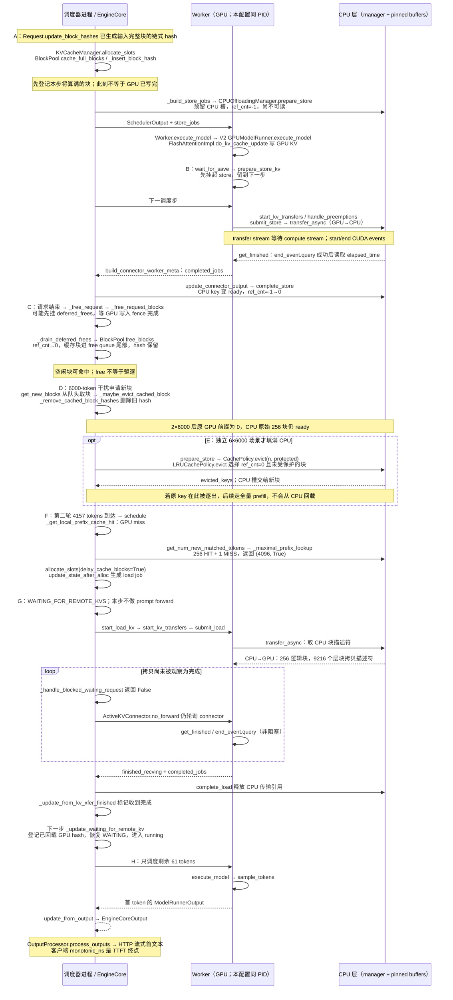

# M0：一个 KV 块的生命周期

本实验沿用 Week1 的 Qwen3-8B / H200 NVL GPU 0 / NUMA 2，
512 个 GPU blocks（含 null block）、16 tokens/block、4 GB CPU LRU、
`offload_prompt_only=true`。三次 GPU 命中、三次 2×6000 CPU 回载，
另做三次 6×6000 CPU 满容量驱逐。完整命令、fixture 和原始日志在
[实验目录](../results/m0-lifecycle-20261102)。
[TTFT 分解](m0_ttft.md)和[接口问答](m0_qa.md)分别给出时间与 M4/M5 接入结论。

## 三泳道时序

泳道表示逻辑职责。**本次默认 TP=1 使用 UniProcExecutor，调度器和 GPU
Worker 共用 EngineCore PID**，不能把两者之间的耗时称为跨进程 IPC；HTTP
前端是另一进程。CPU 层也没有独立后台服务：CPU manager 位于调度侧，
pinned/mmap 缓冲及拷贝由 Worker 管理。进程号以原始 JSONL 的 `pid` 为准。



## 代码位置

| 阶段 | 关键函数及文件 |
| --- | --- |
| A：hash 生成 | [`Request.update_block_hashes`](https://github.com/vllm-project/vllm/blob/5df63a7203cdb9328d824a27b682e77c7b9928be/vllm/v1/request.py)，[`get_request_block_hasher`](https://github.com/vllm-project/vllm/blob/5df63a7203cdb9328d824a27b682e77c7b9928be/vllm/v1/core/kv_cache_utils.py)；hash 来源是 token IDs / 前缀链，不是 KV 浮点内容 |
| A：分配、登记、实际写入 | [`KVCacheManager.allocate_slots`](patches/README.md#file-vllm-v1-core-kv-cache-manager-py)，[`BlockPool.cache_full_blocks / _insert_block_hash`](patches/README.md#file-vllm-v1-core-block-pool-py)，[`FlashAttentionImpl.do_kv_cache_update`](https://github.com/vllm-project/vllm/blob/5df63a7203cdb9328d824a27b682e77c7b9928be/vllm/v1/attention/backends/flash_attn.py) |
| B：卸载计划 | [`OffloadingConnectorScheduler._build_store_jobs / _calc_num_offloadable_tokens`](patches/README.md#file-vllm-distributed-kv-transfer-kv-connector-v1-offloading-scheduler-py) |
| B：延后提交与异步拷贝 | [`OffloadingConnector.wait_for_save`](https://github.com/vllm-project/vllm/blob/5df63a7203cdb9328d824a27b682e77c7b9928be/vllm/distributed/kv_transfer/kv_connector/v1/offloading_connector.py)，[`OffloadingConnectorWorker.prepare_store_kv / start_kv_transfers / handle_preemptions`](patches/README.md#file-vllm-distributed-kv-transfer-kv-connector-v1-offloading-worker-py)，[`SingleDirectionOffloadingHandler.transfer_async / get_finished`](patches/README.md#file-vllm-v1-kv-offload-cpu-gpu-worker-py) |
| C：结束、延迟释放 | [`Scheduler._free_request / _free_request_blocks / _drain_deferred_frees`](patches/README.md#file-vllm-v1-core-sched-scheduler-py)，[`BlockPool.free_blocks`](patches/README.md#file-vllm-v1-core-block-pool-py) |
| D：GPU 驱逐 | [`BlockPool.get_new_blocks / _maybe_evict_cached_block / _remove_cached_block_hashes`](patches/README.md#file-vllm-v1-core-block-pool-py) |
| E：CPU 驱逐 | [`CPUOffloadingManager.prepare_store`](patches/README.md#file-vllm-v1-kv-offload-cpu-manager-py)，[`LRUCachePolicy.evict`](https://github.com/vllm-project/vllm/blob/5df63a7203cdb9328d824a27b682e77c7b9928be/vllm/v1/kv_offload/cpu/policies/lru.py) |
| F：GPU、外部查找与分配 | [`Scheduler.schedule / _get_local_prefix_cache_hit`](patches/README.md#file-vllm-v1-core-sched-scheduler-py)，[`OffloadingConnectorScheduler.get_num_new_matched_tokens / _maximal_prefix_lookup / update_state_after_alloc`](patches/README.md#file-vllm-distributed-kv-transfer-kv-connector-v1-offloading-scheduler-py) |
| G：轮询与恢复 | [`ActiveKVConnector.no_forward / post_forward`](https://github.com/vllm-project/vllm/blob/5df63a7203cdb9328d824a27b682e77c7b9928be/vllm/v1/worker/gpu/kv_connector.py)，[`Scheduler._update_from_kv_xfer_finished / _handle_blocked_waiting_request / _update_waiting_for_remote_kv`](patches/README.md#file-vllm-v1-core-sched-scheduler-py) |
| H：执行、采样、返回 | [`Worker.execute_model`](patches/README.md#file-vllm-v1-worker-gpu-worker-py)，[`GPUModelRunner.execute_model / sample_tokens`](https://github.com/vllm-project/vllm/blob/5df63a7203cdb9328d824a27b682e77c7b9928be/vllm/v1/worker/gpu/model_runner.py)，[`Scheduler.update_from_output`](patches/README.md#file-vllm-v1-core-sched-scheduler-py)，[`OutputProcessor.process_outputs`](patches/README.md#file-vllm-v1-engine-output-processor-py) |

## 观测方法

`AGENTKV_TRACE=1` 在进程启动时启用；默认关闭。
`AGENTKV_TRACE_DIR` 指定输出目录。
[`trace.py`](patches/README.md#file-vllm-v1-kv-offload-trace-py)记录 `time.monotonic_ns()`、PID、
请求 ID、阶段及必要的 block/key/job/step 字段。请求入口用 span 传递 request
上下文；全局调度事件使用 step，跨步延迟释放的块事件可通过 block ID + key
关联回创建请求。这里不会把不带 request 的空调度步伪装成某个请求。

热路径将事件留在内存，正常退出后序列化 JSONL；每进程上限 65536 条，
超过时分批写盘，长运行要考虑该批写盘成本。本次各进程事件数低于上限。
每个 CPU/GPU 传输 job 的关联独立记录，单调时间戳在同机对齐。
CUDA 耗时复用已有 `start_event / end_event`，仅在 `end_event.query()` 成功后
调用 `elapsed_time`，没有新增 `torch.cuda.synchronize()` 或逐 token tensor 回读。
日志须在服务正常关闭后分析，强杀可能丢掉尚未写出的内存事件。

## 一条实际块轨迹

以下来自 trial 1 的 2×6000 场景；相对时间以首次 GPU hash 登记为 0，
不是 TTFT 区间。原始 key（hash + group 0）为：

```text
296b576d8f7bc70beea2bef61bb2b2dee0743a52346649513249e403e747501700000000
```

| 事件 | 相对时间 ms | 物理 GPU block | 请求关联 |
| --- | ---: | ---: | --- |
| `gpu_cache_insert` | 0.000 | 511 | cmpl-trial1.cpu_keep.turn1-0-bbce3302 |
| `cpu_keys_ready` | 131.256 | — | cmpl-trial1.cpu_keep.turn1-0-bbce3302 |
| `gpu_free_zero_ref` | 218.127 | 511 | 延迟释放；由 block ID + key 回关联 turn1 |
| `gpu_hash_remove` | 770.889 | 511 | cmpl-trial1.cpu_keep.noise2-0-9cd2b6e8 |
| `cpu_load_keys` | 1154.753 | — | cmpl-trial1.cpu_keep.turn2-0-9c86fa06 |
| `gpu_cache_insert` | 1176.910 | 18 | cmpl-trial1.cpu_keep.turn2-0-9c86fa06 |

同一 key 从 GPU block 511 被逐出，随后从 CPU 恢复到 GPU block 18；
内容标识连续，物理 GPU 槽不要求相同。`store_plan` 在 computed=0、
scheduled=4096、RUNNING 时就已创建，Worker 在 +20.550 ms 延后 store，
+22.061 ms 提交拷贝；CPU ready 在 +131.256 ms，请求结束入口在
+212.058 ms，最终 ref=0 在 +218.127 ms。这直接说明保存早于请求结束。
这里 hash 先登记而 KV 后写入是调度器的预登记；实际可读性靠执行顺序和
传输 stream 的依赖保证，不能把登记时间当作 GPU 写完时间。

6×6000 的独立轨迹中，同一逻辑 key 在 +1950.647 ms 被 noise5 的
`cpu_evict` 删除；第二轮只能全量 prefill。三次均在 noise4/5/6 分别驱逐
61/375/375 块，共 811，CPU 上原 prompt 的 ready keys 从 256 到 195 到 0。
2×6000 则 CPU 驱逐为 0，原 prompt 仍为 256/256；所以不能声称单次
2×6000 实验同时演示了 CPU 驱逐和该副本的回载。
