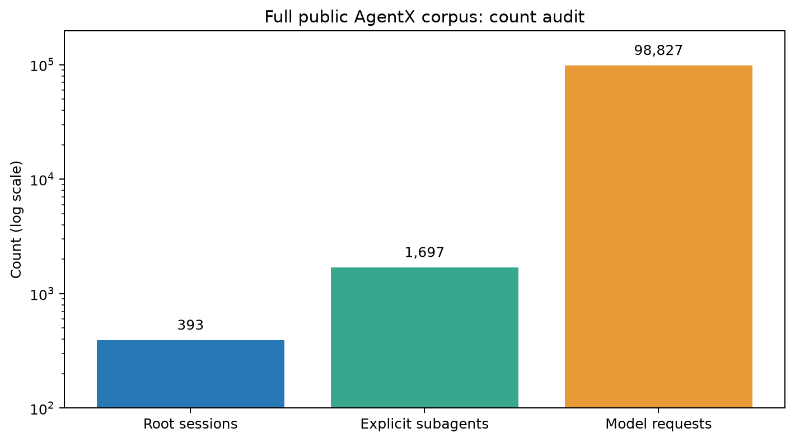
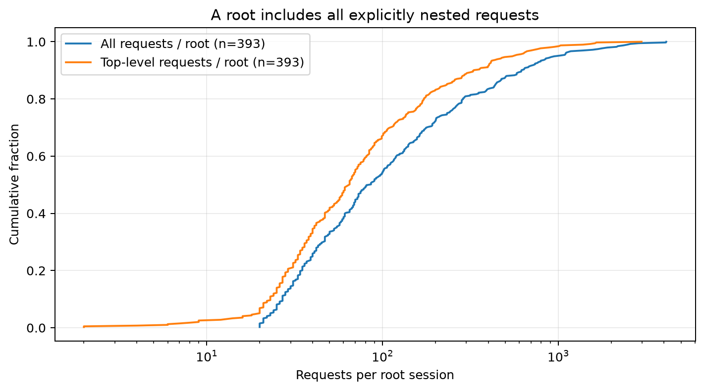
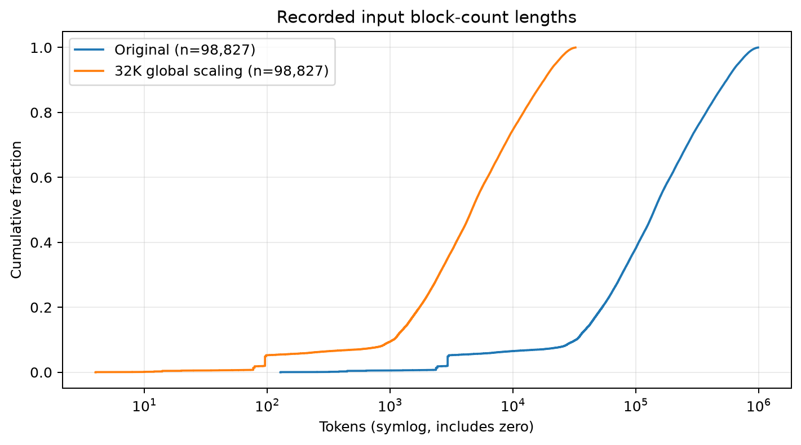
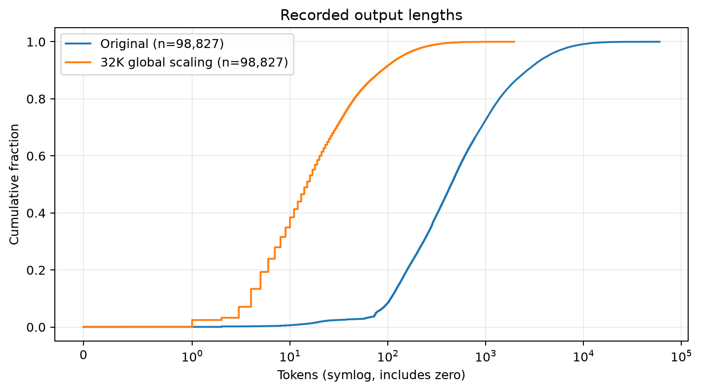
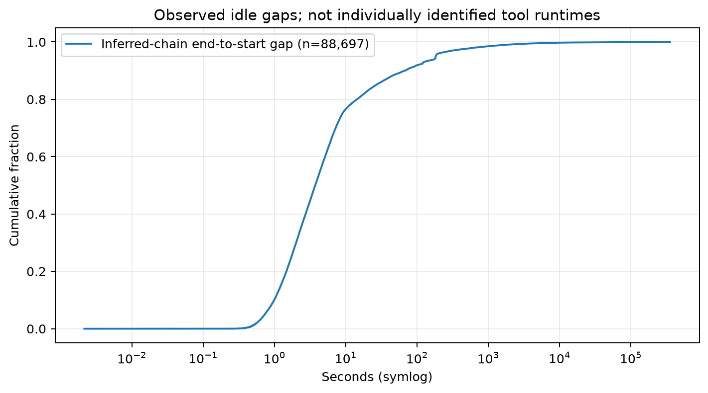
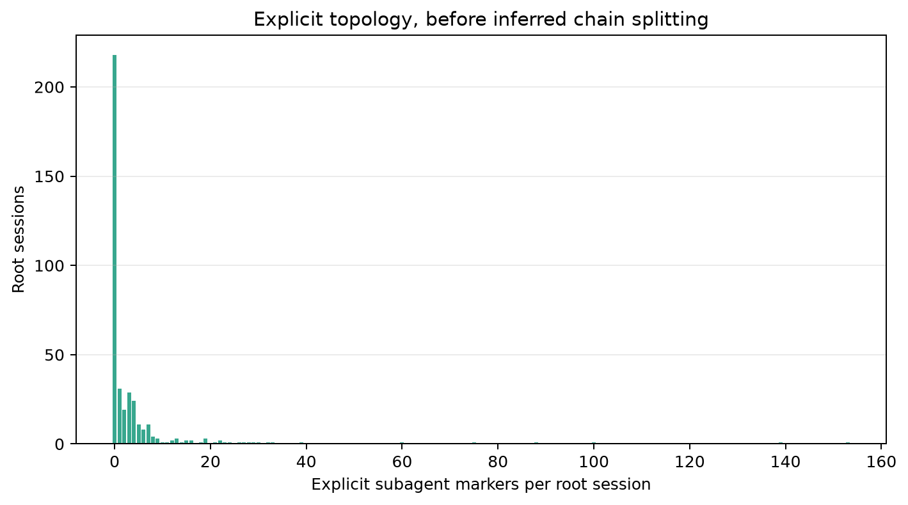
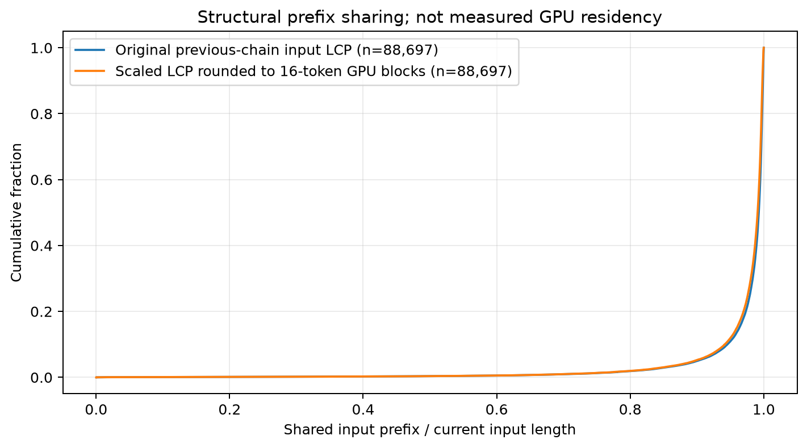

# M1：AgentX 编码 trace 数据说明

**结论：部分能用。** 已下载并全量分析 **393 个根会话、98,827 次模型请求、1,697 个显式子 Agent 分组**。数据有请求相对时间、API 耗时和按顺序排列的前缀块哈希，可以支撑长度、前缀共享和并发分叉的合成负载分析；没有原始文本、真实 token ID、工具名和逐工具开始/结束事件。因此能计算请求外的观察间隔，不能把它全部称为“工具执行耗时”，也不能据此训练按工具名分类的耗时预测器。

分析日期：2026-11-02。本次只下载、校验、统计和画图，未编写回放器或运行模型。全部统计来自本机下载文件，不是网页摘要。

## 1. 使用哪个数据集

从 [SemiAnalysis AgentX harness](https://github.com/SemiAnalysisAI/agentx-harness) 的带子 Agent 数据入口确认数据源为 [semianalysisai/cc-traces-weka-062126](https://huggingface.co/datasets/semianalysisai/cc-traces-weka-062126)。没有选用旧的不带子 Agent 的别名数据集。

| 项目 | 固定值 |
| --- | --- |
| Harness commit | `e4bb2f835ffedbbe6b76252ea5c93caec68c5faf` |
| HF dataset revision | `23f152f6f0f9399a85901b89a6458def0ef16729` |
| 文件 | `traces.jsonl`，1,847,151,435 bytes，393 行 |
| SHA256 | `29b6a19e751ff5230771519aab755f80a0f43a4ba9cf96b72d3a6a437ec99276` |
| 本机位置 | `data/raw/agentx/cc-traces-weka-062126/traces.jsonl` |
| 许可 | Apache-2.0 |

字节数、SHA256 与 HF 元数据一致；根会话、顶层请求、子 Agent 分组、嵌套请求、总输入/输出量也全部与发布方数值一致。原始 JSONL 已加入 `.gitignore`。固定来源、源码快照和复现步骤见 [结果目录](../results/m1-agentx-data-20261102/README.md)。

这是经过筛选的 Claude Code proxy trace：发布方限制版本、最少请求数、并发子 Agent 数，排除了图片、部分辅助分类调用、重复行和部分异常会话，并按请求过滤过大输入。因此它代表这份公开样本，不能直接当作所有 Agent 工作负载的无偏分布。[固定版本数据卡](https://huggingface.co/datasets/semianalysisai/cc-traces-weka-062126/blob/23f152f6f0f9399a85901b89a6458def0ef16729/README.md)

## 2. 结构：一行是根会话，内部混合请求与子 Agent 标记

| 层级/字段 | 含义与本次发现 |
| --- | --- |
| 一行 JSON：`id / models / block_size / hash_id_scope / requests` | 一个根会话；`id` 是根会话 ID，不是请求 ID |
| `requests[]` 中 `type="s"` / `"n"` | 一次流式/非流式模型 API 调用，分别 56,432 / 42,395 次 |
| `requests[]` 中 `type="subagent"` | 启动标记与嵌套请求列表；不能再把它算成一次模型调用 |
| `agent_id` | 显式子 Agent 标识，连同根会话 ID 使用 |
| `t / duration_ms / status / requests` | 子 Agent 启动时间、整个分组的耗时、状态及内部模型调用 |
| 轮次号、每请求 ID、`parent_id` | 原始数据没有；分析中的数组位置、`chain_turn`、`chain_id` 都是派生字段 |

实际总量为 **56,798 次顶层调用 + 42,029 次嵌套调用 = 98,827 次模型调用**；175/393 个根会话含显式子 Agent（44.5%）。全部 1,697 个 marker 的状态为 `completed`，`subagent_type` 都是泛称 `Subagent`。嵌套位置给出“属于哪个根会话”的关系；没有完整的多级 `parent_id` 链，也没有准确指出由父 Agent 的哪一轮、哪次工具调用创建它。

原始外层/内层列表仍会混入并发或辅助调用，不能把整个根会话当成单条串行 Agent。分析使用固定上游 [detect_agent_chains](https://github.com/SemiAnalysisAI/agentx-harness/blob/e4bb2f835ffedbbe6b76252ea5c93caec68c5faf/src/aiperf/dataset/loader/weka_agent_chains.py)，在顶层容器和每个显式子 Agent 容器内分别拆链：依据前缀、模型和请求时间区间识别延续/分叉，并合并符合规则的上下文切换。采用默认 seam 参数 3600 秒和 0.5 overlap ratio，不额外裁剪请求。

得到 **10,130 条推断链**，中位长度 1，P90 为 22，最长 851；**这不等于原始真实 Agent 数或会话数**。其中既有独立辅助调用，也有启发式推断出的串流。没有运行完整 benchmark loader 的 preamble 分类等后续步骤。所有请求恰好分配到一条推断链，未丢弃或重复计算。



会话总数是单个计数，使用柱图；其余分布使用 CDF 或直方图。图中的 subagent 是显式分组数。

## 3. 内容：没有文本，但有可恢复的输入前缀关系

数据没有原始提示词、代码、工具参数/结果、输出文本或真实 tokenizer token ID。它也不只是输入/输出计数：每个请求都有 **有序的 `hash_ids`**，表示连续 64-token 输入块；所有根会话都声明 `block_size=64`、`hash_id_scope="local"`。

实测 98,827/98,827 条请求满足：

```text
in == 64 × len(hash_ids)
共享输入前缀长度 = 64 × LCP(请求 A.hash_ids, 请求 B.hash_ids)
```

这里 LCP 是最长公共前缀的块数。必须在同一根会话命名空间内比较，包含它的显式子 Agent；不同根会话的整数哈希 ID 不能相互比较。由此可以恢复已记录输入的共享前缀树，不能逆推出原始文本、精确工具消息边界，或上一轮输出究竟占下一轮输入的哪一段。跨根会话共享系统提示词的关系也无法恢复。

例如真实首条示例根 ID 为 `002001296e8a8c38ad9d7cc436d691afc602`，首请求 `t=0`、`in=640`、`out=20`、10 个哈希块、`api_time=1.979` 秒；完整的两个截短示例见 [schema_examples.json](../results/m1-agentx-data-20261102/schema_examples.json)。

**长度不是精确原始 tokenizer 计数。** 发布方说明 `in` 来自哈希块计数；大上下文、高 cache-write 的尾部可能比计费长度高约 260K，已过滤 `in>990,016` 的请求。本次实测最大输入 989,824。下面的 token 分布均按公开字段统计，不把它解释成原始模型的精确文本长度。

另一个影响后续 M1 的结果：88,697 对链内相邻输入中，**84,889 对保留上一轮整个输入前缀，3,808 对没有保留**。后者与上游识别出的上下文切换 seam 对应，可能包含压缩或改写，不能通过“所有轮次严格追加”的验收规则。前者也只能确认上一轮输入仍为前缀，不能确认上一轮输出原文被完整回填。

## 4. 时间：可以算观察间隔，不能识别逐工具耗时

每个模型请求都有 `t` 和 `api_time`：前者为距根会话开始的相对秒数，后者为记录的 API 处理时长。没有绝对 UTC 发送/完成时间戳，但可以按记录的 API 时长推导相对完成时刻与下一次发送间隔；它不是独立采集的完成事件：

```text
end_k = t_k + api_time_k
idle_k = t_(k+1) - end_k
```

应在同一串行链内计算。子 Agent 当前数据的 `t` 已位于根会话时间轴；本次没有触发上游为旧格式提供的相对时间转换。`duration_ms` 是整个子 Agent 分组耗时，包含模型调用，不能用作某次工具耗时。字段定义和时间换算参考固定上游 [schema](https://github.com/SemiAnalysisAI/agentx-harness/blob/e4bb2f835ffedbbe6b76252ea5c93caec68c5faf/src/aiperf/dataset/loader/weka_trace_models.py) 与 [时间处理代码](https://github.com/SemiAnalysisAI/agentx-harness/blob/e4bb2f835ffedbbe6b76252ea5c93caec68c5faf/src/aiperf/dataset/loader/weka_trace.py#L99)。

直接在原始容器中按相邻请求相减，会得到 **96,737 对中的 6,409 个负间隔**，最小 −384.366 秒。这说明存在并行串流，不能将其补零后解释为串行工具时序。拆链后得到 **88,697 个非负观察间隔**，缺失 API 时长为 0 对，最小 0.004 秒；没有为这张 CDF 截断长尾。

虽然 98,434 条请求带 `think_time`，它与拆链后重算间隔只有 65,877/88,697 对在 1 ms 内一致；绝对差的 P90 为 3.691 秒。分析保留两列，主统计使用明确的 end-to-start 公式。

**不能据此得到真实逐工具分布。** 原始 98,827 条模型调用全部缺少 `stop`、`input_types` 和 `tool_name`；schema 的默认值不能当成已采集标签。可确认由工具调用结束信号或工具结果标记连接的样本数为 **0**。观察间隔还可能包含用户停顿、调度、并发 Agent 等待与合流；最长约 4.1 天也提醒我们不能把所有间隔当作单个工具运行时间。

## 5. 全量规模与分布

表中每会话轮数以“请求次数”为代理，包含辅助调用；输入、输出按所有模型请求等权，间隔按推断链的相邻请求对等权。P90 使用线性插值，因此计数分位数可带小数。

| 指标 | 样本量 | 中位数 | P90 | 最大值 |
| --- | ---: | ---: | ---: | ---: |
| 每根会话模型请求数，含子 Agent | 393 | 86 | 617.6 | 4,114 |
| 每根会话顶层模型请求数 | 393 | 65 | 330.2 | 2,977 |
| 每根会话显式子 Agent 数 | 393 | 0 | 8 | 153 |
| 每请求输入长度，块计数口径 | 98,827 | 142,016 | 549,504 | 989,824 |
| 每请求输出长度 | 98,827 | 444 | 2,659 | 59,903 |
| 每请求 API 时长，秒 | 98,827 | 6.652 | 26.319 | 720.213 |
| 链内观察到的 end-to-start 间隔，秒 | 88,697 | 3.733 | 67.634 | 355,531.762 |
| 可确认的逐工具耗时，秒 | 0 | 缺失 | 缺失 | 缺失 |

总输入字段之和为 **21,635,381,376**，总输出字段之和为 **106,474,498**。最大单请求输入加输出为 **996,579**。未按根会话先平均；长会话会对请求级分布贡献更多样本。



根会话长尾明显，含子 Agent 的总请求数高于顶层计数；这两个口径不能混用。



原始输入中位数为 142K；全局缩放后约 4.6K，长上下文压力会明显减弱。



输出同样有长尾；图中保留零输出请求，横轴使用含零的 symlog。



多数间隔为秒级，但尾部达到天级；这是请求外空闲时间分布，逐工具耗时分布缺失。



218 个根会话没有显式子 Agent，少量会话有很大的累计 fan-out；累计数不等于峰值并发数。



链内共享前缀占比普遍较高；图表示输入结构，不表示已经驻留 GPU 或实际测得的缓存命中率。

## 6. 缩到 32K：保留什么，会改变什么

先用全局同一比例做长度与块边界审计，给模板等预留 256 token：

```text
budget = 32768 - 256 = 32512
alpha = budget / max(in + out) = 0.032623605353915744
in'  = floor(alpha × in)
out' = ceil(alpha × out)
前缀位置映射 q(k) = floor(alpha × 64 × k)
```

实际全量检查 `in'+out'<=32,512`，未删除请求或显式分叉，原本非空的输入/输出仍非空；零输出仍保留为零。原始每个 64-token 哈希块在目标空间至少占 2 token，逻辑前缀边界没有因零宽块被合并。这里是长度和结构检查，**尚未生成合成 token，也未验证目标 tokenizer/chat template 的最终长度**。

| 要保留的性质 | 结果与条件 |
| --- | --- |
| 请求/轮次数 | 能保留全部 98,827 次，不需要删轮；辅助调用仍需单独标识 |
| 观察到的请求外间隔 | 能原样保留数值；换模型后闭环等待相同 gap 与保持原绝对发送偏移不能同时保证，因为模型耗时会改变 |
| 同根会话输入前缀关系 | 逻辑上能保留：按整棵前缀树统一映射，父/子 Agent 使用同一命名空间与比例；逐请求各自裁剪或缩放会破坏它 |
| GPU 块粒度的共享效果 | 部分保留：目标以 16 token 为一块时，短前缀可能不足一整块，精确缓存访问序列不再相同 |
| 显式子 Agent 分叉 | 1,697 个 marker 及根归属可以保留；精确父轮次、深层调用树和工具语义仍缺失 |
| 完整并发/合流依赖 | 部分能用：有时间区间与嵌套信息，其余依赖需要推断；本次没有实现或验证可执行 DAG |
| 原始编码任务语义/模型质量 | 不能恢复，需要原始文本与工具事件 |

量化块粒度损失：88,697 对原本有共享前缀的链内相邻请求中，**20 对**缩放后共享量不足一个 16-token GPU 块。上游算法给出的 8,040 个分叉候选中，692 个有正共享前缀，其中 **30 个**缩放后不足一整块。后者是启发式分叉候选，不是 1,697 个显式 subagent marker 的计数。保留逻辑分叉不能等同于保留其全部缓存收益。

全局比例保留跨会话长度比例，但会让大量请求变短。补充比较同一根会话及全部子 Agent 共用一个比例：

```text
alpha_session = min(1, 32512 / max_session(in + out))
```

| 缩放方式 | 输入中位数 / P90 / 最大值 | 输出中位数 / P90 / 最大值 |
| --- | --- | --- |
| 全局比例 | 4,633 / 17,926 / 32,291 | 15 / 87 / 1,955 |
| 按根会话比例 | 10,616 / 27,774 / 32,511 | 30 / 183 / 18,949 |

两种方案均通过输入加输出预算检查。按根会话方案更能利用 32K 空间，仍可保留根内逻辑前缀树，但改变了不同会话之间的长度比；不能把它称为原分布的统一等比缩小。上面的 GPU 块损失数只针对全局方案，不直接套用到按根会话方案。后续正式负载应显式选择并报告缩放口径，同时对实际合成 token 的 LCP、模板预算、上下文切换及分叉做验证。

## 7. 对项目的影响与缺口

**数据源 A 可用来构造结构与观察间隔驱动的合成 serving 负载，整体判定仍是“部分能用”。** 它能提供多轮请求数、长度长尾、根内共享前缀、显式子 Agent 及请求时间区间。不能据此声称还原真实代码执行或真实工具耗时。

需要数据源 B 补充：原始/可追踪的 token 序列；每次工具的名字、开始与结束时间；真实 agent/request/parent ID；父子创建与 join 事件；用户停顿和工具等待的区分；上下文压缩标记。M7 按工具名预测耗时依赖这些标签，不能只靠当前 AgentX 文件。

对现有 M1 验收的具体约束是：将“所有 prompt 严格追加”改为区分追加、上下文切换和分叉；不要把根会话列表直接串行化；不要跨根比较局部哈希；不要把观察间隔当成真实逐工具标签。这里只记录核查结论，未改动 `docs/PLAN.md`，也未开始回放器实现。

可复现入口：[分析脚本](../agentkv/analysis/analyze_agentx_data.py)、[汇总 JSON](../results/m1-agentx-data-20261102/summary.json)、[表/图/下载复现说明](../results/m1-agentx-data-20261102/README.md)。
