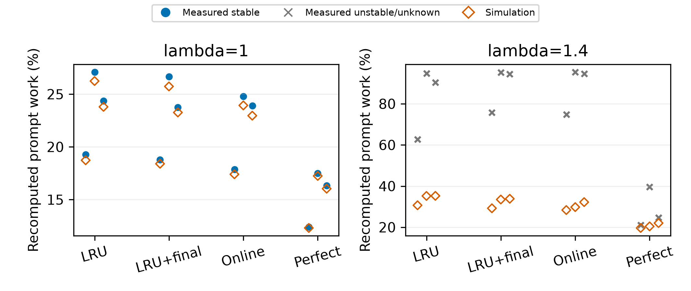
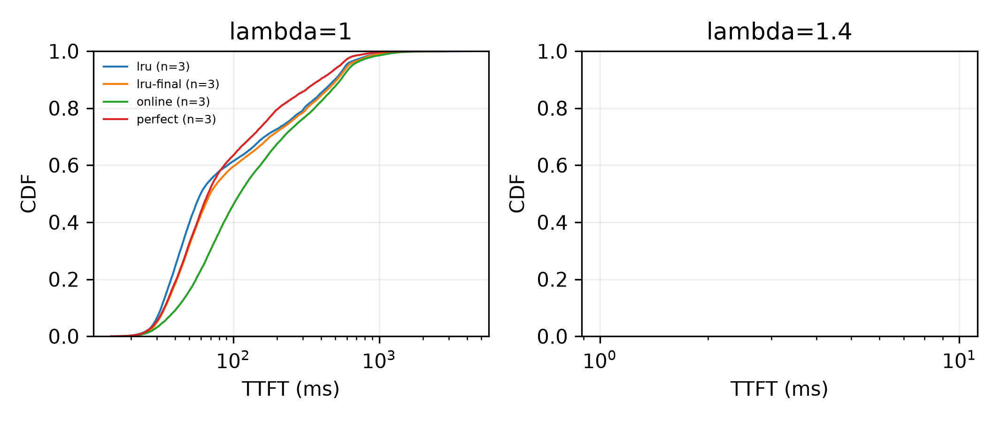
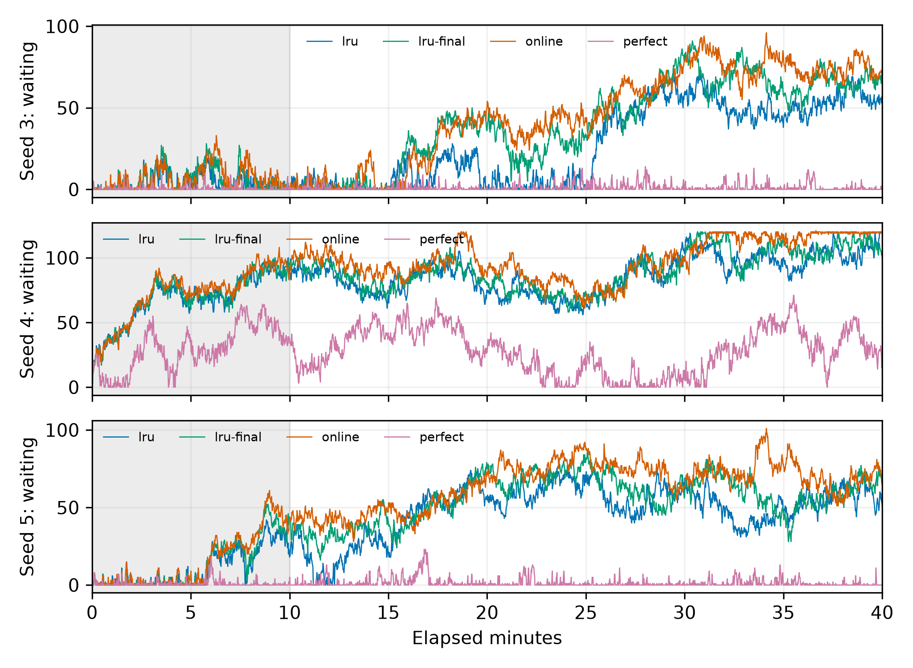

# E1 GPU config-11

本报告仅使用持久目录中完成的24次attempt-2测量。首次矩阵原始产物因主机重启丢失，聊天摘要全部排除，见[事故记录](../../docs/EVIDENCE.md#archives)。重跑没有再次中断，没有第三次重跑。

测量提交`def5ee43d790c0c41374038c17d32aebd5051161`；vLLM提交`4749dd5961841243596559b10ba0a22c48980c45`；语义冻结提交`23c2d6d909e87c1b5a7e1aa1bd11bbd84f0708db`，优化核心冻结于`e2501f0d63fec130ada2574803b044c9cd195310`。CPU预测提交`0800a144cc18b8ef73663b33c8d1dcddb8124779`。只增加事后发布核验工具，预注册运行文件SHA256、评分、校准及参数均未改变。发布工具提交见[总run.json](run.json)的git_commit；逐次原始run.json保留测量提交及原字节。

已重新核验24份生产者输入/输出指纹，从请求元数据独立重算有效重算比例及TTFT分位数；18项跨策略共同请求token核对通过。保留请求元数据、轻量观测、metrics、两卡dmon、原始run.json及清单；完整prompt数组仍在持久目录，路径及SHA256见总run.json，未复制实现源码。完整测试227通过、3项历史跳过，另有发布相关9项测试通过。

λ=1时online在三个留出人口上均减少重算，平均减少1.3856个百分点，但TTFT P50/P99平均增加51.8313/124.9003ms；perfect平均减少8.1540个百分点，P99平均降低172.1177ms，P50平均增加6.1002ms。λ=1.4四种策略均为0/3稳定，无稳定配对可用于主指标，不能给出该到达率下的稳态收益结论。三个留出人口不做显著性检验。

状态：complete；预注册 `502ca060d7937959b575a41fa6646dbaf7d01460`；已完成24/24。

每个人口一个点，报告均值及最小–最大；3个人口不做显著性检验。主指标仅稳定运行；配对差值要求策略和同人口LRU都稳定。负差表示策略较低。不稳定/失败不删除。有效重算为实际前向prompt工作量，名义三分类和重复工作另列于逐次e1-analysis.json。

## λ=1

| 策略 | 重算%（稳定） | TTFT P50 ms | TTFT P99 ms | Δ重算pp | ΔP50 ms | ΔP99 ms | 稳定次数/3 |
|---|---:|---:|---:|---:|---:|---:|---:|
| lru | 23.5709 [19.2634, 27.0867], n=3 | 62.6870 [51.2487, 68.6420], n=3 | 955.7722 [746.9288, 1154.6837], n=3 | 0.0000 [0.0000, 0.0000], n=3 | 0.0000 [0.0000, 0.0000], n=3 | 0.0000 [0.0000, 0.0000], n=3 | 3/3 |
| lru-final | 23.0666 [18.7782, 26.6656], n=3 | 73.3932 [58.4062, 81.9912], n=3 | 1003.9231 [839.7047, 1221.8686], n=3 | -0.5044 [-0.6067, -0.4211], n=3 | 10.7063 [7.1575, 13.8210], n=3 | 48.1509 [-15.5080, 92.7759], n=3 | 3/3 |
| online | 22.1853 [17.8588, 24.8027], n=3 | 114.5183 [89.1161, 128.9123], n=3 | 1080.6725 [801.3941, 1381.9433], n=3 | -1.3856 [-2.2840, -0.4683], n=3 | 51.8313 [37.8674, 60.7422], n=3 | 124.9003 [54.4654, 227.2596], n=3 | 3/3 |
| perfect | 15.4169 [12.4164, 17.4990], n=3 | 68.7871 [55.8153, 76.7147], n=3 | 783.6545 [636.0117, 920.0841], n=3 | -8.1540 [-9.5877, -6.8470], n=3 | 6.1002 [4.5667, 8.0726], n=3 | -172.1177 [-234.5996, -110.9171], n=3 | 3/3 |
## λ=1.4

| 策略 | 重算%（稳定） | TTFT P50 ms | TTFT P99 ms | Δ重算pp | ΔP50 ms | ΔP99 ms | 稳定次数/3 |
|---|---:|---:|---:|---:|---:|---:|---:|
| lru | NA | NA | NA | NA | NA | NA | 0/3 |
| lru-final | NA | NA | NA | NA | NA | NA | 0/3 |
| online | NA | NA | NA | NA | NA | NA | 0/3 |
| perfect | NA | NA | NA | NA | NA | NA | 0/3 |

## λ=1.4完成数（含不稳定运行）

| 策略 | 稳定/3 | 全部完成数 | 非is_entry完成数 |
|---|---:|---:|---:|
| lru | 0/3 | 8100.0000 [7173.0000, 9292.0000], n=3 | 8100.0000 [7173.0000, 9292.0000], n=3 |
| lru-final | 0/3 | 7528.0000 [6824.0000, 8155.0000], n=3 | 7528.0000 [6824.0000, 8155.0000], n=3 |
| online | 0/3 | 7084.6667 [6333.0000, 7828.0000], n=3 | 7084.6667 [6333.0000, 7828.0000], n=3 |
| perfect | 0/3 | 11419.0000 [10464.0000, 12318.0000], n=3 | 11419.0000 [10464.0000, 12318.0000], n=3 |

## 全部运行及模拟差距

| λ | 种子 | 策略 | 状态 | 稳定性 | 窗口完成/有效完成 | 实测重算% | 模拟% | 差pp |
|---:|---:|---|---|---|---:|---:|---:|---:|
| 1 | 3 | lru | complete | stable | 6930/6930 | 19.2634 | 18.7303 | +0.5331 |
| 1 | 3 | online | complete | stable | 6919/6919 | 17.8588 | 17.4021 | +0.4567 |
| 1 | 3 | perfect | complete | stable | 6932/6932 | 12.4164 | 12.3094 | +0.1070 |
| 1 | 3 | lru-final | complete | stable | 6925/6925 | 18.7782 | 18.3986 | +0.3796 |
| 1 | 4 | lru-final | complete | stable | 6017/6017 | 26.6656 | 25.7313 | +0.9343 |
| 1 | 4 | lru | complete | stable | 6019/6019 | 27.0867 | 26.2419 | +0.8448 |
| 1 | 4 | online | complete | stable | 6007/6007 | 24.8027 | 23.9309 | +0.8718 |
| 1 | 4 | perfect | complete | stable | 6035/6035 | 17.4990 | 17.2458 | +0.2532 |
| 1 | 5 | online | complete | stable | 7625/7625 | 23.8943 | 22.9589 | +0.9353 |
| 1 | 5 | lru | complete | stable | 7649/7649 | 24.3626 | 23.7947 | +0.5679 |
| 1 | 5 | perfect | complete | stable | 7646/7646 | 16.3353 | 16.0345 | +0.3008 |
| 1 | 5 | lru-final | complete | stable | 7634/7634 | 23.7559 | 23.2605 | +0.4954 |
| 1.4 | 3 | perfect | complete | unstable | 11475/11475 | 21.0127 | 19.6426 | +1.3701 |
| 1.4 | 3 | online | complete | unstable | 7828/7828 | 74.8256 | 28.3592 | +46.4664 |
| 1.4 | 3 | lru-final | complete | unstable | 8155/8155 | 75.6744 | 29.2158 | +46.4586 |
| 1.4 | 3 | lru | complete | unstable | 9292/9292 | 62.7279 | 30.6701 | +32.0578 |
| 1.4 | 4 | online | complete | unstable | 7093/7093 | 95.3790 | 29.7805 | +65.5984 |
| 1.4 | 4 | perfect | complete | unstable | 12318/12318 | 39.6441 | 20.4115 | +19.2326 |
| 1.4 | 4 | lru-final | complete | unstable | 7605/7605 | 95.3072 | 33.4752 | +61.8320 |
| 1.4 | 4 | lru | complete | unstable | 7835/7835 | 94.8360 | 35.2005 | +59.6355 |
| 1.4 | 5 | lru-final | complete | unstable | 6824/6824 | 94.4596 | 33.8330 | +60.6266 |
| 1.4 | 5 | lru | complete | unstable | 7173/7173 | 90.2877 | 35.2476 | +55.0401 |
| 1.4 | 5 | online | complete | unstable | 6333/6333 | 94.5943 | 32.2060 | +62.3883 |
| 1.4 | 5 | perfect | complete | unstable | 10464/10464 | 24.6713 | 22.0104 | +2.6610 |

CDF按稳定人口等权混合，主表仍为每人口分位数的等权均值，不把混合CDF分位数冒充配对均值。

[逐次数据](runs.csv) · [hint对账](hint_counts.csv) · [轻量回调耗时](callback_timings.csv) · [机器汇总](summary.json)。

窗口完成数按结束时刻计，主指标按发送时刻入窗；全部与非is_entry完成数都报告。实际闭环请求集合可能不同，共同请求token哈希在组内核对。CPU模拟固定0.5秒、零搬运，不模拟真实TTFT或服务时间依赖。

断点续跑：`python -m agentkv.bench.e1_gpu run --output-dir ../agentkv-runs/e1-recovery-20261105 --gpu-index 1 --port 8016`；`--max-groups 3`可每晚最多跑3组。状态用`python -m agentkv.bench.e1_gpu status --output-dir ../agentkv-runs/e1-recovery-20261105`。

checkpoint.json保留每次attempt、原因和选中成功产物SHA；失败不覆盖，第二次非策略失败后停止该配置。未执行显著性检验。

## 次要指标与稳定性核验

三分类按每个人口的16-token完整块计算，再对3个人口等权平均。单位为完整prompt块token的百分比，尾块和末token replay不在这三类中，它们的和不是主指标的实际前向工作量。间隙按触发前缀来源定义，含工具间隙、客户端误差和服务端排队；同时报告这些请求的平均排队时间（人口等权）。λ=1.4仅为不稳定运行诊断。

| λ | 策略 | 不可避免% | 间隙期间（含排队）驱逐% | 其他驱逐% | 间隙驱逐请求平均排队s |
|---:|---|---:|---:|---:|---:|
| 1 | lru | 1.7578 | 21.6128 | 0.1215 | 0.0467 |
| 1 | lru-final | 1.7603 | 21.0901 | 0.1367 | 0.0455 |
| 1 | online | 1.7628 | 20.2088 | 0.1333 | 0.0633 |
| 1 | perfect | 1.7627 | 13.4422 | 0.1247 | 0.0352 |
| 1.4 | lru | 2.2979 | 79.9986 | 0.3015 | 13.8987 |
| 1.4 | lru-final | 2.3495 | 85.8419 | 0.2762 | 16.1612 |
| 1.4 | online | 2.3846 | 85.6039 | 0.2647 | 19.2806 |
| 1.4 | perfect | 2.0296 | 26.0770 | 0.2575 | 1.8787 |

[逐次三分类、尾块、replay和排队原值](recomputation_sources.csv)。所有窗口请求失败数为0；重复prompt工作量、抢占后未知设备来源命中、hit超过历史前缀异常均为0。

| λ=1.4种子 | 策略 | 零等待占比%（须≥80） | 等待P99（须≤8） | 拟合30分增量（须<1） | TTFT后/前半比（须≤1.5） |
|---:|---|---:|---:|---:|---:|
| 3 | perfect | 63.408 | 10.000 | 0.505 | 1.130 |
| 3 | online | 9.034 | 89.000 | 89.400 | 5.147 |
| 3 | lru-final | 11.264 | 85.000 | 79.558 | 5.002 |
| 3 | lru | 20.869 | 68.000 | 71.909 | 23.190 |
| 4 | online | 0.000 | 120.000 | 27.876 | 1.070 |
| 4 | perfect | 7.666 | 63.000 | -5.137 | 0.575 |
| 4 | lru-final | 0.000 | 119.000 | 27.933 | 1.088 |
| 4 | lru | 0.000 | 116.530 | 26.403 | 1.066 |
| 5 | lru-final | 0.000 | 80.000 | 24.735 | 1.010 |
| 5 | lru | 1.316 | 73.000 | 28.993 | 0.916 |
| 5 | online | 0.000 | 93.530 | 32.452 | 1.186 |
| 5 | perfect | 64.000 | 14.000 | -1.627 | 0.765 |

24次均观察到KV判据所需回调，共4个KV阻塞事件，发生在λ=1.4的perfect种子4（3个）和5（1个），运行数均为7，未低于阈值。其余22次无KV阻塞事件。条件性KV判据均通过，但不代表另外三项稳定性条件通过。[全部判据](stability.csv)。等待图跨人口使用一致策略颜色，阴影为预热。

## 预测差距与观测开销

| λ | 策略 | 实测−模拟重算百分点：均值 [最小, 最大] | 稳定次数 |
|---:|---|---:|---:|
| 1 | lru | 0.6486 [0.5331, 0.8448] | 3/3 |
| 1 | lru-final | 0.6031 [0.3796, 0.9343] | 3/3 |
| 1 | online | 0.7546 [0.4567, 0.9353] | 3/3 |
| 1 | perfect | 0.2203 [0.1070, 0.3008] | 3/3 |
| 1.4 | lru | 48.9111 [32.0578, 59.6355] | 0/3 |
| 1.4 | lru-final | 56.3057 [46.4586, 61.8320] | 0/3 |
| 1.4 | online | 58.1510 [46.4664, 65.5984] | 0/3 |
| 1.4 | perfect | 7.7545 [1.3701, 19.2326] | 0/3 |

模型服务时间固定0.5秒、搬运时间为0。λ=1.4同时观察到积压、TTFT恶化和大幅重算，模拟收益不能直接外推到该到达率；本实验未通过因果消融分离服务时长、排队、驱逐及策略开销的贡献。

轻量直方图P99为区间；下表使用其上界、单位ms，对3个人口报告均值和范围。这是实际GPU回调序列的耗时，不能由此前CPU离线序列的耗时替代。

| λ=1策略 | evict P99上界ms | on_request_finished P99上界ms | scheduler.schedule P99上界ms |
|---|---:|---:|---:|
| lru | 4.533 [3.834, 5.079] | 11.971 [11.338, 12.583] | 9.306 [8.454, 10.093] |
| lru-final | 3.714 [3.211, 3.998] | 15.816 [15.663, 15.925] | 16.712 [15.401, 17.826] |
| online | 6.936 [6.685, 7.176] | 80.740 [74.973, 89.653] | 49.545 [49.021, 50.070] |
| perfect | 3.097 [2.916, 3.293] | 22.850 [21.758, 24.248] | 19.049 [17.826, 20.054] |

[逐次回调P50/P99、均值、最大值与计数](callback_timings.csv)。online存在明显回调开销和TTFT代价；没有为改变结果而调整冻结实现或矩阵。

## hint、两卡记录及复核

全部24次发送253404个hint、传输接收253404个；18次自定义策略运行共消费191576个，逐次与其发送数一致。内置LRU忽略hint，消费计数不适用，传输仍核对。见[hint_counts.csv](hint_counts.csv)。

24次启动前nvidia-smi快照均无GPU进程。统计窗口dmon中GPU0最大SM为0%，GPU1各次平均SM为59.17%～98.29%；原始dmon.log逐次保留，[汇总](dmon_summary.csv)。这些是启动快照和设备级采样，不推断未观测的进程归因。

完整prompt数组仍在`../agentkv-runs/e1-recovery-20261105/`，总run.json列出路径和原始SHA256。发布核验：`python -m agentkv.analysis.e1_gpu_publish --source ../agentkv-runs/e1-recovery-20261105 --destination results/e1-gpu-config11-20261105`，需干净工作区，不运行GPU。主表和原始图可由冻结的`python -m agentkv.bench.e1_gpu report --output-dir ../agentkv-runs/e1-recovery-20261105`重建。本页追加事实汇总；发布时只统一等待图颜色及修正持久路径。
