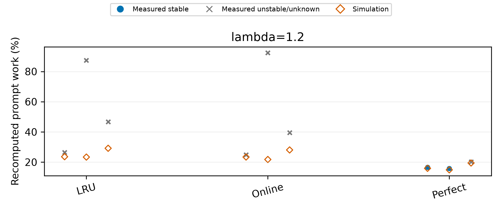
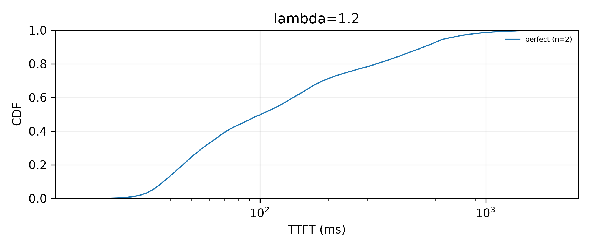
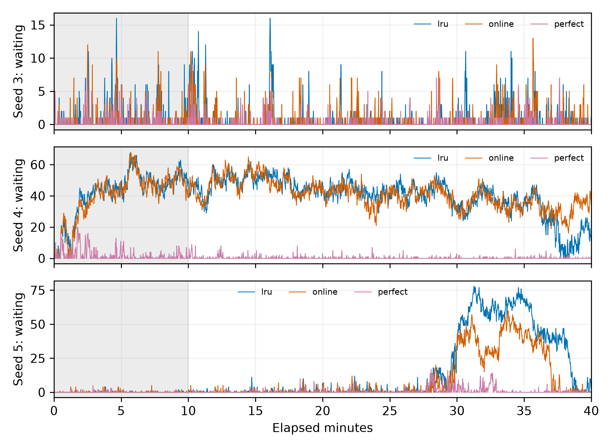

# λ=1.2稳定负载上限：config-11

状态：complete；预注册 `daeb439b160a1d598495eda1ed2fea0c732f19b5`；已完成9/9。

九次均为attempt-1，未重跑。测量源和预注册提交均为`daeb439b160a1d598495eda1ed2fea0c732f19b5`；实现冻结提交`a3b1cfedf676eb768eba81076bb233986bc12d62`，vLLM fork `4749dd5961841243596559b10ba0a22c48980c45`。评分与rank不变，已通过全部可重放记录的有序驱逐一致性核验。九项CPU预测与固定顺序见[预注册](../../docs/stable_limit_12_preregistration.md)。

**验收限制：** [40分钟开销验证](../m5-chain-growth-20261107/README.md)仍未达到调度P99相对LRU增量≤2ms，最终版本为+3.276799ms。下列TTFT含真实策略开销，不能把本矩阵解释为该性能目标已通过。

本次LRU与online各0/3稳定，perfect为2/3；没有任何同人口稳定LRU配对，因此所有主指标配对差值均为NA（n=0）。perfect两次稳定运行的绝对值不能与不稳定LRU混成主指标差值。这三个人口不能据以推断所有人口的精确稳定上限。

每个人口一个点，报告均值及最小–最大；3个人口不做显著性检验。主指标仅稳定运行；配对差值要求策略和同人口LRU都稳定。负差表示策略较低。不稳定/失败不删除。有效重算为实际前向prompt工作量，名义三分类和重复工作另列于逐次e1-analysis.json。

## λ=1.2

| 策略 | 重算%（稳定） | TTFT P50 ms | TTFT P99 ms | Δ重算pp | ΔP50 ms | ΔP99 ms | 稳定次数/3 |
|---|---:|---:|---:|---:|---:|---:|---:|
| lru | NA | NA | NA | NA | NA | NA | 0/3 |
| online | NA | NA | NA | NA | NA | NA | 0/3 |
| perfect | 16.2233 [15.8892, 16.5574], n=2 | 100.6751 [89.3261, 112.0242], n=2 | 1098.5610 [1073.7383, 1123.3836], n=2 | NA | NA | NA | 2/3 |

## λ=1.2完成数（含不稳定运行）

| 策略 | 稳定/3 | 全部完成数 | 非is_entry完成数 |
|---|---:|---:|---:|
| lru | 0/3 | 9412.6667 [7523.0000, 10397.0000], n=3 | 9412.6667 [7523.0000, 10397.0000], n=3 |
| online | 0/3 | 9449.3333 [7107.0000, 10845.0000], n=3 | 9449.3333 [7107.0000, 10845.0000], n=3 |
| perfect | 2/3 | 10546.6667 [9693.0000, 11511.0000], n=3 | 10546.6667 [9693.0000, 11511.0000], n=3 |

## 全部运行及模拟差距

| λ | 种子 | 策略 | 状态 | 稳定性 | 窗口完成/有效完成 | 实测重算% | 模拟% | 差pp |
|---:|---:|---|---|---|---:|---:|---:|---:|
| 1.2 | 3 | lru | complete | unstable | 10397/10397 | 26.5082 | 23.6030 | +2.9052 |
| 1.2 | 3 | online | complete | unstable | 10396/10396 | 24.9239 | 23.3831 | +1.5408 |
| 1.2 | 3 | perfect | complete | stable | 10436/10436 | 16.5574 | 15.9173 | +0.6401 |
| 1.2 | 4 | perfect | complete | stable | 9693/9693 | 15.8892 | 14.9071 | +0.9821 |
| 1.2 | 4 | lru | complete | unstable | 7523/7523 | 87.3682 | 23.3525 | +64.0157 |
| 1.2 | 4 | online | complete | unstable | 7107/7107 | 92.4209 | 21.7563 | +70.6646 |
| 1.2 | 5 | perfect | complete | unstable | 11511/11511 | 20.1407 | 19.4447 | +0.6960 |
| 1.2 | 5 | online | complete | unstable | 10845/10845 | 39.4902 | 28.0705 | +11.4197 |
| 1.2 | 5 | lru | complete | unstable | 10318/10318 | 46.7462 | 29.1746 | +17.5715 |





CDF按稳定人口等权混合，主表仍为每人口分位数的等权均值，不把混合CDF分位数冒充配对均值。



[逐次数据](runs.csv) · [hint对账](hint_counts.csv) · [轻量回调耗时](callback_timings.csv) · [机器汇总](summary.json)。

窗口完成数按结束时刻计，主指标按发送时刻入窗；全部与非is_entry完成数都报告。实际闭环请求集合可能不同，共同请求token哈希在组内核对。CPU模拟固定0.5秒、零搬运，不模拟真实TTFT或服务时间依赖。

断点续跑使用原持久输出目录：`python -m agentkv.bench.e1_gpu run --output-dir <持久目录> --gpu-index 1 --port 8016`；本实验必须加`--protocol docs/stable_limit_12_preregistration.json`。`--max-groups 1`可每次最多跑1组。状态用`python -m agentkv.bench.e1_gpu status --output-dir <持久目录>`。

checkpoint.json保留每次attempt、原因和选中成功产物SHA；失败不覆盖，第二次非策略失败后停止该配置。未执行显著性检验。

## 逐次判据与异常幅度

所有判据保持a81dd86原口径；没有因临界值放宽阈值。KV阻塞观察器全部有效，九次均无KV不足阻塞事件。

| 种子 | 策略 | 等待为0% | 等待P99 | 30分钟拟合增量 | TTFT后半/前半 | 稳定 |
|---:|---|---:|---:|---:|---:|---|
| 3 | lru | 78.273 | 9 | -0.5214 | 1.2841 | unstable |
| 3 | online | 79.703 | 7 | -0.1513 | 1.1533 | unstable |
| 3 | perfect | 84.914 | 4 | -0.0001 | 1.2683 | stable |
| 4 | perfect | 83.934 | 5 | -0.4060 | 0.7473 | stable |
| 4 | lru | 0.229 | 58 | -29.6629 | 0.7374 | unstable |
| 4 | online | 0.000 | 60 | -19.2480 | 0.8404 | unstable |
| 5 | perfect | 78.070 | 12 | 1.0518 | 1.4965 | unstable |
| 5 | online | 56.375 | 54 | 31.5977 | 5.8136 | unstable |
| 5 | lru | 49.657 | 73 | 56.7681 | 24.3745 | unstable |

seed-3 online的等待为0占比79.703%，低于80%门槛，按预注册仍判不稳定。seed-5 perfect的等待P99=12、30分钟拟合增量1.0518，也按原门槛判不稳定。

seed-4 LRU/online的实测有效重算率为87.368%/92.421%，对应模拟为23.352%/21.756%，差64.016/70.665个百分点；其等待P99为58/60，等待为0占比0.229%/0%，GPU1窗口平均SM利用率97.958%/97.307%。这两项均已单列为不稳定，未纳入主均值。该人口所有请求的重复prefill工作和主窗口抢占请求计数均为0；不能把差距归因为已经观测到的抢占。固定0.5秒、零搬运的CPU模型不包含实际排队和服务时间反馈；本报告未逐项建立这些因素对差距的因果分解。

九次运行的GPU0统计窗口SM平均值/最大值均为0；GPU1窗口平均SM为76.009%–97.958%。两卡原始dmon逐次保留，汇总见[dmon_summary.csv](dmon_summary.csv)。没有按这些数值删掉不利结果。

## 来源与核验

- 九次run.json、服务端清单、轻量指标闭合记录、hint消费数、原始请求SHA均已核验；六项组内共同逻辑请求的token哈希/置换种子/长度对照全部一致。
- 发送hint与HTTP端接收hint总数相同，hint策略的有效hint消费数逐次与发送数相同；LRU只接收而不消费hint。
- 原始prompt载荷保留于`../agentkv-runs/stable-limit-12-20261107`，Git发布逐请求元数据、生产者清单、日志、指纹和图，不复制实现源码。所有派生结论对应的数据见run.json文件哈希及各次e1-analysis.json。
- 相关Python完整测试256通过，3项为历史跳过；日志见[validation-tests.log](../../docs/EVIDENCE.md#runtime-logs)。PNG为300dpi，另有PDF。

```bash
# 从同一持久目录核验、跳过已完成项并续跑
python -m agentkv.bench.e1_gpu run --protocol docs/stable_limit_12_preregistration.json --output-dir ../agentkv-runs/stable-limit-12-20261107 --gpu-index 1 --port 8016
# 重建报告（使用已有全部原始文件，不重跑GPU）
python -m agentkv.bench.e1_gpu report --protocol docs/stable_limit_12_preregistration.json --output-dir ../agentkv-runs/stable-limit-12-20261107
```
