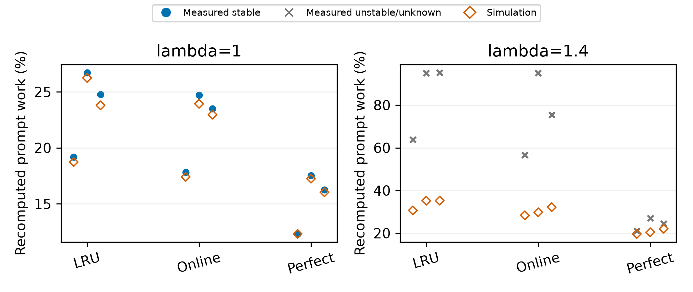
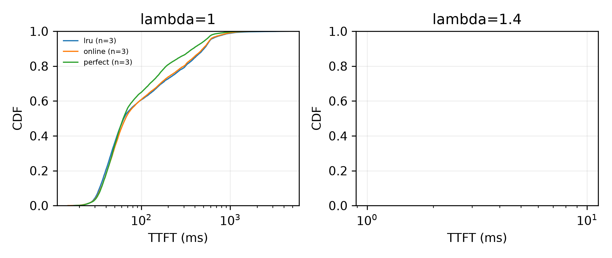
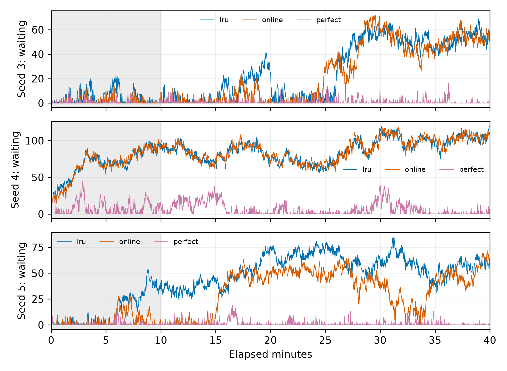

# E1 v2：链级rank实现，config-11

状态：complete；预注册 `52ab4ded1c57b29ac1d0b68d71c32d057d64c84b`；已完成18/18。

每个人口一个点，报告均值及最小–最大；3个人口不做显著性检验。主指标仅稳定运行；配对差值要求策略和同人口LRU都稳定。负差表示策略较低。不稳定/失败不删除。有效重算为实际前向prompt工作量，名义三分类和重复工作另列于逐次e1-analysis.json。

## λ=1

| 策略 | 重算%（稳定） | TTFT P50 ms | TTFT P99 ms | Δ重算pp | ΔP50 ms | ΔP99 ms | 稳定次数/3 |
|---|---:|---:|---:|---:|---:|---:|---:|
| lru | 23.5549 [19.1864, 26.7149], n=3 | 66.6715 [55.0500, 73.6734], n=3 | 1072.6661 [801.4082, 1411.1196], n=3 | 0.0000 [0.0000, 0.0000], n=3 | 0.0000 [0.0000, 0.0000], n=3 | 0.0000 [0.0000, 0.0000], n=3 | 3/3 |
| online | 22.0083 [17.8010, 24.7247], n=3 | 68.5705 [57.9447, 75.5413], n=3 | 951.1729 [785.9337, 1073.2087], n=3 | -1.5466 [-1.9902, -1.2643], n=3 | 1.8990 [-1.4479, 4.2502], n=3 | -121.4932 [-337.9109, -11.0943], n=3 | 3/3 |
| perfect | 15.3649 [12.3148, 17.5388], n=3 | 63.5469 [55.6413, 68.7083], n=3 | 772.5919 [615.0767, 897.0574], n=3 | -8.1899 [-9.1761, -6.8716], n=3 | -3.1246 [-5.0001, 0.5913], n=3 | -300.0742 [-514.0622, -186.3315], n=3 | 3/3 |

## λ=1.4

| 策略 | 重算%（稳定） | TTFT P50 ms | TTFT P99 ms | Δ重算pp | ΔP50 ms | ΔP99 ms | 稳定次数/3 |
|---|---:|---:|---:|---:|---:|---:|---:|
| lru | NA | NA | NA | NA | NA | NA | 0/3 |
| online | NA | NA | NA | NA | NA | NA | 0/3 |
| perfect | NA | NA | NA | NA | NA | NA | 0/3 |

## λ=1.4完成数（含不稳定运行）

| 策略 | 稳定/3 | 全部完成数 | 非is_entry完成数 |
|---|---:|---:|---:|
| lru | 0/3 | 8010.3333 [6966.0000, 9253.0000], n=3 | 8010.3333 [6966.0000, 9253.0000], n=3 |
| online | 0/3 | 8331.3333 [7737.0000, 9450.0000], n=3 | 8331.3333 [7737.0000, 9450.0000], n=3 |
| perfect | 0/3 | 11849.6667 [10497.0000, 13541.0000], n=3 | 11849.6667 [10497.0000, 13541.0000], n=3 |

## 全部运行及模拟差距

| λ | 种子 | 策略 | 状态 | 稳定性 | 窗口完成/有效完成 | 实测重算% | 模拟% | 差pp |
|---:|---:|---|---|---|---:|---:|---:|---:|
| 1 | 3 | lru | complete | stable | 6930/6930 | 19.1864 | 18.7303 | +0.4561 |
| 1 | 3 | online | complete | stable | 6923/6923 | 17.8010 | 17.4021 | +0.3989 |
| 1 | 3 | perfect | complete | stable | 6936/6936 | 12.3148 | 12.3094 | +0.0054 |
| 1 | 4 | lru | complete | stable | 6017/6017 | 26.7149 | 26.2419 | +0.4730 |
| 1 | 4 | online | complete | stable | 6021/6021 | 24.7247 | 23.9309 | +0.7938 |
| 1 | 4 | perfect | complete | stable | 6041/6041 | 17.5388 | 17.2458 | +0.2930 |
| 1 | 5 | online | complete | stable | 7647/7647 | 23.4990 | 22.9589 | +0.5401 |
| 1 | 5 | lru | complete | stable | 7647/7647 | 24.7634 | 23.7947 | +0.9686 |
| 1 | 5 | perfect | complete | stable | 7660/7660 | 16.2412 | 16.0345 | +0.2067 |
| 1.4 | 3 | perfect | complete | unstable | 11511/11511 | 20.9587 | 19.6426 | +1.3160 |
| 1.4 | 3 | online | complete | unstable | 9450/9450 | 56.5718 | 28.3592 | +28.2126 |
| 1.4 | 3 | lru | complete | unstable | 9253/9253 | 63.8151 | 30.6701 | +33.1450 |
| 1.4 | 4 | online | complete | unstable | 7737/7737 | 95.0480 | 29.7805 | +65.2675 |
| 1.4 | 4 | perfect | complete | unstable | 13541/13541 | 27.0306 | 20.4115 | +6.6191 |
| 1.4 | 4 | lru | complete | unstable | 7812/7812 | 94.9897 | 35.2005 | +59.7892 |
| 1.4 | 5 | lru | complete | unstable | 6966/6966 | 95.2249 | 35.2476 | +59.9773 |
| 1.4 | 5 | online | complete | unstable | 7807/7807 | 75.4863 | 32.2060 | +43.2803 |
| 1.4 | 5 | perfect | complete | unstable | 10497/10497 | 24.4728 | 22.0104 | +2.4625 |

CDF按稳定人口等权混合，主表仍为每人口分位数的等权均值，不把混合CDF分位数冒充配对均值。

[逐次数据](runs.csv) · [hint对账](hint_counts.csv) · [轻量回调耗时](callback_timings.csv) · [机器汇总](summary.json)。

窗口完成数按结束时刻计，主指标按发送时刻入窗；全部与非is_entry完成数都报告。实际闭环请求集合可能不同，共同请求token哈希在组内核对。CPU模拟固定0.5秒、零搬运，不模拟真实TTFT或服务时间依赖。

断点续跑使用原持久输出目录：`python -m agentkv.bench.e1_gpu run --output-dir <持久目录> --gpu-index 1 --port 8016`；v2另加`--protocol docs/e1_v2_preregistration.json`。`--max-groups 3`可每晚最多跑3组。状态用`python -m agentkv.bench.e1_gpu status --output-dir <持久目录>`。

checkpoint.json保留每次attempt、原因和选中成功产物SHA；失败不覆盖，第二次非策略失败后停止该配置。未执行显著性检验。

## E1 v1 / v2 并列

v2仅改变实现性能：链级评分、链内冻结rank。online/perfect及734/2005次基线的有序驱逐逐次相同；公式和校准不变。真实闭环完成时刻与交错可能不同，这不是同一时刻的A/B实验。所有共同请求的token在版本间逐项相同。

主指标仅稳定运行，配对还要求同人口LRU稳定；均值[最小,最大]，注明样本数，不做显著性检验。负差表示较同版本LRU更低。

| λ | 版本 | 策略 | 稳定/3 | 重算% | TTFT P50 ms | TTFT P99 ms | 配对Δ重算pp | 配对ΔP50 ms | 配对ΔP99 ms |
|---:|---|---|---:|---:|---:|---:|---:|---:|---:|
| 1 | v1 | lru | 3/3 | 23.571 [19.263, 27.087], n=3 | 62.687 [51.249, 68.642], n=3 | 955.772 [746.929, 1154.684], n=3 | 0.000 [0.000, 0.000], n=3 | 0.000 [0.000, 0.000], n=3 | 0.000 [0.000, 0.000], n=3 |
| 1 | v2 | lru | 3/3 | 23.555 [19.186, 26.715], n=3 | 66.671 [55.050, 73.673], n=3 | 1072.666 [801.408, 1411.120], n=3 | 0.000 [0.000, 0.000], n=3 | 0.000 [0.000, 0.000], n=3 | 0.000 [0.000, 0.000], n=3 |
| 1 | v1 | online | 3/3 | 22.185 [17.859, 24.803], n=3 | 114.518 [89.116, 128.912], n=3 | 1080.673 [801.394, 1381.943], n=3 | -1.386 [-2.284, -0.468], n=3 | 51.831 [37.867, 60.742], n=3 | 124.900 [54.465, 227.260], n=3 |
| 1 | v2 | online | 3/3 | 22.008 [17.801, 24.725], n=3 | 68.570 [57.945, 75.541], n=3 | 951.173 [785.934, 1073.209], n=3 | -1.547 [-1.990, -1.264], n=3 | 1.899 [-1.448, 4.250], n=3 | -121.493 [-337.911, -11.094], n=3 |
| 1 | v1 | perfect | 3/3 | 15.417 [12.416, 17.499], n=3 | 68.787 [55.815, 76.715], n=3 | 783.654 [636.012, 920.084], n=3 | -8.154 [-9.588, -6.847], n=3 | 6.100 [4.567, 8.073], n=3 | -172.118 [-234.600, -110.917], n=3 |
| 1 | v2 | perfect | 3/3 | 15.365 [12.315, 17.539], n=3 | 63.547 [55.641, 68.708], n=3 | 772.592 [615.077, 897.057], n=3 | -8.190 [-9.176, -6.872], n=3 | -3.125 [-5.000, 0.591], n=3 | -300.074 [-514.062, -186.332], n=3 |
| 1.4 | v1 | lru | 0/3 | NA | NA | NA | NA | NA | NA |
| 1.4 | v2 | lru | 0/3 | NA | NA | NA | NA | NA | NA |
| 1.4 | v1 | online | 0/3 | NA | NA | NA | NA | NA | NA |
| 1.4 | v2 | online | 0/3 | NA | NA | NA | NA | NA | NA |
| 1.4 | v1 | perfect | 0/3 | NA | NA | NA | NA | NA | NA |
| 1.4 | v2 | perfect | 0/3 | NA | NA | NA | NA | NA | NA |

[逐人口v1/v2原值、稳定性及完成数](v1_v2_populations.csv)。不稳定项全部保留，不能用缺失值表示无差异。

复跑：`python -m agentkv.bench.e1_gpu run --protocol docs/e1_v2_preregistration.json --output-dir <新的持久目录> --gpu-index 1 --port 8016`。断点续跑使用原持久目录，不覆盖已有attempt。

## 来源、完整性和适用边界

预注册及全部18次测量提交`52ab4ded1c57b29ac1d0b68d71c32d057d64c84b`；运行器与链实现冻结`dd8c7fb220570745645df573ad062c19b228a4bf`；vLLM `4749dd5961841243596559b10ba0a22c48980c45`。语义冻结、全部Python源码及输入SHA256见[预注册](../../docs/e1_v2_preregistration.md)和配套JSON。
测量跨北京时间2026-11-06至11-07，18个attempt-1全部完成、没有重跑。原始完整prompt留在`../agentkv-runs/e1-v2-config11-20261106/`；本目录保留原始run.json、服务清单/配置、两卡dmon、轻量汇总、请求元数据、重算分解、checkpoint及指纹。未复制实现代码。
主指标重新从元数据计算，18次与原分析逐项相等，所有producer指纹通过。组内12项、跨v1/v2共18项共同逻辑请求token哈希/实例置换/长度逐项相同。源请求大文件SHA与本机文件核对；原始run.json不改。
共200190个hint发出、200190个被传输层接收；两种自定义策略合计138785个有效hint完成消费，逐次完全一致，内置LRU不消费hint。统计发送窗口成功146620个、失败0。完成时刻口径另见主表。
两卡dmon见[dmon_summary.csv](dmon_summary.csv)：GPU0统计窗SM均为0；GPU1平均SM约59.3%–98.3%。各服务的其他进程与显存状态保存在server-manifest.json，不从瞬时空闲推断其他时间的资源独占。

## 短时门槛与正式窗口的调度开销

链级实现对固定完整回调的有序key验证全部一致；online无插桩CPU finished/evict P99为1.079/1.959ms。独立20分钟GPU验证的scheduler P99相对LRU保守增量online/perfect为1.802/1.343ms，满足进入正式实验的预设门槛，见[原始门槛](../m5-chain-implementation-20261106/README.md)。
正式40分钟中，λ=1三个种子online的保守增量为2.294/3.736/4.588ms，perfect为2.032/2.884/3.539ms；均超过2ms。λ=1.4下也未保持2ms以内，全部原值见[formal_scheduler.csv](formal_scheduler.csv)。不把短时通过解释为其他时长、人口或负载的开销保证；CPU离线目标也不是GPU观测回调的保证。

| λ | 种子 | 策略 | schedule P99区间 ms | 相对同人口LRU差值区间 ms |
|---:|---:|---|---:|---:|
| 1 | 3 | online | [10.682, 10.748] | [+2.163, +2.294] |
| 1 | 3 | perfect | [10.420, 10.486] | [+1.901, +2.032] |
| 1 | 4 | online | [13.566, 13.631] | [+3.604, +3.736] |
| 1 | 4 | perfect | [12.714, 12.780] | [+2.753, +2.884] |
| 1 | 5 | online | [15.139, 15.204] | [+4.456, +4.588] |
| 1 | 5 | perfect | [14.090, 14.156] | [+3.408, +3.539] |
| 1.4 | 3 | perfect | [19.137, 19.268] | [+2.425, +2.621] |
| 1.4 | 3 | online | [21.496, 21.627] | [+4.784, +4.981] |
| 1.4 | 4 | online | [20.185, 20.316] | [+6.750, +6.947] |
| 1.4 | 4 | perfect | [26.083, 26.214] | [+12.648, +12.845] |
| 1.4 | 5 | online | [22.413, 22.544] | [+8.389, +8.585] |
| 1.4 | 5 | perfect | [19.661, 19.792] | [+5.636, +5.833] |

直方图分位数为区间，不假装知道区间内的精确值；差值区间以候选下界减LRU上界、候选上界减LRU下界计算。完整policy回调P50/P99/均值/最大值见[callback_timings.csv](callback_timings.csv)。

## 结果解读

在config-11、λ=1、种子3/4/5三次均稳定的范围内，online在每个人口都降低有效重算，平均减少1.547pp，TTFT P50配对差为+1.899ms（−1.448至+4.250）；perfect平均减少8.190pp，P50配对差为−3.125ms（−5.000至+0.591）。
v1在线策略的P50配对增量为+51.831ms，v2为+1.899ms；同一冻结评分在新实现下的观测增量缩小。v1/v2不是同时段运行，LRU自身分位数也变化，不把全部时延差归因于实现。只有3个人口，不作显著性结论。
λ=1.4全部9次不稳定，三种策略均为0/3稳定，不能据此宣称支持该到达率。LRU/online在高负载下的实测重算远高于固定服务模型预测；模型不含排队、重算服务时间与驱逐反馈，不能用其数值替代GPU测量。perfect虽队列较短，仍未通过预注册的零等待比例与P99条件。
TTFT CDF右侧λ=1.4面板为空，是因为没有稳定人口，不是缺失运行；不稳定运行的原值及队列完整保留。三分类名义口径、实际有效前向工作量及其差额见[recomputation_sources.csv](recomputation_sources.csv)，不能互相替代。

完整验证：246通过、3项历史后端测试跳过，见[tests.log](../../docs/EVIDENCE.md#runtime-logs)。历史前缀上限异常（hit>u）计数为0。PNG为300dpi，并保留同名PDF。发布脚本先核验干净源码及协议，再从原始数据复算；本报告补充表和测试日志的SHA也纳入总清单。
