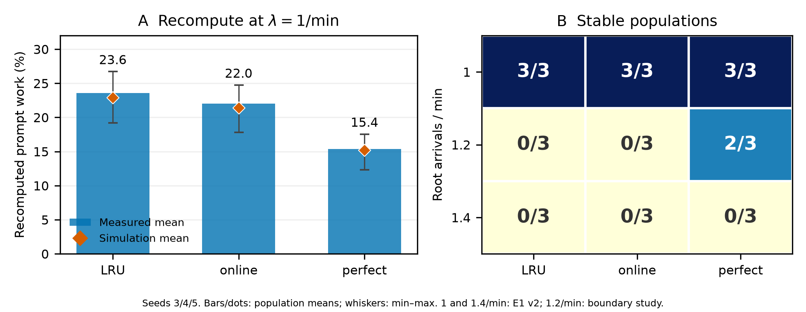

# 最终总结图与草稿数字核验

仅使用既有结果，没有启动GPU或重新选择人口。

相对百分比按三个留出人口的策略均值除以LRU均值计算；不是逐人口百分比的平均。

| 策略 | 实测重算% | 模拟% | 相对重算% | ΔP50 ms | ΔP99 ms | 相对P99% |
|---|---:|---:|---:|---:|---:|---:|
| lru | 23.554877 | 22.922288 | +0.000000 | +0.000000 | +0.000000 | +0.000000 |
| online | 22.008256 | 21.430664 | -6.566033 | +1.899001 | -121.493212 | -11.326284 |
| perfect | 15.364946 | 15.196551 | -34.769576 | -3.124617 | -300.074203 | -27.974613 |

| E0 λ | 稳定人口数 | 间隙/总重算% |
|---:|---:|---:|
| 0.5 | 3 | 86.921361 |
| 0.7 | 3 | 89.144692 |
| 1 | 2 | 91.629464 |

| 策略 | v2实测−模拟均值 pp | 最小–最大 pp |
|---|---:|---:|
| lru | 0.632589 | 0.456103–0.968648 |
| online | 0.577592 | 0.398884–0.793782 |
| perfect | 0.168396 | 0.005440–0.293004 |

| λ | LRU稳定 | online稳定 | perfect稳定 |
|---:|---:|---:|---:|
| 1 | 3/3 | 3/3 | 3/3 |
| 1.2 | 0/3 | 0/3 | 2/3 |
| 1.4 | 0/3 | 0/3 | 0/3 |

| λ=1.2策略 | 三人口平均完成数 | 较LRU增量 | 相对增量% |
|---|---:|---:|---:|
| lru | 9412.666667 | +0.000000 | +0.000000 |
| online | 9449.333333 | +36.666667 | +0.389546 |
| perfect | 10546.666667 | +1134.000000 | +12.047595 |

| CPU λ=1策略 | Oracle捕获率：均值之比% | 原报告逐人口比值均值% |
|---|---:|---:|
| remaining-online | 18.202744 | 18.021253 |
| remaining-noisy | 82.879949 | 83.056498 |
| remaining-perfect | 94.279567 | 94.319295 |

本次Oracle捕获率 = (mean(LRU) − mean(hint)) / (mean(LRU) − mean(Oracle))；原报告口径保留作对照。
[CPU原始留出报告](../m5-scoring-evaluation-20261104/README.md)。

E0使用稳定人口；λ=1只有两个稳定人口，不能写成三个。E1相对比例均使用种子3/4/5。

校准差距、完成数及稳定次数的全部数值见[summary.json](summary.json)。

[E0来源](../m1-e0-config11-20261103/README.md) · [E1 v2来源](../e1-gpu-v2-config11-20261106/README.md) · [λ=1.2来源](../e1-gpu-stable-limit-12-20261107/README.md)



PNG为300dpi，另有[PDF](summary.pdf)。

```bash
python -m agentkv.analysis.summary_figure --output-dir ../agentkv-runs/summary-new
```
