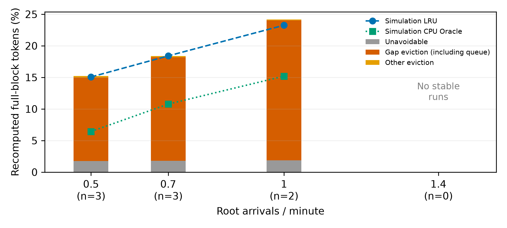
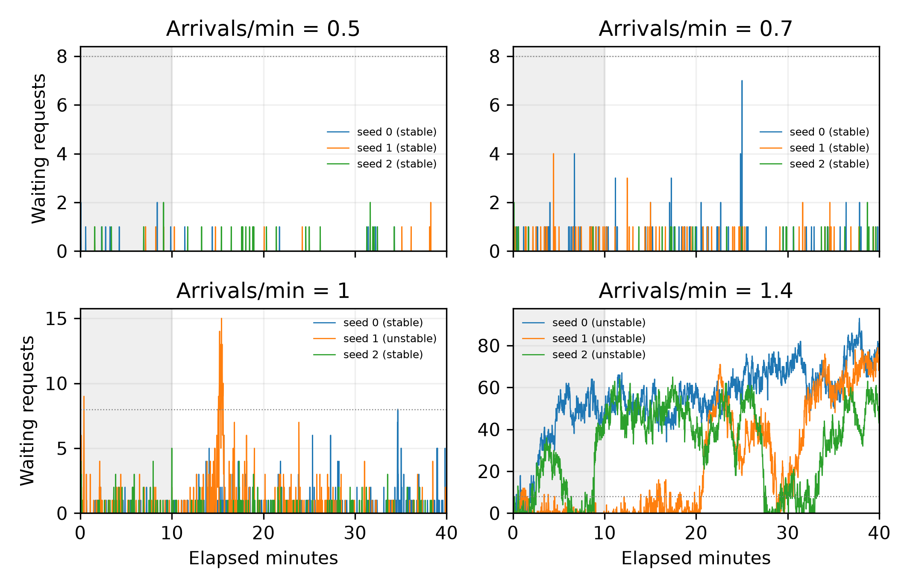

# E0 config-11

状态：complete；代码 `7a22dcb4f04eb30f7e670c20d4e7755c4921fbc5`。12次登记运行，完成12，其中稳定8。

16K、8槽位、GPU182880/CPU274320 token；LRU、none；40分钟/预热10分钟；人口种子0/1/2。
三类使用16-token整块，尾块与hit>u异常逐次单列。曲线只纳入新判据下稳定的真实运行及其同人口模型，先算每次token加权比例，再对保留种子等权平均；无稳定种子的λ不画点。

| λ | 种子 | 稳定性 | 真实重算 | 模拟LRU | Oracle | 间隙/可避免 | 间隙请求平均排队(s) | hit>u异常 |
|---|---|---|---:|---:|---:|---:|---:|---:|
| 0.5 | 0 | stable | 15.849% | 15.769% | 6.979% | 98.10% | 0.0131 | 0 |
| 0.5 | 1 | stable | 11.813% | 11.620% | 2.982% | 97.89% | 0.0115 | 0 |
| 0.5 | 2 | stable | 17.951% | 17.817% | 9.346% | 98.88% | 0.0150 | 0 |
| 0.7 | 0 | stable | 17.040% | 17.295% | 10.022% | 98.91% | 0.0219 | 0 |
| 0.7 | 1 | stable | 19.775% | 19.833% | 12.068% | 99.05% | 0.0264 | 0 |
| 0.7 | 2 | stable | 18.277% | 18.093% | 10.230% | 98.61% | 0.0157 | 0 |
| 1 | 0 | stable | 26.922% | 25.490% | 16.537% | 99.34% | 0.0683 | 0 |
| 1 | 1 | unstable | 33.059% | 30.842% | 20.226% | 99.56% | 0.1704 | 0 |
| 1 | 2 | stable | 21.414% | 21.020% | 13.859% | 99.16% | 0.0357 | 0 |
| 1.4 | 0 | unstable | 95.409% | 33.655% | 19.134% | 99.62% | 15.3446 | 0 |
| 1.4 | 1 | unstable | 64.455% | 34.499% | 19.294% | 99.52% | 9.0050 | 0 |
| 1.4 | 2 | unstable | 78.395% | 33.914% | 20.463% | 99.65% | 9.1442 | 0 |

## 固定服务时间模型（完整登记人口）

| λ | 种子 | LRU重算 | Oracle重算 | LRU间隙/可避免 | 驱逐时刻一致率（LRU/Oracle） |
|---|---|---:|---:|---:|---:|
| 0.5 | 0 | 15.769% | 6.979% | 98.52% | 100.0% / 100.0% |
| 0.5 | 1 | 11.620% | 2.982% | 98.49% | 100.0% / 100.0% |
| 0.5 | 2 | 17.817% | 9.346% | 98.84% | 100.0% / 100.0% |
| 0.7 | 0 | 17.295% | 10.022% | 98.63% | 100.0% / 100.0% |
| 0.7 | 1 | 19.833% | 12.068% | 99.00% | 100.0% / 100.0% |
| 0.7 | 2 | 18.093% | 10.230% | 98.72% | 100.0% / 100.0% |
| 1 | 0 | 25.490% | 16.537% | 99.27% | 100.0% / 100.0% |
| 1 | 1 | 30.842% | 20.226% | 99.25% | 100.0% / 100.0% |
| 1 | 2 | 21.020% | 13.859% | 98.96% | 100.0% / 100.0% |
| 1.4 | 0 | 33.655% | 19.134% | 99.16% | 100.0% / 100.0% |
| 1.4 | 1 | 34.499% | 19.294% | 99.14% | 100.0% / 100.0% |
| 1.4 | 2 | 33.914% | 20.463% | 98.98% | 100.0% / 100.0% |

## 未纳入曲线的运行

- [lambda-1-seed-1](lambda-1-seed-1/real/e0-analysis.json)：queue_distribution
- [lambda-1.4-seed-0](lambda-1.4-seed-0/real/e0-analysis.json)：queue_distribution, fitted_growth_30min
- [lambda-1.4-seed-1](lambda-1.4-seed-1/real/e0-analysis.json)：queue_distribution, fitted_growth_30min, ttft_half_ratio
- [lambda-1.4-seed-2](lambda-1.4-seed-2/real/e0-analysis.json)：queue_distribution



逐次新判据数值见run.json各real.stability；队列曲线及两卡dmon保存在各real目录。

```bash
python -m agentkv.bench.e0 --output-dir ../agentkv-runs/new-e0-config11
```

## 统计窗口汇总

每次先按整块token加权，再对保留的稳定人口种子等权平均；该表是经稳定性筛选后的条件均值，不能当作全部人口的无条件均值。

| λ | 稳定/登记 | 不可避免 | 间隙驱逐（含排队） | 其他驱逐 | 总重算 | 同人口LRU模型 | 同人口CPU Oracle | 间隙/可避免 | 间隙请求排队(ms) |
|---|---:|---:|---:|---:|---:|---:|---:|---:|---:|
| 0.5 | 3/3 | 1.768% | 13.216% | 0.221% | 15.205% | 15.069% | 6.436% | 98.291% | 13.23 |
| 0.7 | 3/3 | 1.806% | 16.370% | 0.188% | 18.364% | 18.407% | 10.773% | 98.859% | 21.33 |
| 1 | 2/3 | 1.858% | 22.145% | 0.165% | 24.168% | 23.255% | 15.198% | 99.250% | 51.97 |
| 1.4 | 0/3 | — | — | — | — | — | — | — | — |

## 不稳定人口诊断（不纳入曲线）

以下按失败人口等权平均，仅作诊断；λ=1.4无稳定人口，不能报告稳态均值。

| λ | 不稳定人口数 | 实测重算 | 同人口LRU模型 | 同人口CPU Oracle | 间隙/可避免 | 间隙请求排队(s) |
|---|---:|---:|---:|---:|---:|---:|
| 1 | 1 | 33.059% | 30.842% | 20.226% | 99.563% | 0.170 |
| 1.4 | 3 | 79.420% | 34.023% | 19.630% | 99.596% | 11.165 |

## 逐次稳定性复核

| 运行 | 结论 | 队列=0 | 队列P99 | 30分钟拟合增量 | TTFT后/前 | KV阻塞次数 | 未通过项 |
|---|---|---:|---:|---:|---:|---:|---|
| lambda-0.5-seed-0 | stable | 99.60% | 0.00 | -0.002 | 1.006 | 0 | 无 |
| lambda-0.5-seed-1 | stable | 99.54% | 0.00 | 0.007 | 1.046 | 0 | 无 |
| lambda-0.5-seed-2 | stable | 98.75% | 1.00 | -0.008 | 0.940 | 0 | 无 |
| lambda-0.7-seed-0 | stable | 97.54% | 1.00 | -0.023 | 0.937 | 0 | 无 |
| lambda-0.7-seed-1 | stable | 97.54% | 1.00 | -0.029 | 1.077 | 0 | 无 |
| lambda-0.7-seed-2 | stable | 98.74% | 1.00 | 0.020 | 1.050 | 0 | 无 |
| lambda-1-seed-0 | stable | 88.46% | 4.00 | 0.087 | 1.409 | 0 | 无 |
| lambda-1-seed-1 | unstable | 85.84% | 9.00 | -1.155 | 0.611 | 0 | queue_distribution |
| lambda-1-seed-2 | stable | 95.72% | 1.00 | -0.042 | 0.926 | 0 | 无 |
| lambda-1.4-seed-0 | unstable | 0.00% | 85.00 | 26.361 | 1.278 | 0 | queue_distribution,fitted_growth_30min |
| lambda-1.4-seed-1 | unstable | 21.89% | 75.00 | 76.439 | 22.511 | 0 | queue_distribution,fitted_growth_30min,ttft_half_ratio |
| lambda-1.4-seed-2 | unstable | 5.37% | 61.00 | -20.979 | 0.317 | 0 | queue_distribution |

## 设备与口径边界

本批次GPU选择、显存与进程快照见各gpu-check目录，运行全程两卡dmon在各real目录；“显存共享、算力共享”按实际记录，不将总SM利用率等同于本进程利用率。

CPU模型固定服务时间0.5秒、搬运零耗时；Oracle只替换CPU策略，GPU仍是LRU，不宣称全局最优。同人口不保证相同发送序列，不能把模型Oracle重算比例视为真实运行可达的下界。

按给定公式划分前缀来源。u取发送历史，尚未完成的并发前缀也属于历史，因此“其他驱逐”是剩余历史前缀未命中，不能仅凭这一项证明物理驱逐。无限缓存零驱逐的单元测试使用串行闭环链。真实服务的整块/末token回放边界仍按名义命中计数；不足16-token的尾部另列。

排队时长口径为客户端安全阀等待加EngineCore接收到首次调度的等待；未包含HTTP前端解析耗时。间隙类名称始终包含排队，不能将不稳定运行中的该比例单独归因于工具停顿。



测量代码 `7a22dcb4f04eb30f7e670c20d4e7755c4921fbc5`；复核与作图代码 `fd60b42044fabfad6fa954e7de3f6779834daf31`。完整请求文件本机保留，Git提供去除重复prompt数组的requests-metadata.parquet；原始及元数据SHA256见postprocess-run.json。未复制实现源码。

[独立复核与来源](postprocess-run.json) · [全部文件指纹](artifacts.json) · [逐次判据](criteria.csv)

```bash
python -m agentkv.analysis.finalize_e0 --run-dir ../agentkv-runs/completed-e0-run
```

本批使用的GPU编号集合为[1]，资源状态：显存共享、算力共享。各次启动前GPU0空闲显存范围9.705–9.705 GB。
全部启动检查中GPU0均未达到60GB空闲显存门槛。

[最初的GPU进程采样及其N/A限制](availability-initial/README.md)

固定服务时间模型不包含服务时长随重算量或服务端排队变化的反馈，不能用于证明真实系统稳定；不稳定实跑与模型的差异只作诊断，不解释为可直接获得的Oracle收益。
