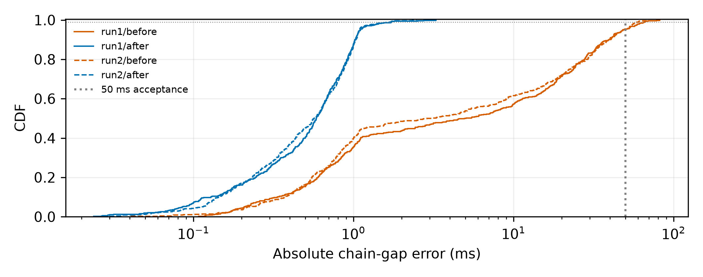

# M1 调度长尾：125 在途 / 12K prompt

## 固定负载与对照

两次独立调用，相同 fixture SHA256、相同到达时刻、125 条链×6 轮=750 请求/版本/调用，12,000 token prompt，链内等待 0.3 秒，链首按 2ms 间隔启动。独立假服务进程每请求固定 4 秒、流式 3 token，使并发达到 125；每次运行 30 秒，前 3 秒预热。这里 4 秒只用于维持目标并发，不替代容量估算的 s=0.5。prompt 来自原 v3 不同行组；没有改负载以降低误差。

旧版调度器和置换代码均从上一轮真实试跑归档冻结。新版共同修改：计时前将 token 列加载为 Arrow 缓冲区；触发时开始构建、预留完整间隔；使用两个专用构建线程；实例置换使用等价稠密查表。对照不能把收益唯一归因于某一项。

## 结果

| 调用 | 版本 | 链内误差 P99 ms | 构建耗时 P50 / P99 ms | 事件循环延迟 P99 ms | 最大循环延迟 ms | 峰值在途 | 成功 / 失败 |
|---|---|---:|---:|---:|---:|---:|---:|
| run1 | before | 65.746 | 53.884 / 118.273 | 2.056 | 3.269 | 125 | 750 / 0 |
| run1 | after | 1.729 | 3.226 / 6.277 | 2.088 | 3.883 | 125 | 750 / 0 |
| run2 | before | 58.952 | 52.210 / 116.602 | 1.958 | 5.773 | 125 | 750 / 0 |
| run2 | after | 1.624 | 3.035 / 5.710 | 2.050 | 3.159 | 125 | 750 / 0 |

每个版本每次有 625 个统计请求、500 个可检查的链内间隔。安全阀排队均为 0。新版服务端运行请求数中位数为 125；两次新版循环漏检均为 0。旧版复现了 P99>50ms 的调度长尾；新版两次均低于 50ms 验收线。



[PDF](chain_gap_cdf.pdf) · [独立审计](validation.json) · [测试日志](../../docs/EVIDENCE.md#runtime-logs)

**适用边界：** 这是指定假服务压力负载的客户端验证。旧版真实 vLLM 试跑曾为 P99 819ms，本探针复现的是超过 50ms 的同类长尾，没有复现 819ms 这一数值。修复后真实 vLLM 的调度精度和容量尚未验证，不能据此确定正式 E0。用户确认独占卡暂不可用，未启动共享 GPU 替代试跑。

## 记录和独立核验

每请求的 `body_build_ms` 是构建线程内部墙钟时间；`body_prepare_wait_ms` 是触发至线程开始的等待，分开统计。构建在线程内可能受 CPU 抢占，不能把墙钟时间直接视为纯 CPU 耗时。实际发送时刻不等同于服务端收到请求的时刻。10ms 绝对时钟记录每次唤醒偏差与跨过的检查数；原始数据在每个版本的 `loop_probe.parquet`，新版还保存回放器自己的 `loop_lag.parquet`。统计分位数用 numpy 线性插值，保留所有样本。

每个版本目录的 `run.json` 包含 Git 提交/工作区状态、参数、输入/调度器/置换/探针/假服务 SHA256；原文快照同目录保留。`timing.parquet` 不复制大型 token 列。[validate_probe.py](../../docs/EVIDENCE.md#other-evidence) 独立检查全部 3000 请求的 token 指纹、事件因果、预构建就绪、间隔重算和产物指纹。

```bash
export PYTHONPATH=../agentkv-runs/agentkv-parquet-tools:../agentkv-runs/agentkv-week1-plot-tools
PYTHON=../vllm/.venv/bin/python
"$PYTHON" -m agentkv.bench.scheduler_probe --output-dir results/new-probe-run1
"$PYTHON" -m agentkv.bench.scheduler_probe --output-dir results/new-probe-run2
"$PYTHON" results/m1-scheduler-tail-final/validate_probe.py
"$PYTHON" -m pytest tests -q
```

中间诊断不用于最终验收：[首次产物 schema 失败](../../docs/EVIDENCE.md#archives)、[只提前构建但仍有线程争用](../../docs/EVIDENCE.md#archives)、[线程限制和查表修复诊断](../../docs/EVIDENCE.md#archives)。第三次诊断旧版导入了当时新版置换辅助代码，基线不够严格，因此最终两次冻结了归档辅助代码重新测量。完整测试中的新增测试曾沿用无限线程的余量假设，失败日志见 [pytest-before-test-fix.log](../../docs/EVIDENCE.md#runtime-logs)；修正测试的等待间隔后完整 **74 项测试通过**，未改变上述高并发探针参数。
