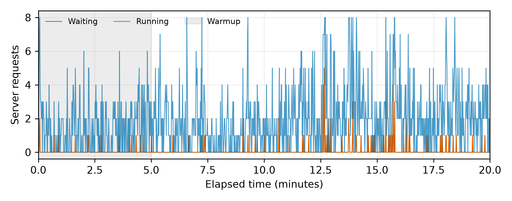
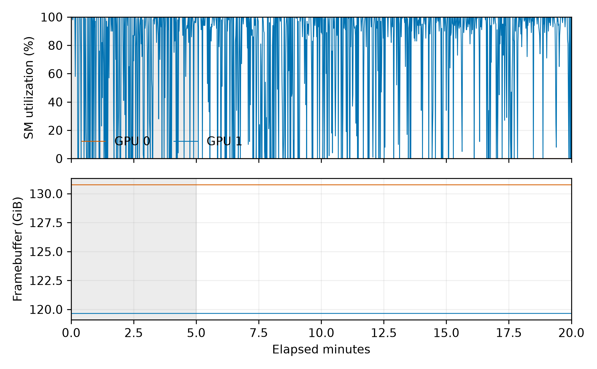

# 共享 GPU：Qwen3-8B、LRU、none、20 分钟

λ=1 根/分钟；16K；8 槽位；GPU池182880 token、CPU层274320 token；稳态初始化；预热5分钟。保留现有 GPU 进程，独立端口；nvidia-smi dmon 同时记录 GPU0、GPU1。

AgentKV 提交 `d753fd8a241f3a2fc8de83c02c4ed8b369e17b94`，vLLM 提交 `60da6135b0349fac50a051e9dcec2bd5b4514400`；两仓库启动前均检查干净。原始输入/请求输出 SHA256 在 run.json，未复制实现源码。

| 指标 | 实测 |
|---|---:|
| 窗口请求 / 成功 / 失败 | 3906 / 3906 / 0 |
| 运行请求 P50 / P90 / 最大值 | 2.0 / 5.0 / 8 |
| 等待队列前5 / 后5分钟均值 | 0.041 / 0.116 |
| 队列趋势条件 | False |

| token 来源 | 模拟（40分/预热10分） | 实测（20分/预热5分） | 实测−模拟百分点 |
|---|---:|---:|---:|
| gpu_hit | 56.528% | 54.373% | -2.154 |
| cpu_hit | 17.903% | 22.514% | +4.611 |
| recomputed | 25.569% | 23.112% | -2.457 |

名义口径按 token 加权，三类相加为100%。有限窗口、固定服务时间模型、真实 vLLM 块生命周期/异步搬运、共享资源均可能造成差异，本次对照不能独立归因。





[run.json](run.json) · [分析](pilot-analysis.json) · [原始 dmon](../../docs/EVIDENCE.md#runtime-logs) · [逐请求名义来源](../../docs/EVIDENCE.md#requests)

指定配置是否有更大 Oracle 空间的替代项见 pilot-analysis.json 的 oracle_ranking 和 noticeably_larger_oracle_configurations；完整对照见相邻 Oracle 结果目录。

## 对照与验收边界

等待队列末/首5分钟均值比值为 2.824，预设≤1.5条件未通过。92.57% 的队列采样为0，峰值为5；不能把小绝对值当成放宽预设条件的理由，也不据此单独断言长期过载。运行请求数中位数为2，只有 1.83% 的采样达到8；没有满足‘接近槽位上限’的目标。**本次不是E0正式配置验收通过。**

原模拟是40分钟/预热10分钟。为区分窗口混合差异，另以完全相同20分钟/预热5分钟、同种子人口做LRU模拟：

| 来源 | 同窗口模拟 | 实测 | 差值（百分点） |
|---|---:|---:|---:|
| gpu_hit | 57.120% | 54.373% | -2.746 |
| cpu_hit | 21.189% | 22.514% | +1.326 |
| recomputed | 21.692% | 23.112% | +1.421 |

该配置下同窗口三类差异最大约2.75个百分点；不推广为其他配置或策略均已校准。

TTFT P50/P99 为 72.46/869.51ms；链内间隔绝对误差P99为 4.18ms，安全阀未触发，客户端峰值在途17/128。

[14组Oracle排序](../m1-oracle-seed0/README.md)：指定config-11减少8.944个百分点；最大config-13减少9.290，仅大0.346，不属于预先定义的≥2个百分点的明显更大。未改变指定试跑配置。

两卡利用率统计见 [dmon-summary.json](dmon-summary.json)；GPU1数值包括共享进程，无法仅由dmon归因到本次服务。

运行时为保持工作区干净，数据先写到 /tmp；run.json保留当时暂存路径，发布后文件放在本目录，未改写原始记录。requests.parquet包含完整prompt，按仓库规则仅本机保留，其SHA256记入run.json；可审计的轻量来源CSV、统计与原始dmon已提交。

```bash
python -m agentkv.bench.shared_pilot --output-dir ../agentkv-runs/new-pilot-run --comparison-dir ../agentkv-runs/new-oracle-run
python -m agentkv.analysis.validate_oracle_pilot --oracle results/m1-oracle-seed0 --pilot results/m1-shared-pilot-seed0 --output ../agentkv-runs/new-pilot-audit.json
```

统计窗口GPU0的SM利用率均值/中位数均为0%；GPU1均值78.63%、中位数100%。因此不能将运行请求数较少解释为GPU算力低利用；共享GPU1的SM活动也不能仅由dmon划分到具体进程。
