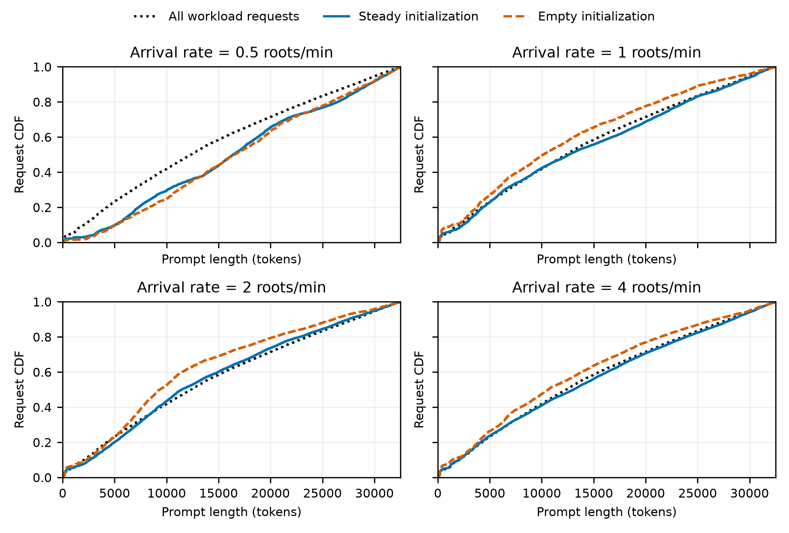

# M1 稳态初始化：人口、进度与请求分布

设计第 5.5、7.3、7.4 节先以提交 `2f322e9` 保存，之后实现 [steady_state.py](../../agentkv/bench/steady_state.py) 和 [estimate_steady_state.py](../../agentkv/bench/estimate_steady_state.py)。本报告为固定 s=0.5 秒、无限并发、无排队和网络开销的离线估算。

## 输入与参数

输入为 [v3 负载](../m1-workload-seed0-v3/README.md)：100 根、2,274 条链、28,812 个请求。原负载的字段和字节保持不变。独立的 [schedule_estimate.parquet](../../docs/EVIDENCE.md#requests) 为 240,266 bytes，包含请求关联 ID、`est_send_s`、`est_duration_s`；同根预计时长在各请求行重复，抽样时按根去重。服务时间、源负载及估算器 SHA256 在元数据中。

源负载 SHA256：`38fe20ee8e3316124fc25cb4bb296f914cf3d8ee3cdc0fceac7d4f00854bd9e8`。调度文件 SHA256：`6f465acdb8d2c2bf1224a30ec2115c6c772b3a8471ecc17daf7f1dc9f2b1a514`。

人口种子 `population_seed=0`；T=2400 秒、预热 600 秒、收尾 0 秒。每个 λ 做初始化开/关对照；两种模式共用完全相同的新到达实例、根、到达时刻和编号。根预计平均时长为 **4,126.61375 秒**。

五个独立 PCG64 流由 `SeedSequence([population_seed, λ的IEEE754位模式]).spawn(5)` 派生，分别负责初始数量、初始根、τ、泊松到达和新根。初始实例编号为奇数，新到达实例为偶数。每组 `run.json` 记录全部实例、参数、请求文件指纹及 Python 实现 SHA256。运行记录中的 Git 提交为先提交的设计文档，`git_worktree_dirty=true`，实现以源码指纹定位。

## 活跃人口、请求与峰值在途

根活跃期为 `[实例开始, 实例开始+D_R−τ)`；链活跃期从该链首次预计发送到最后预计结束，包含间隔，截去 τ 之前部分。初始已发出请求的虚拟剩余服务计入活跃期，不计入实际在途数。统计窗口每 10 秒采样一次，即 600、610、…、2400 秒，共 181 个时刻；分位数使用线性插值。

| λ（根/分钟） | 初始化 | M₀ | 活跃根 中位数/P90 | 活跃链 中位数/P90 | 窗口请求数 | 全程峰值在途 |
| --- | --- | ---: | ---: | ---: | ---: | ---: |
| 0.5 | 稳态 | 39 | 29 / 37 | 31 / 43 | 3,501 | 8 |
| 0.5 | 空 | 0 | 7 / 7 | 7 / 10 | 1,124 | 4 |
| 1 | 稳态 | 61 | 77 / 80 | 89 / 94 | 8,610 | 11 |
| 1 | 空 | 0 | 33 / 37 | 38 / 45 | 4,165 | 8 |
| 2 | 稳态 | 121 | 133 / 138 | 155 / 165 | 16,166 | 15 |
| 2 | 空 | 0 | 46 / 57 | 59 / 73 | 7,228 | 11 |
| 4 | 稳态 | 280 | 267 / 278 | 338 / 348 | 34,798 | 30 |
| 4 | 空 | 0 | 71 / 95 | 88 / 121 | 10,681 | 12 |

八组统计窗口内 **is_entry 均为 0，占比均为 0%**。四组稳态运行全程分别有 **49、70、136、340** 个 is_entry，最晚约在 120.3131 秒发出。被跳过触发请求的剩余服务小于 0.5 秒，后续间隔/启动延迟不超过 120 秒，因此这些入口在 120.5 秒前发出，早于 600 秒预热结束。空初始化全程没有 is_entry。

峰值在途按实际回放请求的 `[send,send+0.5)` 统计，完成与发送同刻时先释放旧请求，覆盖整个 40 分钟并包含预热。该峰值对应固定服务时间模型，实际服务耗时和排队会改变峰值。

## Prompt 分布与后期覆盖

全部负载 prompt 长度中位数 **12,348**，P90 **28,023.9**。窗口分布按非 is_entry 请求等权；CDF 距离是与全部负载请求经验 CDF 的最大绝对差，不是显著性检验。

| λ | 初始化 | prompt 中位数 | prompt P90 | CDF 最大距离 |
| --- | --- | ---: | ---: | ---: |
| 0.5 | 稳态 | 16,371 | 29,468.0 | 0.1609 |
| 0.5 | 空 | 16,564 | 29,359.2 | 0.1732 |
| 1 | 稳态 | 12,621 | 28,342.5 | 0.0358 |
| 1 | 空 | 10,169 | 25,578.8 | 0.0772 |
| 2 | 稳态 | 11,475 | 27,478.0 | 0.0332 |
| 2 | 空 | 9,352 | 26,059.4 | 0.1295 |
| 4 | 稳态 | 13,049 | 28,384.0 | 0.0263 |
| 4 | 空 | 10,629 | 26,832.0 | 0.0623 |

λ=1、2、4 时，稳态初始化的 CDF 更接近全部请求，空初始化的中位数和 P90 更短。λ=0.5 时，两种模式都偏长，空初始化的中位数甚至略高于稳态初始化；该组只有 15 个新到达实例，没有呈现“空初始化中位数更短”的预期。四种 λ 的新实例数分别为 15、52、87、150。以上是单个固定种子的有限窗口结果。



[300 dpi PNG](population-seed0/prompt_cdf.png)、[PDF](population-seed0/prompt_cdf.pdf)。

额外按根预计时长 P90 定义长会话（`D_R ≥8489.5969秒`），按 `est_send/D_R ≥0.75` 定义其后期。四种 λ 在稳态窗口内分别包含 **581、557、1,484、3,744** 个这样的请求，空初始化四组均为 **0**。该定义下长会话后期从相对到达约 6367 秒后开始，超过从空状态启动的 2400 秒窗口；进度初始化覆盖了这些阶段。

## 验证

- **56 项单元测试通过**：[unit-tests.log](../../docs/EVIDENCE.md#runtime-logs)。覆盖全部进度边界、触发规则、is_entry、人口抽样、实例置换及原有行为。
- [schedule_validation.json](schedule_validation.json)：全部请求身份、预计根时长、来源指纹通过，旧 JSON/CSV 与历史结果字节相同。
- [token_permutation_validation.json](token_permutation_validation.json)：真实合法词表 151,655 个 ID 的一一映射、16 个真实 prompt 的 256 对 LCP 保持，两个实例的首 token 不同。
- [population_validation.json](population_validation.json)：独立审计八组共 **109,619** 个请求，核对完整性、发送时刻、is_entry、共用新实例、1,448 次时间采样、prompt 统计及峰值在途。
- [reproduction_validation.json](reproduction_validation.json)：独立完整复跑八组实验，19 个请求、参数、汇总和图文件全部字节一致。
- [population-seed0/summary.json](population-seed0/summary.json)：全部汇总；各 `lambda-*/steady|empty/` 子目录保存完整 `run.json` 和逐请求 `requests.parquet`。

## 复现

在仓库根目录执行：

```bash
export PYTHONPATH=../agentkv-runs/agentkv-parquet-tools:../agentkv-runs/agentkv-week1-plot-tools
export HF_HUB_OFFLINE=1 TRANSFORMERS_OFFLINE=1
PYTHON=../vllm/.venv/bin/python
"$PYTHON" -m pytest tests -q
"$PYTHON" -m agentkv.bench.estimate_replay --workload results/m1-workload-seed0-v3/workload.parquet --output-dir results/m1-steady-state-seed0
"$PYTHON" -m agentkv.bench.estimate_steady_state --population-seed 0
"$PYTHON" results/m1-steady-state-seed0/validate_population.py
```

实例 token 置换提供为在线工具；本次人口估算读取请求元数据，原负载 token 未重写。日志：[population-build.log](../../docs/EVIDENCE.md#runtime-logs)、[population-validation.log](../../docs/EVIDENCE.md#runtime-logs)、[population-timing.txt](../../docs/EVIDENCE.md#other-evidence)。
