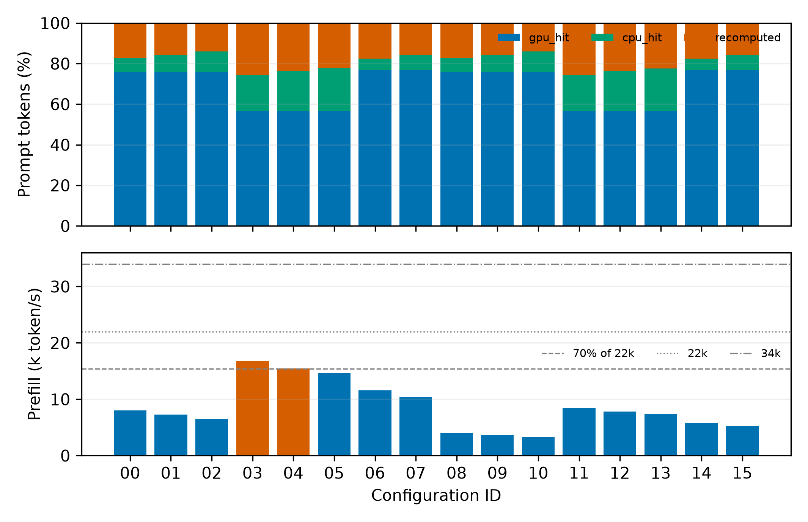
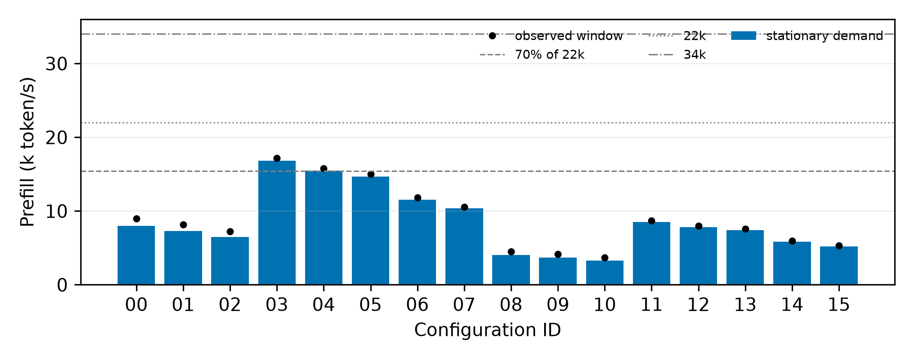

# M1 两层 LRU 模拟

## 最小模型与核验门槛

完整 16-token 前缀块；同实例可共享、不同实例隔离，等价于置换后的前缀身份。先查询 GPU 连续前缀，再用 CPU 连续前缀延伸；剩余 token（含不完整末块）全部重算。新块在请求完成时才就绪，GPU 运行 KV 钉住，输出 KV 只作私有预留，不缓存。槽位与 GPU 容量不足时 FCFS 排队。

CPU 是重复写入的 prompt 镜像层，两层独立执行 LRU；GPU 淘汰不向 CPU 插入，CPU 淘汰不使 GPU 副本失效。请求完成时按整条 prompt 更新两层 recency，前缀头比尾更近期。它不是独占 victim cache，也不包含 vLLM 具体 chunk 分组和异步搬运策略。服务固定 0.5 秒，搬运视为瞬时，不能预测真实服务时延。

使用容量分析相同实例及 τ，缓存从空状态开始，不预填初始历史；T=40 分钟、预热 10 分钟，is_entry 请求照常加载但不计统计。同人口无限缓存对照使用相同槽位和完成时就绪规则。

**测量前约定的推荐门槛：** 容量约束通过；模拟 LRU 命中率比全负载理论上限、同人口无限缓存对照都至少低 10 个百分点；稳态 prefill 需求≤15400 token/s。报告另确认该次窗口的实测速率也≤15400。全负载理论上限约98.095%；有限窗口的 prompt 混合不同，同窗口理论上限另记录，不能把无限缓存对照略高于全负载平均视为超出上限。

稳态需求=`λ/60×mean_R(sum prompt_len)×模拟 token 加权重算比例`；窗口速率=`窗口重算 token/1800s`。所有源比例均按 token 加权，三者相加为 100%；不是逐请求比例的算术均值。仅计 prefill，不包含 decode、CPU 带宽和共享 GPU 干扰。

## 全部模拟结果

| ID | GPU / CPU / 重算 | 距全负载上限 pp | 同人口无限缓存命中 | 稳态 / 窗口 prefill token/s | 占22k / 占34k | 模拟门槛 |
|---|---:|---:|---:|---:|---:|---|
| [config-00](config-00/run.json) | 75.97% / 6.68% / 17.35% | 15.45 | 98.405% | 8,001.5 / 8,969.1 | 36.37% / 23.53% | 通过 |
| [config-01](config-01/run.json) | 75.97% / 8.20% / 15.83% | 13.92 | 98.405% | 7,298.6 / 8,181.2 | 33.18% / 21.47% | 通过 |
| [config-02](config-02/run.json) | 75.97% / 10.00% / 14.03% | 12.12 | 98.405% | 6,468.3 / 7,250.5 | 29.40% / 19.02% | 通过 |
| [config-03](config-03/run.json) | 56.51% / 17.95% / 25.54% | 23.64 | 97.843% | 16,825.0 / 17,176.2 | 76.48% / 49.49% | 不通过 |
| [config-04](config-04/run.json) | 56.51% / 19.99% / 23.50% | 21.59 | 97.843% | 15,479.3 / 15,802.4 | 70.36% / 45.53% | 不通过 |
| [config-05](config-05/run.json) | 56.51% / 21.19% / 22.29% | 20.39 | 97.843% | 14,686.2 / 14,992.8 | 66.76% / 43.19% | 通过 |
| [config-06](config-06/run.json) | 76.88% / 5.58% / 17.55% | 15.64 | 97.843% | 11,558.2 / 11,799.4 | 52.54% / 33.99% | 通过 |
| [config-07](config-07/run.json) | 76.88% / 7.42% / 15.71% | 13.80 | 97.843% | 10,346.4 / 10,562.4 | 47.03% / 30.43% | 通过 |
| [config-08](config-08/run.json) | 75.94% / 6.66% / 17.39% | 15.49 | 98.347% | 4,041.7 / 4,530.4 | 18.37% / 11.89% | 通过 |
| [config-09](config-09/run.json) | 75.94% / 8.19% / 15.87% | 13.97 | 98.347% | 3,688.1 / 4,134.1 | 16.76% / 10.85% | 通过 |
| [config-10](config-10/run.json) | 75.94% / 9.99% / 14.07% | 12.17 | 98.347% | 3,269.7 / 3,665.1 | 14.86% / 9.62% | 通过 |
| [config-11](config-11/run.json) | 56.53% / 17.90% / 25.57% | 23.66 | 97.793% | 8,487.6 / 8,664.7 | 38.58% / 24.96% | 通过 |
| [config-12](config-12/run.json) | 56.53% / 19.94% / 23.53% | 21.63 | 97.793% | 7,810.8 / 7,973.8 | 35.50% / 22.97% | 通过 |
| [config-13](config-13/run.json) | 56.53% / 21.14% / 22.33% | 20.42 | 97.793% | 7,412.1 / 7,566.8 | 33.69% / 21.80% | 通过 |
| [config-14](config-14/run.json) | 76.84% / 5.59% / 17.57% | 15.66 | 97.793% | 5,832.3 / 5,954.0 | 26.51% / 17.15% | 通过 |
| [config-15](config-15/run.json) | 76.84% / 7.42% / 15.73% | 13.83 | 97.793% | 5,222.8 / 5,331.8 | 23.74% / 15.36% | 通过 |

**不放行项：** config-03：稳态 16,825.0、窗口 17,176.2 token/s，未过项 compute_22k_70pct；config-04：稳态 15,479.3、窗口 15,802.4 token/s，未过项 compute_22k_70pct

14 个配置通过模拟推荐门槛；这不是 GPU 试跑通过。全部候选的工作集、池大小、比例和估算方法见 [容量表](../m1-capacity-seed0-v3/README.md)。

## 优先去共享 GPU 短跑的配置

按当前只读显存快照，加 30GiB 非 KV 预留检查，优先固定 GPU 池和 8 槽位，对照 λ 与 CPU 大小：

| ID | 预算 / λ / 槽位 | GPU token / GiB | CPU token / GiB | 工作集 P50 / P90 token | prefill token/s |
|---|---|---:|---:|---:|---:|
| config-08 | 16384 / 0.7 / 8 | 182,880 / 25.11 | 274,320 / 37.67 | 506,708.5 / 538,898.0 | 4,041.7 |
| config-11 | 16384 / 1 / 8 | 182,880 / 25.11 | 274,320 / 37.67 | 764,289.5 / 832,029.3 | 8,487.6 |
| config-13 | 16384 / 1 / 8 | 182,880 / 25.11 | 365,760 / 50.23 | 764,289.5 / 832,029.3 | 7,412.1 |

优先短跑配置数为 3。当前空闲显存最多约 62.61GiB（若未取得显卡信息则为0，不认定可放入共享卡）；优先项 GPU KV 均约25.11GiB，加30GiB预留约55.11GiB。现场会变化，启动前仍须重新核对。其他大池即使通过模拟，也可能放不进目前共享 GPU，见 [analysis.json](analysis.json)。

**本次未执行任何 GPU 试跑，未确定正式 E0。** 70% 算力线只是筛选余量，不能保证其他进程争用下稳定。按 [pilot-plan.json](pilot-plan.json) 短跑后仍需核验等待队列趋势、运行并发和实际命中。

## 诊断与证据

单链无限缓存与最大 LCP 上限精确一致的单元测试使用 token 粒度；实验使用16-token块。同一循环工作集大于 GPU、CPU 小于 GPU 的测试中，发生 GPU 驱逐仍没有 CPU 增益；另有真实16K人口的小CPU诊断，见 [small-cpu-diagnostic/run.json](small-cpu-diagnostic/run.json)。

[run.json](run.json) 记录全部参数、Git状态、输入和实现指纹；各配置保存 requests.parquet 和 run.json。无限缓存对照保存在 unlimited-* 目录。独立核验见 [validation.json](validation.json)，完整测试见 [pytest.log](../../docs/EVIDENCE.md#runtime-logs)。





图另有 [来源 PDF](lru_sources.pdf)、[吞吐 PDF](lru_prefill.pdf)。

真实人口诊断：GPU=182,880 token，CPU=91,440 token，CPU/GPU=0.5；GPU / CPU / 重算为 75.9415% / 0.0000% / 24.0585%。该诊断违反候选比例约束，只用于验证镜像层退化，不推荐试跑。

## 当前复现命令路径

在仓库根目录、干净工作区中执行。基准入口已统一到 `agentkv/bench/`，M3 模拟器为 `agentkv/sim/two_tier.py`；hint 信封位于 `agentkv/hints/protocol.py`。不要从历史快照目录执行旧入口。输出先放 /tmp，避免前一个命令产生的未提交结果阻止下一个测量。

```bash
python -m agentkv.bench.capacity --output-dir ../agentkv-runs/new-capacity-run
python -m agentkv.sim.two_tier --capacity-dir ../agentkv-runs/new-capacity-run --output-dir ../agentkv-runs/new-two-tier-run
python -m agentkv.bench.report_two_tier --capacity-dir ../agentkv-runs/new-capacity-run --simulation-dir ../agentkv-runs/new-two-tier-run
python -m agentkv.bench.compare_oracle --output-dir ../agentkv-runs/new-oracle-run
```

原始 LRU 结果仍是 40 分钟、预热10分钟；新的 Oracle 对照和20分钟共享GPU试跑在结果索引中单列，不覆盖本目录的测量数据。
