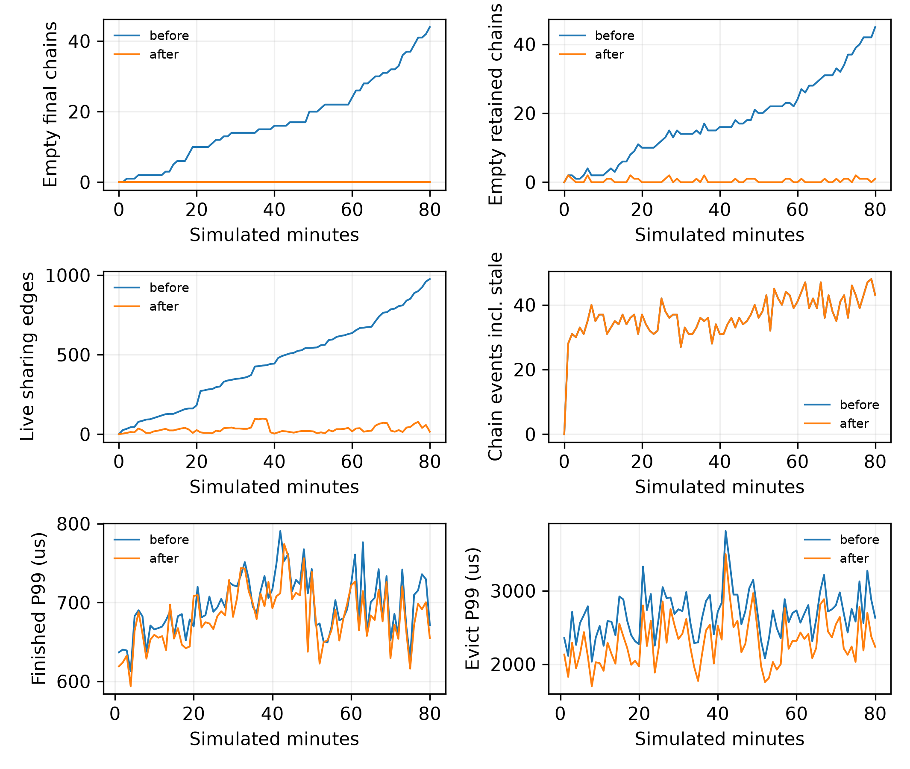

# 链状态增长：80分钟CPU诊断与清理

config-11、λ=1、人口种子4、online，固定服务0.5秒，80分钟。每60模拟秒只读采样，不推进策略时钟；每次finished/evict单独计时，快照扫描在计时外。全部单次耗时见callbacks.parquet，81个快照见snapshots.parquet。以下端点为10分钟和80分钟，趋势统计排除前10分钟。
清理前源`6afbaee04886deb2c0ab632007f65bbc4480cd7a`，清理后源`8bc18babf4322c4027e3fdf2a3a2b768901c3414`。人口指纹`1f5fb3ccdbdb8d772f7d4f32ed5f1a66ae175487083b2f8b4d4f61ea08539725`；全部逐请求字段（含CPU命中/重算）完全相同。

| 项 | 清理前10→80分钟 | 清理后10→80分钟 | 清理后最大值 |
|---|---:|---:|---:|
| chains | 41 → 87 | 39 → 43 | 54 |
| final_empty | 2 → 44 | 0 → 0 | 0 |
| empty_chains | 2 → 45 | 0 → 1 | 2 |
| neighbor_chains | 60 → 380 | 11 → 8 | 29 |
| neighbor_edges | 110 → 976 | 22 → 16 | 98 |
| neighbor_groups | 49 → 356 | 5 → 3 | 12 |
| chain_events | 37 → 43 | 37 → 43 | 48 |
| stale_chain_events | 2 → 4 | 2 → 4 | 7 |
| overdue_empty | 0 → 0 | 0 → 0 | 0 |

单调增长的泄漏是空final链和历史邻接/共享分组。事件堆、实际存活链及回调时延均非单调增长，不能把此前GPU开销增长全部归因于泄漏。清理后空final链为0、邻接索引按当前实际共享块引用计数回收；未完成请求的空链仍保留，避免丢失pending归属。存活计数随人口和请求阶段波动，不能要求它们恒定或每分钟递减。
存活口径为保留的非final链（chains−final_retained），见minute_states.csv；超时口径为waiting且t>deadline+margin。remaining模式不使用旧expired标志，拥有CPU块的超时链仍需评分，不能因过期直接丢掉归属。所有持久事件堆及过期条目均列在快照；驱逐中的链头堆每次重建并释放，其大小上限为rank_views，不跨回调积累。
remaining评分路径每秒至多检查一次事件堆；无效事件超过一半才压缩。perfect旧deadline路径的超时版本复用/压缩时序具有可观测语义，因此保留原逻辑，不借此修正无关行为。共享关系清理不改变任何链分数或rank。

## CPU耗时

下面是每分钟P99的前20/后20个统计点均值，单位μs；不是把这些均值当成全局P99，也不做显著性检验。

| 回调 | 修复前 前20/后20 | 修复后 前20/后20 |
|---|---:|---:|
| on_request_finished_p99_us | 684.8 / 701.5 | 672.5 / 680.9 |
| evict_p99_us | 2658.6 / 2769.3 | 2286.2 / 2404.1 |

历史垃圾状态的持续积累已消除，但不能据此宣布GPU的2ms目标已经满足。仅清理版本的evict分钟P99均值略高于原版；若包含后续热路径优化，该中间版原始记录保留于cleanup-only，最终CPU耗时按上表原样报告。

## 有序驱逐一致性

| 原记录 | 策略 | evict次数 | 结果 |
|---|---|---:|---|
| results/m5-chain-scoring-20261106/online-trace | online | 734 | 全部有序key一致 |
| results/m5-vllm-integration-20261104/probe | native LRU | 1128 | 全部有序key一致 |
| results/m5-vllm-integration-20261104/smoke | perfect | 2005 | 全部有序key一致 |
| results/archive/m5-vllm-full-probe-20261104-unclosed | native LRU | 1132 | 全部有序key一致；仅完整回调前缀 |

更早的policy-observations探针没有完整touch/protected/ref参数，不能作为完整调用重放数据；以上覆盖全部callbacks.v1记录。损坏归档保留原始字节，只恢复完整JSON行并截到最后一个已结束的顶层回调，不伪造footer或结束事件。
初版检查器错误地用hint策略回放原LRU采集，修复前版本也在81092调用不匹配；修正为原生LRU路径。第二次遇到已知归档gzip无footer；最终使用显式部分前缀模式。两次检查器失败日志保留在本机持久目录，没有当作新旧策略差异或合格完整采集。
逐调用时延大表及原始prompt载荷保留在持久目录`../agentkv-runs/m5-chain-growth-20261107`；逐次驱逐决策表和生产者run.json按原字节发布，省略的大表仍可按原run.json的SHA核验。



[全部趋势](trends.csv)。GPU验证及λ=1.2预注册另行记录；此CPU结果不代表GPU门槛通过。

## 同人口40分钟GPU验证

目录`gpu`；源`79307af5915d3a06124f61f37a503b2efb8269d6`，LRU→online，各2400秒、预热600秒、λ=1、种子4，新服务、轻量插桩、两卡dmon。保守差值=online P99上界−LRU下界，是否≤2ms：`False`。

- lru: schedule P99 [9633792, 9699327] ns，TTFT {'n': 6022, 'p50': 73.79697999999999, 'p99': 939.4143355, 'maximum': 1810.756037}，hint 8315/8315/None。
- online: schedule P99 [13828096, 13893631] ns，TTFT {'n': 6025, 'p50': 76.383304, 'p99': 872.039775120001, 'maximum': 1500.190927}，hint 8319/8319/8319。
online保守增量：4.259839 ms。

## 同人口40分钟GPU验证

目录`gpu-2`；源`e0b60b18d897adb93f4bb5cd5c96878ca421c14e`，LRU→online，各2400秒、预热600秒、λ=1、种子4，新服务、轻量插桩、两卡dmon。保守差值=online P99上界−LRU下界，是否≤2ms：`False`。

- lru: schedule P99 [9961472, 10027007] ns，TTFT {'n': 6022, 'p50': 72.820889, 'p99': 1038.3991414999998, 'maximum': 1850.198914}，hint 8315/8315/None。
- online: schedule P99 [12845056, 12910591] ns，TTFT {'n': 6026, 'p50': 74.597661, 'p99': 1086.7318265, 'maximum': 2113.554912}，hint 8320/8320/8320。
online保守增量：2.949119 ms。

## 同人口40分钟GPU验证

目录`gpu-3`；源`24a36ec1ece7ae1fa15e709e29a591a57f55cf35`，LRU→online，各2400秒、预热600秒、λ=1、种子4，新服务、轻量插桩、两卡dmon。保守差值=online P99上界−LRU下界，是否≤2ms：`False`。

- lru: schedule P99 [10027008, 10092543] ns，TTFT {'n': 6020, 'p50': 75.57287500000001, 'p99': 925.0009865800014, 'maximum': 1505.891942}，hint 8315/8315/None。
- online: schedule P99 [13107200, 13172735] ns，TTFT {'n': 6020, 'p50': 77.8386035, 'p99': 1014.1161838000014, 'maximum': 2205.842245}，hint 8313/8313/8313。
online保守增量：3.145727 ms。

## 同人口40分钟GPU验证

目录`gpu-4`；源`05c5a8f78442ff5f670be9701cd920aa3d4269ea`，LRU→online，各2400秒、预热600秒、λ=1、种子4，新服务、轻量插桩、两卡dmon。保守差值=online P99上界−LRU下界，是否≤2ms：`False`。

- lru: schedule P99 [9699328, 9764863] ns，TTFT {'n': 6022, 'p50': 75.87536399999999, 'p99': 1029.8018388299997, 'maximum': 1667.749517}，hint 8318/8318/None。
- online: schedule P99 [12910592, 12976127] ns，TTFT {'n': 6023, 'p50': 75.726673, 'p99': 892.7197441799995, 'maximum': 1631.367561}，hint 8318/8318/8318。
online保守增量：3.276799 ms。

## 最终验收状态与复现

最新核心源 `8bc18ba`；CPU单元测试256通过、3项历史跳过，日志见cleanup-merge-tests.log。

80分钟主结果采用after-merge；修复前后全部逐请求列相同，final_empty与overdue_empty始终为0。逐分钟P99仍随请求组合波动，不能声称所有计数或耗时恒定。

关闭插桩的online真实序列回放：

| 版本 | finished P99(ms) | evict P99(ms) | 两项≤2ms |
|---|---:|---:|---|
| latency-hotpath | 1.007602 | 2.048167 | False |
| latency-fastinsert | 0.997132 | 1.891490 | True |
| latency-finish | 1.000549 | 1.951344 | True |
| latency-merge | 1.024030 | 1.869715 | True |

四轮GPU验证均未通过2ms增量目标，各轮使用不同实现版本及本轮新LRU对照，没有复跑同一版本挑选时延。最终gpu-4为最新实现的验证，不以历史最好值替代。该性能要求仍未完成；后续λ=1.2实验沿指定矩阵独立预注册，报告明确保留这项限制。

```bash
python -m agentkv.bench.chain_growth --output-dir /persistent/new-growth
python -m agentkv.bench.cleanup_replay --reference-commit 6afbaee --output-dir /persistent/new-parity
python -m agentkv.bench.chain_replay --run-dir results/m5-chain-scoring-20261106/online-trace --hint-tier online --implementation chain-plugin --output-dir /persistent/new-latency
python -m agentkv.bench.chain_trial --output-dir /persistent/new-gpu --labels lru online --duration 2400 --warmup 600 --population-seed 4 --gpu-index 1 --port 8018
```
