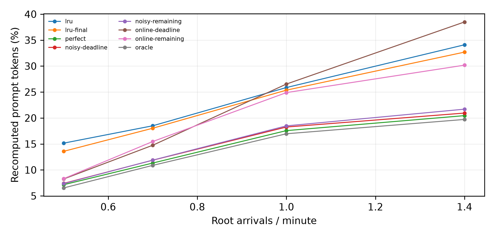
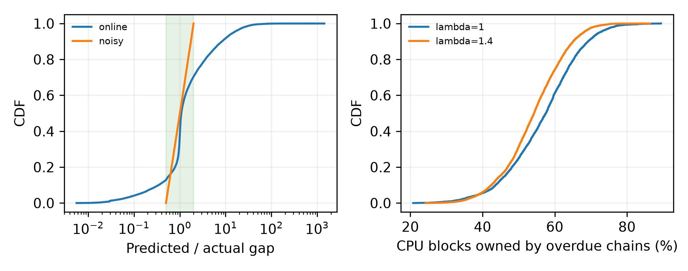

# E1：剩余寿命打分与final基线（纯CPU）

状态：complete；测量提交 `c9027f5afcd04d62f3ae03264efdc575f84789e1`；预注册 `329824d`。

config-11：16K、8槽位、GPU182880/CPU274320 token；T=40分钟、预热10分钟、固定服务0.5秒、零传输耗时；沿用E0全部12个人口，不按真实GPU稳定性筛选。每人口按原始prompt token加权，排除is_entry和预热，再对三个种子等权平均。没有调用GPU/vLLM，不推断TTFT或真实策略开销。

## 预测误差

在回放负载全部非final请求上逐间隔计数，不按人口重复加权。实际间隔为截断、压缩后的gap_after_s；比值只对实际间隔>0定义，零间隔另计。

| 档位 | 正间隔数 | P10 | P50 | P90 | P99 | [0.5,2]占比 | 实际为0 |
|---|---:|---:|---:|---:|---:|---:|---:|
| online | 26538 | 0.343 | 1.082 | 8.310 | 35.113 | 57.56% | 0 |
| noisy | 26538 | 0.575 | 1.008 | 1.747 | 1.973 | 100.00% | 0 |

## 旧online策略驱逐时的过deadline占用

以下只统计600≤t<2400秒的驱逐调用，每次选受害块前采样；链返回以模拟器实际开始执行请求为界，包含已到期但仍排队的情况。分子是至少属于一条waiting且now>原始deadline链的驻留块并集，共享块只计一次，可能仍被其他未超时链引用；不是“可以直接释放”的比例。均值/分位数按决策等权；合并占比=sum(超时块)/sum(CPU块)，不是时间加权。完整模拟全部决策另存各legacy-online/deadline_decisions.parquet。

| λ | seed | 决策数 | 均值 | 中位数 | P90 | 合并占比 |
|---|---|---:|---:|---:|---:|---:|
| 1 | 0 | 7946 | 59.13% | 59.39% | 71.11% | 59.13% |
| 1 | 1 | 5744 | 55.32% | 56.59% | 66.89% | 55.32% |
| 1 | 2 | 6943 | 55.13% | 55.70% | 68.92% | 55.13% |
| 1.4 | 0 | 10749 | 54.39% | 54.65% | 65.51% | 54.39% |
| 1.4 | 1 | 11670 | 52.60% | 52.88% | 64.11% | 52.60% |
| 1.4 | 2 | 10680 | 55.27% | 54.94% | 65.49% | 55.27% |

## 校准与默认配置

训练集为未抽中的293个根会话、62159个链内间隔，与100个回放根无交集。online/noisy分别有10/10个预测分位桶。每桶以G>e的样本计算剩余寿命，e=0..120秒、步长1秒，左端点查表，无存活样本退回LRU；不外推。训练对、存活数及均值表均保留。
默认final开启、尾部关闭；perfect仍使用原deadline，noisy/online使用剩余寿命。旧deadline+超时降级与尾部开关保留。新旧打分对照使用相同的尾部关闭配置；legacy额外回归上一轮尾部开启的三档输出。LRU+final完全不读取间隔预测，非final按LRU，final为无穷大，共享块仍取所有拥有者最早分数。

## 重算比例（三种子均值）

| λ | lru | lru-final | perfect | noisy-deadline | noisy-remaining | online-deadline | online-remaining | oracle |
|---|---:|---:|---:|---:|---:|---:|---:|---:|
| 0.5 | 15.155% | 13.581% | 7.151% | 7.408% | 7.357% | 8.252% | 8.317% | 6.530% |
| 0.7 | 18.500% | 18.026% | 11.322% | 11.870% | 11.884% | 14.751% | 15.470% | 10.875% |
| 1 | 25.861% | 25.357% | 17.567% | 18.260% | 18.479% | 26.530% | 24.887% | 16.960% |
| 1.4 | 34.096% | 32.687% | 20.453% | 20.947% | 21.698% | 38.493% | 30.175% | 19.720% |

## 配对减少百分点与Oracle空间捕获

减少百分点=LRU−策略。捕获率逐人口计算(LRU−策略)/(LRU−Oracle)，再等权平均；不截断负值，分母为0记NA。括号为三个种子的最小–最大。

| λ | 策略 | 减少百分点均值（范围） | Oracle捕获率均值（范围） |
|---|---|---:|---:|
| 0.5 | lru-final | +1.573 (+0.842–+3.023) | 18.24% (9.74%–35.02%) |
| 0.5 | perfect | +8.004 (+7.710–+8.269) | 92.80% (91.12%–95.81%) |
| 0.5 | noisy-deadline | +7.747 (+7.540–+7.979) | 89.84% (87.93%–92.46%) |
| 0.5 | noisy-remaining | +7.798 (+7.405–+8.279) | 90.42% (87.52%–95.93%) |
| 0.5 | online-deadline | +6.903 (+5.822–+8.132) | 79.99% (68.81%–94.23%) |
| 0.5 | online-remaining | +6.838 (+5.331–+8.260) | 79.18% (63.01%–95.71%) |
| 0.7 | lru-final | +0.474 (+0.247–+0.777) | 6.21% (3.14%–10.02%) |
| 0.7 | perfect | +7.178 (+6.803–+7.366) | 94.14% (93.67%–94.96%) |
| 0.7 | noisy-deadline | +6.630 (+6.312–+6.835) | 86.96% (86.90%–87.04%) |
| 0.7 | noisy-remaining | +6.616 (+6.129–+6.997) | 86.71% (84.38%–89.09%) |
| 0.7 | online-deadline | +3.748 (+2.639–+5.017) | 49.11% (34.02%–63.88%) |
| 0.7 | online-remaining | +3.030 (+2.170–+3.968) | 39.72% (27.98%–50.52%) |
| 1 | lru-final | +0.503 (+0.369–+0.573) | 5.82% (4.13%–7.93%) |
| 1 | perfect | +8.293 (+6.744–+9.929) | 93.22% (91.77%–94.29%) |
| 1 | noisy-deadline | +7.601 (+6.245–+9.018) | 85.54% (84.31%–87.30%) |
| 1 | noisy-remaining | +7.381 (+6.129–+8.791) | 83.11% (80.76%–85.69%) |
| 1 | online-deadline | -0.669 (-1.358–+0.314) | -6.63% (-15.18%–4.39%) |
| 1 | online-remaining | +0.974 (+0.899–+1.085) | 11.35% (8.83%–15.16%) |
| 1.4 | lru-final | +1.409 (+1.274–+1.523) | 9.80% (9.43%–10.50%) |
| 1.4 | perfect | +13.643 (+12.831–+14.445) | 94.91% (94.13%–95.49%) |
| 1.4 | noisy-deadline | +13.149 (+12.270–+13.875) | 91.46% (91.31%–91.71%) |
| 1.4 | noisy-remaining | +12.398 (+11.590–+13.006) | 86.25% (85.63%–86.86%) |
| 1.4 | online-deadline | -4.397 (-5.060–-3.999) | -30.52% (-33.32%–-28.48%) |
| 1.4 | online-remaining | +3.922 (+3.126–+4.338) | 27.16% (23.27%–29.65%) |

## online逐人口验收

| λ | seed | LRU重算 | 剩余寿命重算 | 减少百分点 | ≥0 |
|---|---|---:|---:|---:|---|
| 0.5 | 0 | 15.845% | 8.923% | +6.922 | 通过 |
| 0.5 | 1 | 11.708% | 3.448% | +8.260 | 通过 |
| 0.5 | 2 | 17.910% | 12.579% | +5.331 | 通过 |
| 0.7 | 0 | 17.394% | 14.440% | +2.953 | 通过 |
| 0.7 | 1 | 19.917% | 17.747% | +2.170 | 通过 |
| 0.7 | 2 | 18.188% | 14.221% | +3.968 | 通过 |
| 1 | 0 | 25.569% | 24.670% | +0.899 | 通过 |
| 1 | 1 | 30.900% | 29.963% | +0.937 | 通过 |
| 1 | 2 | 21.113% | 20.028% | +1.085 | 通过 |
| 1.4 | 0 | 33.728% | 29.427% | +4.301 | 通过 |
| 1.4 | 1 | 34.574% | 30.236% | +4.338 | 通过 |
| 1.4 | 2 | 33.987% | 30.861% | +3.126 | 通过 |

## 旧打分与尾部组件控制

旧→剩余寿命=旧重算−新重算（正数表示新打分更好）；尾部影响=开启尾部−默认关闭（正数表示开启更差）。两者都固定final开启。

| λ | 档位 | 旧→剩余寿命均值（范围），pp | 开启尾部均值（范围），pp |
|---|---|---:|---:|
| 0.5 | noisy | +0.051 (-0.135–+0.300) | +0.109 (+0.032–+0.171) |
| 0.5 | online | -0.065 (-0.491–+0.166) | +0.053 (-0.004–+0.139) |
| 0.7 | noisy | -0.014 (-0.183–+0.162) | +0.019 (+0.014–+0.025) |
| 0.7 | online | -0.718 (-1.050–-0.469) | +0.012 (+0.000–+0.030) |
| 1 | noisy | -0.220 (-0.317–-0.116) | +0.006 (-0.002–+0.019) |
| 1 | online | +1.643 (+0.770–+2.257) | +0.001 (+0.000–+0.003) |
| 1.4 | noisy | -0.751 (-0.869–-0.680) | +0.005 (+0.003–+0.006) |
| 1.4 | online | +8.318 (+7.125–+9.398) | +0.000 (+0.000–+0.000) |

所有人口与GPU/调度路径一致性、旧E0和E1逐请求回归及SHA256核验见[validation.json](validation.json)。Oracle只是当前两层前缀模型中的CPU未来访问启发式，不保证全局最优。新打分的表格来自校准集，无测试人口调参；验收失败时保留原结果。

[配对原始值](paired.csv) · [均值/范围](aggregate.csv) · [驱逐诊断](deadline_diagnostics.csv) · [控制](controls.csv) · [run.json](run.json) · [产物指纹](artifacts.json) · [预注册](../../docs/m5_remaining_life_design.md)





复现（从干净工作区，在Git外生成结果）：

```bash
python -m pip install -e '.[simulation]'
python -m agentkv.bench.calibrate_remaining_life --output-dir ../agentkv-runs/new-calibration
OMP_NUM_THREADS=1 OPENBLAS_NUM_THREADS=1 python -m agentkv.bench.e1_remaining --output-dir ../agentkv-runs/new-e1-remaining --calibration-dir ../agentkv-runs/new-calibration --workers 4
python -m agentkv.bench.e1_remaining --validate ../agentkv-runs/new-e1-remaining
```

## 汇总观察与最终验证

新online在全部12个人口上均优于LRU，配对减少的最小值为0.899个百分点。它并非普遍优于旧online：λ=0.5/0.7的旧打分平均重算更低；λ=1/1.4则由旧打分的负收益转为正收益。noisy在λ=0.7/1/1.4也没有从新打分中获得平均改善，原样保留。

noisy的[0.5,2]覆盖率100%来自构造时将噪声限制为此区间的对数均匀因子，不能解释为现实预测器的准确率。online只有57.56%，且P99比值35.11，存在明显高估长尾。

三个种子的驱逐决策合并如下；按决策等权，不是将各人口的中位数再平均，也不是按时间加权。共享块只计一次，但仍可能有其他活跃拥有者；此占比不等于可直接回收的容量。

| λ | 决策数 | 过deadline块占比均值 | 中位数 | P90 |
|---|---:|---:|---:|---:|
| 1 | 20633 | 56.72% | 57.53% | 69.18% |
| 1.4 | 33099 | 54.04% | 54.24% | 65.09% |

156次模拟、72次上一轮E1逐请求回归、E0 LRU/Oracle回归及1574066条记录的独立复核均通过，CPU写入跳过次数为0。完整仓库最终测试156项通过。

测量代码 `c9027f5`，校准代码 `b1f730d`，最终复核/复现代码 `8f63d8ecd63a8fbbcb00261375d325077c230a5c`。复现修正只让worker读取记录中的校准文件；策略打分代码与正式测量相同。重新校准的全部数值与已发布表一致，来源标签可不同。

[最终测试](final-tests.json) · [测量时验证](measurement-validation.json) · [重新校准与输入加载检查](reproduction_check.json) · [驱逐决策合并](deadline_aggregate.csv)
