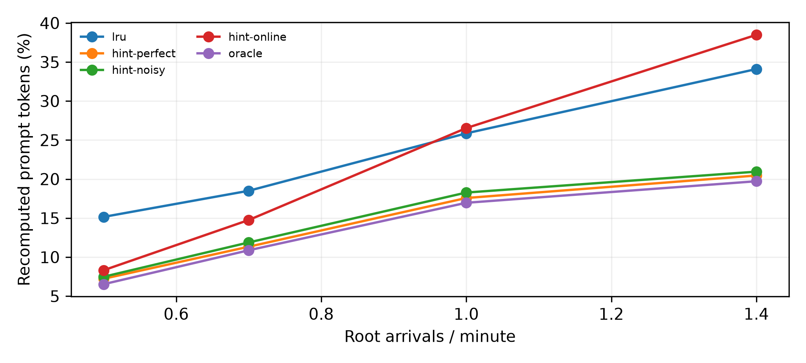
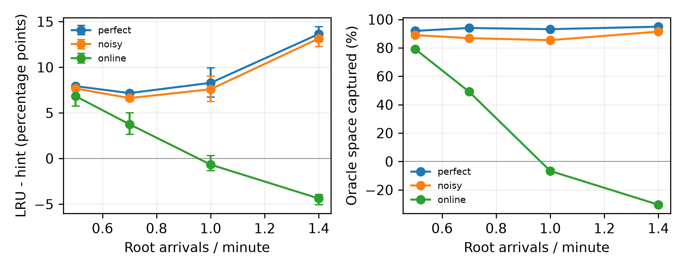

# E1：config-11 的 CPU-only 模拟预演

状态：complete；代码 `5a4618278ed8d8069c1b8e5761c252f468c90e0a`；预注册 `c00b430`。

GPU182880/CPU274320 token、16K、8槽位，40分钟/预热10分钟，固定服务0.5秒、零搬运耗时、完成时CPU重复写prompt。未调用GPU或vLLM。
使用E0全部12个人口，含其不稳定GPU实跑人口；本次不应用GPU稳定性筛选。所有比例以原始prompt token为分母、窗口内排除is_entry；不是E0整块重算分解的分母。每次token加权，再对三个种子等权平均。

## 每种策略的重算比例

| λ | LRU | perfect | noisy | online | CPU Oracle |
|---|---:|---:|---:|---:|---:|
| 0.5 | 15.155% | 7.226% | 7.483% | 8.322% | 6.530% |
| 0.7 | 18.500% | 11.332% | 11.879% | 14.753% | 10.875% |
| 1 | 25.861% | 17.573% | 18.271% | 26.533% | 16.960% |
| 1.4 | 34.096% | 20.455% | 20.948% | 38.478% | 19.720% |

## 配对收益与Oracle空间捕获

百分点为LRU−hint；捕获率逐人口计算(LRU−hint)/(LRU−Oracle)，再等权平均，不截断负数或超过100%的值。括号为三个种子的最小–最大。

| λ | hint | 减少百分点均值（范围） | Oracle捕获率均值（范围） |
|---|---|---:|---:|
| 0.5 | perfect | 7.928 (7.676–8.139) | 91.93% (90.73%–94.31%) |
| 0.5 | noisy | 7.672 (7.532–7.886) | 88.97% (86.52%–91.38%) |
| 0.5 | online | 6.833 (5.750–8.079) | 79.17% (67.96%–93.61%) |
| 0.7 | perfect | 7.168 (6.798–7.353) | 94.00% (93.59%–94.79%) |
| 0.7 | noisy | 6.621 (6.309–6.829) | 86.84% (86.72%–86.95%) |
| 0.7 | online | 3.747 (2.636–5.018) | 49.09% (33.98%–63.90%) |
| 1 | perfect | 8.288 (6.741–9.928) | 93.16% (91.63%–94.24%) |
| 1 | noisy | 7.589 (6.243–9.009) | 85.42% (84.03%–87.29%) |
| 1 | online | -0.672 (-1.355–0.310) | -6.66% (-15.15%–4.34%) |
| 1.4 | perfect | 13.642 (12.829–14.445) | 94.90% (94.11%–95.48%) |
| 1.4 | noisy | 13.148 (12.269–13.874) | 91.46% (91.31%–91.70%) |
| 1.4 | online | -4.382 (-5.065–-3.950) | -30.41% (-33.35%–-28.48%) |

## 单组件消融

差值=消融重算率−完整hint重算率，单位百分点；正数表示去掉该组件变差。每项仅关闭一个开关，全部三个hint档位均覆盖。

| λ | hint | 移除组件 | 差值均值（范围） |
|---|---|---|---:|
| 0.5 | perfect | no-tail | -0.076 (-0.130–-0.033) |
| 0.5 | perfect | no-final | +1.331 (+1.216–+1.424) |
| 0.5 | perfect | no-timeout | +0.000 (+0.000–+0.000) |
| 0.5 | noisy | no-tail | -0.075 (-0.124–-0.009) |
| 0.5 | noisy | no-final | +1.672 (+1.466–+1.992) |
| 0.5 | noisy | no-timeout | +0.010 (+0.000–+0.031) |
| 0.5 | online | no-tail | -0.070 (-0.086–-0.053) |
| 0.5 | online | no-final | +0.978 (+0.872–+1.170) |
| 0.5 | online | no-timeout | -0.685 (-0.935–-0.324) |
| 0.7 | perfect | no-tail | -0.011 (-0.013–-0.005) |
| 0.7 | perfect | no-final | +1.246 (+1.043–+1.403) |
| 0.7 | perfect | no-timeout | +0.005 (-0.030–+0.047) |
| 0.7 | noisy | no-tail | -0.009 (-0.017–-0.003) |
| 0.7 | noisy | no-final | +1.097 (+1.044–+1.169) |
| 0.7 | noisy | no-timeout | +0.036 (+0.008–+0.089) |
| 0.7 | online | no-tail | -0.001 (-0.003–+0.001) |
| 0.7 | online | no-final | +0.493 (+0.413–+0.559) |
| 0.7 | online | no-timeout | -0.620 (-0.748–-0.448) |
| 1 | perfect | no-tail | -0.005 (-0.012–-0.000) |
| 1 | perfect | no-final | +1.101 (+1.064–+1.147) |
| 1 | perfect | no-timeout | -0.071 (-0.133–-0.018) |
| 1 | noisy | no-tail | -0.012 (-0.025–-0.001) |
| 1 | noisy | no-final | +0.941 (+0.913–+0.972) |
| 1 | noisy | no-timeout | -0.053 (-0.081–-0.016) |
| 1 | online | no-tail | -0.003 (-0.008–+0.003) |
| 1 | online | no-final | +0.549 (+0.482–+0.651) |
| 1 | online | no-timeout | +0.418 (+0.403–+0.449) |
| 1.4 | perfect | no-tail | -0.002 (-0.003–+0.000) |
| 1.4 | perfect | no-final | +1.403 (+1.187–+1.753) |
| 1.4 | perfect | no-timeout | -0.205 (-0.324–-0.116) |
| 1.4 | noisy | no-tail | -0.001 (-0.002–-0.000) |
| 1.4 | noisy | no-final | +1.455 (+1.288–+1.645) |
| 1.4 | noisy | no-timeout | -0.093 (-0.121–-0.055) |
| 1.4 | online | no-tail | +0.015 (-0.005–+0.049) |
| 1.4 | online | no-final | +0.747 (+0.704–+0.816) |
| 1.4 | online | no-timeout | +2.756 (+2.321–+3.274) |

## 逐人口主比较

| λ | seed | LRU | perfect | noisy | online | Oracle |
|---|---|---:|---:|---:|---:|---:|
| 0.5 | 0 | 15.845% | 7.875% | 8.248% | 9.176% | 7.064% |
| 0.5 | 1 | 11.708% | 3.569% | 3.822% | 3.629% | 3.078% |
| 0.5 | 2 | 17.910% | 10.234% | 10.379% | 12.160% | 9.449% |
| 0.7 | 0 | 17.394% | 10.596% | 11.085% | 13.807% | 10.130% |
| 0.7 | 1 | 19.917% | 12.565% | 13.191% | 17.281% | 12.161% |
| 0.7 | 2 | 18.188% | 10.835% | 11.360% | 13.170% | 10.335% |
| 1 | 0 | 25.569% | 17.374% | 18.054% | 26.924% | 16.626% |
| 1 | 1 | 30.900% | 20.972% | 21.891% | 31.872% | 20.293% |
| 1 | 2 | 21.113% | 14.372% | 14.869% | 20.803% | 13.960% |
| 1.4 | 0 | 33.728% | 20.076% | 20.426% | 37.860% | 19.223% |
| 1.4 | 1 | 34.574% | 20.129% | 20.700% | 39.639% | 19.386% |
| 1.4 | 2 | 33.987% | 21.158% | 21.718% | 37.937% | 20.550% |

## 正确性与边界

每个人口的LRU、Oracle汇总及逐请求记录与E0模型逐项回归；none适配器与本次LRU逐请求、逐字段相同。180个case均保留请求、人口、输入及调度/GPU指纹。时钟来自模拟事件；策略只读当前请求hint，不查看未来prompt或后续hint。Oracle读取完整剩余人口预计时间（含T之后），不保证链式两层模型全局最优。
原LRU的CPU秩只在完成写入时提升；新策略在开始时仅登记元数据，在完成时交付hint。所有策略必须保持相同请求和GPU路径，CPU写入跳过及hint/超时计数见各run.json。
perfect/noisy的gap_p90为expected的2倍，与现有在线信封一致；可能没有超时事件，消融为0也原样报告。尾部资格限制与已有预测/前缀LRU同分排序可能重叠，消融无收益不能解释为实现失效。固定服务及零传输模型不含真实排队/重算服务时间反馈，此预演没有TTFT测量，不能替代真实E1。





[配对原始值](paired.csv) · [均值与范围](aggregate.csv) · [消融](ablations.csv) · [run.json](run.json)

```bash
python -m agentkv.bench.e1_simulation --output-dir ../agentkv-runs/new-e1-simulation --workers 4
```

## 独立复核与组件贡献

完整矩阵180次、12个人口；none控制的逐请求parquet与LRU逐字节相同，LRU/Oracle与E0模型逐项回归。所有策略的调度、GPU命中、请求身份和prompt一致。

测量代码 `5a4618278ed8d8069c1b8e5761c252f468c90e0a`；复核代码 `14fecfaefffc421f84e63cf8bfdddc56f6587663`。核验1816230条逐请求记录及全部输出SHA256。

| hint | 12人口平均减少百分点 | 12人口平均Oracle捕获率 | 收益为正人口数 |
|---|---:|---:|---:|
| perfect | 9.256 | 93.50% | 12/12 |
| noisy | 8.758 | 88.17% | 12/12 |
| online | 1.381 | 22.80% | 7/12 |

下表是三个种子×四个λ全部12个人口的组件消融差值，单位百分点；负数表示去掉该组件反而减少重算。各λ分表仍以上文和ablations.csv为准。

| 移除组件 | hint | 平均影响 | 全12人口最小–最大 |
|---|---|---:|---:|
| no-tail | perfect | -0.023 | -0.130–+0.000 |
| no-tail | noisy | -0.024 | -0.124–-0.000 |
| no-tail | online | -0.015 | -0.086–+0.049 |
| no-final | perfect | +1.270 | +1.043–+1.753 |
| no-final | noisy | +1.291 | +0.913–+1.992 |
| no-final | online | +0.692 | +0.413–+1.170 |
| no-timeout | perfect | -0.068 | -0.324–+0.047 |
| no-timeout | noisy | -0.025 | -0.121–+0.089 |
| no-timeout | online | +0.467 | -0.935–+3.274 |

全矩阵CPU写入跳过次数的单case最大值为0。本结果只适用于当前截断负载、固定服务时间和CPU镜像模型；不替代真实vLLM的收益或开销测量。

[独立验证](validation.json) · [全部产物指纹](artifacts.json) · [策略与实验预注册](../../docs/m5_e1_simulation_design.md)

纯CPU依赖与复现：

```bash
python -m pip install -e '.[simulation]'
OMP_NUM_THREADS=1 OPENBLAS_NUM_THREADS=1 python -m agentkv.bench.e1_simulation --output-dir ../agentkv-runs/new-e1 --workers 4
python -m agentkv.analysis.validate_e1_simulation --run-dir ../agentkv-runs/new-e1
```
