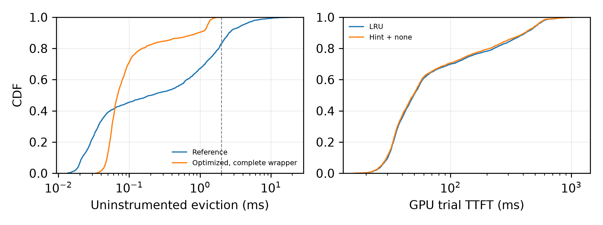
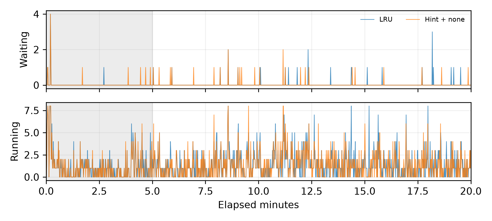

# M5：回调优化与无 hint 接入开销

协议：[测量前登记](../../docs/m5_policy_overhead_design.md)，首个预注册提交 `4e63484`。固定 config-11、λ=1、人口种子3、稳态初始化；每组20分钟，预热5分钟。GPU1显存共享，保留其他进程；两卡 dmon 原样归档。vLLM固定提交 `4749dd5961841243596559b10ba0a22c48980c45`。

## CPU：关闭运行时插桩，原顺序回放

使用完整smoke序列，JSON/gzip解析与ReqContext更新在计时外；无cProfile的独立回放判断门槛。逐次比较有序key、None和请求驱逐数，而非仅比较命中率。最终顺序复测固定CPU32、OMP/BLAS线程1；cProfile另跑，环境见cpu/environment.json。

| 实现 | evict数 | P50 ms | P99 ms | 最大 ms |
|---|---:|---:|---:|---:|
| 原参考适配层+核心 | 2005 | 0.2078 | 8.4328 | 19.9078 |
| 优化适配层+核心 | 2005 | 0.0607 | 1.4241 | 2.0717 |
| 完整vLLM包装层+优化适配层+核心 | 2005 | 0.0683 | 1.4986 | 2.1473 |

CPU门槛：**通过**。两种优化路径全部2005次驱逐逐次一致；最新none路径全部1128次与原生LRU路径一致。驱逐指纹 `09fc5af2fb5f632f3f98cf3ade5a9d6c70c09c27cdf256f2aa48222416216746`。完整前缀枚举2259次，对应2259个请求，结束后缓存条目为0。

原cProfile热点为`_observe`、`_refresh`和`_attach`；慢驱逐包含清理大量陈旧优先级/事件项。优化使用有序优先级索引、增量取消交叉事件及批量合并候选。失效事件保留紧凑时间戳，严格保持原清理阈值和时机。候选优化曾在回调1626952处改变决策，被拒绝；诊断和中间测量保留在归档目录。

get_offload_prefix_keys计数/累计profile耗时：

- reference-profile：4349次，累计0.839438秒。
- optimized-profile：2259次，累计0.466682秒。

全回调累计壁钟计时（无profile）：reference=21.838秒, optimized=24.935秒, vllm=25.488秒。优化适配层比参考增加14.2%，完整包装层增加16.7%；当前优化降低evict长尾，但未降低全回调总耗时。

| 优化后最长调用 | 驱逐块数 | 耗时 ms | 到期事件 | 事件清理批次 | 工作 |
|---|---:|---:|---:|---:|---|
| 1136916 | 511 | 2.1473 | 0 | 1 | 合并选择并删除511个块；清理已取消事件时间戳 |
| 1949859 | 719 | 2.0895 | 0 | 0 | 合并选择并删除719个块 |
| 2336359 | 512 | 1.7840 | 0 | 0 | 合并选择并删除512个块 |
| 2161881 | 511 | 1.7761 | 0 | 0 | 合并选择并删除511个块 |
| 1223041 | 511 | 1.6963 | 0 | 0 | 合并选择并删除511个块 |

参考与优化实现最长10次调用的完整样本见[cpu/validation.json](cpu/validation.json)的slowest字段；完整cProfile见cpu/reference-profile、cpu/optimized-profile。

cProfile的enable/disable本身有显著成本，不能用其分位数判断时延门槛。每种回调的累计无profile时间见cpu/validation.json；优化针对evict长尾，不代表所有hint回调都加速。

## GPU：同人口LRU与hint+none

none为显式、经过逐次验证的原生LRU退化专用路径；不是generic hint评分器的端到端成本。未知hint会拒绝，已知hint档位使用通用优化评分器。轻量模式仅内存计数和直方图，退出每进程写一次；完整插桩只用于显式调试。分位数为nearest-rank桶上下界，桶宽上限1/128；均值使用精确累计时间。

| 组别 | 窗口请求/成功/失败 | GPU命中 | CPU命中 | 重算 | TTFT P50 ms | TTFT P99 ms |
|---|---:|---:|---:|---:|---:|---:|
| lru | 3445/3445/0 | 69.905% | 7.933% | 22.162% | 49.6747 | 716.2143 |
| hint-none | 3450/3450/0 | 69.971% | 8.123% | 21.906% | 49.0944 | 691.2634 |

Hint−LRU：P50 -0.5802ms（-1.168%）；P99 -24.9508ms（-3.484%）。2%门槛：**通过**。

缓存来源为统计窗口内成功、非is_entry请求的prompt token加权名义口径，逐请求三项严格加总为prompt长度。人口与输入指纹相同；闭环时序可能改变真实访问顺序，真实运行的比例近似相同不等于逐次真实驱逐相同。CPU固定序列另给出了逐次一致性证明。

| 回调/调度器 | LRU P50 µs | hint+none P50 µs | LRU P99 µs | hint+none P99 µs | 均值差 µs |
|---|---:|---:|---:|---:|---:|
| scheduler.schedule | 161.792–162.815 | 165.888–166.911 | 7143.424–7176.191 | 7176.192–7208.959 | +7.186 |
| policy.get | 0.416–0.417 | 0.424–0.425 | 1.480–1.487 | 1.416–1.423 | +0.003 |
| policy.mark_evictable | 1.120–1.127 | 1.120–1.127 | 3.696–3.711 | 3.584–3.599 | -0.083 |
| policy.on_request_finished | 325.632–327.679 | 329.728–331.775 | 10027.008–10092.543 | 9699.328–9764.863 | +10.411 |
| policy.on_store_miss | 6.176–6.207 | 8.096–8.127 | 60.928–61.183 | 62.976–63.231 | +6.873 |
| policy.evict | 27.136–27.263 | 26.624–26.751 | 3784.704–3801.087 | 3391.488–3407.871 | -11.406 |
| policy.insert | 0.596–0.599 | 0.592–0.595 | 1.792–1.799 | 1.720–1.727 | +0.001 |
| policy.mark_non_evictable | 0.414–0.415 | 0.426–0.427 | 1.080–1.087 | 1.200–1.207 | +0.017 |

scheduler.schedule测的是CPU调度方法，不包含GPU核函数执行或异步等待。直方图按回调结束时刻落入[300,1200]秒归档；请求指标按发送时刻入窗，故回调计数不必等于窗口请求数。

## 首轮及边界

[首轮原始产物与未通过结论](../../docs/EVIDENCE.md#archives)：两组3448请求全部成功，P50差值+3.602%，未通过2%门槛。首轮数据未删除或合并到新一轮。退出汇总器uint64推断溢出已修复，原始客户端run.json未改；早期失败堆栈保留。

首轮轻量直方图显示none动态转发提高高频get/insert等回调成本；后续直接继承原生LRU方法并移除重复包装。该局部差异不能独立解释全部TTFT变化。共享机器、单个人口种子和一次配对复测限制了因果归因；本任务没有执行E1，也没有证明带perfect/noisy/online hint时的TTFT开销。

复现：先确保固定vLLM源码、模型和负载可用，用`python -m agentkv.bench.profile_callbacks --implementation reference --output-dir ../agentkv-runs/NEW`进行CPU回放，再分别将implementation替换为`optimized`或`vllm`并使用新的输出目录；GPU用`python -m agentkv.bench.policy_overhead --output-dir ../agentkv-runs/NEW --gpu-index 1 --port 8015`。正式测量拒绝脏工作区。结果图/报告可用`python -m agentkv.analysis.policy_overhead_report --result-dir results/m5-policy-overhead-20261104 --first-attempt results/archive/m5-policy-overhead-attempt1-20261104`重新生成。

大请求token数组保留本机并忽略Git；紧凑request-metadata.parquet、完整退出直方图、两卡dmon及客户端run.json纳入版本控制。未向结果目录复制实现代码。

LRU基线跨轮P50漂移：+2.715%。本轮共同请求4242个，其发送prompt哈希、置换种子、prompt长度及输出预算逐项一致。
