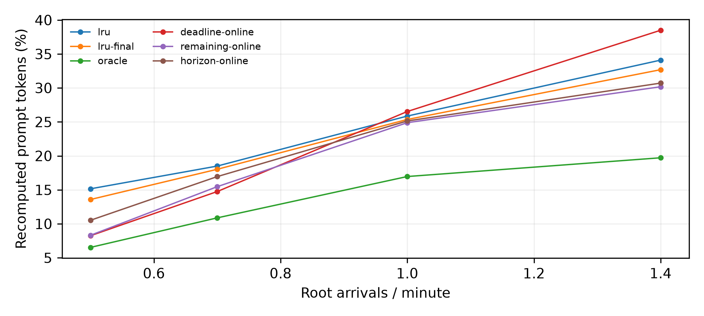
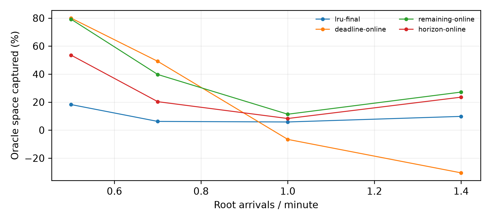

# M5 打分选型：开发组：仅用于选择

代码 `23c2d6d909e87c1b5a7e1aa1bd11bbd84f0708db`；预注册 `a41033c`；状态 complete。

config-11、四个λ、T=40分钟/预热10分钟、固定服务0.5秒、零搬运耗时、尾部关闭；原始prompt token加权，排除is_entry，再按三个种子等权。只用CPU，不代表真实vLLM TTFT或策略开销。
开发数据与最终数据分开；本目录所有表图只使用当前组人口。新种子是人口留出，同一100根trace仍被复用，不宣称跨trace泛化。

## 重算比例

| λ | lru | lru-final | oracle | deadline-online | remaining-online | horizon-online |
|---|---:|---:|---:|---:|---:|---:|
| 0.5 | 15.155% | 13.581% | 6.530% | 8.252% | 8.317% | 10.526% |
| 0.7 | 18.500% | 18.026% | 10.875% | 14.751% | 15.470% | 16.952% |
| 1 | 25.861% | 25.357% | 16.960% | 26.530% | 24.887% | 25.139% |
| 1.4 | 34.096% | 32.687% | 19.720% | 38.493% | 30.175% | 30.711% |

## 预注册选择

选中：`remaining`。先逐人口要求online不差于LRU，再最大化12个人口等权的Oracle捕获率；以下不能作为最终性能数字。

| 候选 | 12人口门槛 | 平均捕获率 | 失败人口 |
|---|---|---:|---|
| deadline | False | 22.987% | lambda-1-seed-0, lambda-1-seed-1, lambda-1.4-seed-0, lambda-1.4-seed-1, lambda-1.4-seed-2 |
| remaining | True | 39.352% | 无 |
| horizon | True | 26.413% | 无 |

## 配对减少百分点与Oracle空间捕获

相对同人口LRU；捕获率先逐人口计算再平均，不截断。括号为三种子的最小–最大，分母0记NA。

| λ | 策略 | 减少百分点均值（范围） | 捕获率均值（范围） | NA |
|---|---|---:|---:|---:|
| 0.5 | lru-final | +1.573 (+0.842–+3.023) | 18.24% (9.74%–35.02%) | 0 |
| 0.5 | deadline-online | +6.903 (+5.822–+8.132) | 79.99% (68.81%–94.23%) | 0 |
| 0.5 | remaining-online | +6.838 (+5.331–+8.260) | 79.18% (63.01%–95.71%) | 0 |
| 0.5 | horizon-online | +4.628 (+2.411–+7.233) | 53.53% (28.49%–83.81%) | 0 |
| 0.7 | lru-final | +0.474 (+0.247–+0.777) | 6.21% (3.14%–10.02%) | 0 |
| 0.7 | deadline-online | +3.748 (+2.639–+5.017) | 49.11% (34.02%–63.88%) | 0 |
| 0.7 | remaining-online | +3.030 (+2.170–+3.968) | 39.72% (27.98%–50.52%) | 0 |
| 0.7 | horizon-online | +1.548 (+1.482–+1.625) | 20.31% (19.82%–20.69%) | 0 |
| 1 | lru-final | +0.503 (+0.369–+0.573) | 5.82% (4.13%–7.93%) | 0 |
| 1 | deadline-online | -0.669 (-1.358–+0.314) | -6.63% (-15.18%–4.39%) | 0 |
| 1 | remaining-online | +0.974 (+0.899–+1.085) | 11.35% (8.83%–15.16%) | 0 |
| 1 | horizon-online | +0.722 (+0.458–+0.907) | 8.29% (5.12%–11.19%) | 0 |
| 1.4 | lru-final | +1.409 (+1.274–+1.523) | 9.80% (9.43%–10.50%) | 0 |
| 1.4 | deadline-online | -4.397 (-5.060–-3.999) | -30.52% (-33.32%–-28.48%) | 0 |
| 1.4 | remaining-online | +3.922 (+3.126–+4.338) | 27.16% (23.27%–29.65%) | 0 |
| 1.4 | horizon-online | +3.385 (+3.050–+3.587) | 23.53% (22.70%–24.73%) | 0 |

## 逐人口记录

| λ | seed | 策略 | 重算率 | 减少百分点 | 捕获率 |
|---|---|---|---:|---:|---:|
| 0.5 | 0 | lru-final | 14.990% | +0.855 | 9.740% |
| 0.5 | 0 | deadline-online | 9.090% | +6.755 | 76.926% |
| 0.5 | 0 | remaining-online | 8.923% | +6.922 | 78.821% |
| 0.5 | 0 | horizon-online | 11.604% | +4.241 | 48.299% |
| 0.5 | 1 | lru-final | 8.686% | +3.023 | 35.023% |
| 0.5 | 1 | deadline-online | 3.576% | +8.132 | 94.226% |
| 0.5 | 1 | remaining-online | 3.448% | +8.260 | 95.713% |
| 0.5 | 1 | horizon-online | 4.476% | +7.233 | 83.805% |
| 0.5 | 2 | lru-final | 17.069% | +0.842 | 9.949% |
| 0.5 | 2 | deadline-online | 12.089% | +5.822 | 68.807% |
| 0.5 | 2 | remaining-online | 12.579% | +5.331 | 63.008% |
| 0.5 | 2 | horizon-online | 15.500% | +2.411 | 28.490% |
| 0.7 | 0 | lru-final | 16.996% | +0.398 | 5.474% |
| 0.7 | 0 | deadline-online | 13.804% | +3.590 | 49.419% |
| 0.7 | 0 | remaining-online | 14.440% | +2.953 | 40.662% |
| 0.7 | 0 | horizon-online | 15.912% | +1.482 | 20.403% |
| 0.7 | 1 | lru-final | 19.140% | +0.777 | 10.016% |
| 0.7 | 1 | deadline-online | 17.279% | +2.639 | 34.020% |
| 0.7 | 1 | remaining-online | 17.747% | +2.170 | 27.976% |
| 0.7 | 1 | horizon-online | 18.380% | +1.537 | 19.821% |
| 0.7 | 2 | lru-final | 17.942% | +0.247 | 3.143% |
| 0.7 | 2 | deadline-online | 13.171% | +5.017 | 63.883% |
| 0.7 | 2 | remaining-online | 14.221% | +3.968 | 50.518% |
| 0.7 | 2 | horizon-online | 16.563% | +1.625 | 20.691% |
| 1 | 0 | lru-final | 25.200% | +0.369 | 4.128% |
| 1 | 0 | deadline-online | 26.927% | -1.358 | -15.184% |
| 1 | 0 | remaining-online | 24.670% | +0.899 | 10.057% |
| 1 | 0 | horizon-online | 25.112% | +0.458 | 5.117% |
| 1 | 1 | lru-final | 30.327% | +0.573 | 5.405% |
| 1 | 1 | deadline-online | 31.864% | -0.964 | -9.088% |
| 1 | 1 | remaining-online | 29.963% | +0.937 | 8.833% |
| 1 | 1 | horizon-online | 29.993% | +0.907 | 8.555% |
| 1 | 2 | lru-final | 20.546% | +0.567 | 7.928% |
| 1 | 2 | deadline-online | 20.798% | +0.314 | 4.393% |
| 1 | 2 | remaining-online | 20.028% | +1.085 | 15.163% |
| 1 | 2 | horizon-online | 20.313% | +0.800 | 11.187% |
| 1.4 | 0 | lru-final | 32.205% | +1.523 | 10.499% |
| 1.4 | 0 | deadline-online | 37.859% | -4.131 | -28.478% |
| 1.4 | 0 | remaining-online | 29.427% | +4.301 | 29.650% |
| 1.4 | 0 | horizon-online | 30.141% | +3.587 | 24.727% |
| 1.4 | 1 | lru-final | 33.142% | +1.432 | 9.426% |
| 1.4 | 1 | deadline-online | 39.635% | -5.060 | -33.319% |
| 1.4 | 1 | remaining-online | 30.236% | +4.338 | 28.562% |
| 1.4 | 1 | horizon-online | 31.057% | +3.517 | 23.159% |
| 1.4 | 2 | lru-final | 32.713% | +1.274 | 9.481% |
| 1.4 | 2 | deadline-online | 37.986% | -3.999 | -29.763% |
| 1.4 | 2 | remaining-online | 30.861% | +3.126 | 23.265% |
| 1.4 | 2 | horizon-online | 30.937% | +3.050 | 22.702% |

## 运行与H统计

horizon使用最近4096个成功驱逐块的last_access至evict时长均值，每秒刷新；初值1秒。活跃拥有者阻止块被驱逐。概率CDF仅由未抽中的293根校准，online/noisy来源分开，perfect直接使用0/1。下表H分位数按全程驱逐调用采样；原始轨迹在case/horizon.parquet。

| 人口 | 策略 | CPU写入跳过 | H P50/P90(s) | 刷新数 |
|---|---|---:|---:|---:|
| lambda-0.5-seed-0 | lru | 0 | — | 0 |
| lambda-0.5-seed-0 | lru-final | 0 | — | 0 |
| lambda-0.5-seed-0 | oracle | 0 | — | 0 |
| lambda-0.5-seed-0 | deadline-online | 0 | — | 0 |
| lambda-0.5-seed-0 | remaining-online | 0 | — | 0 |
| lambda-0.5-seed-0 | horizon-online | 0 | 42.931/53.723 | 2307 |
| lambda-0.5-seed-1 | lru | 0 | — | 0 |
| lambda-0.5-seed-1 | lru-final | 0 | — | 0 |
| lambda-0.5-seed-1 | oracle | 0 | — | 0 |
| lambda-0.5-seed-1 | deadline-online | 0 | — | 0 |
| lambda-0.5-seed-1 | remaining-online | 0 | — | 0 |
| lambda-0.5-seed-1 | horizon-online | 0 | 45.229/55.666 | 2291 |
| lambda-0.5-seed-2 | lru | 0 | — | 0 |
| lambda-0.5-seed-2 | lru-final | 0 | — | 0 |
| lambda-0.5-seed-2 | oracle | 0 | — | 0 |
| lambda-0.5-seed-2 | deadline-online | 0 | — | 0 |
| lambda-0.5-seed-2 | remaining-online | 0 | — | 0 |
| lambda-0.5-seed-2 | horizon-online | 0 | 40.704/51.087 | 2345 |
| lambda-0.7-seed-0 | lru | 0 | — | 0 |
| lambda-0.7-seed-0 | lru-final | 0 | — | 0 |
| lambda-0.7-seed-0 | oracle | 0 | — | 0 |
| lambda-0.7-seed-0 | deadline-online | 0 | — | 0 |
| lambda-0.7-seed-0 | remaining-online | 0 | — | 0 |
| lambda-0.7-seed-0 | horizon-online | 0 | 29.575/44.077 | 2396 |
| lambda-0.7-seed-1 | lru | 0 | — | 0 |
| lambda-0.7-seed-1 | lru-final | 0 | — | 0 |
| lambda-0.7-seed-1 | oracle | 0 | — | 0 |
| lambda-0.7-seed-1 | deadline-online | 0 | — | 0 |
| lambda-0.7-seed-1 | remaining-online | 0 | — | 0 |
| lambda-0.7-seed-1 | horizon-online | 0 | 24.504/37.058 | 2383 |
| lambda-0.7-seed-2 | lru | 0 | — | 0 |
| lambda-0.7-seed-2 | lru-final | 0 | — | 0 |
| lambda-0.7-seed-2 | oracle | 0 | — | 0 |
| lambda-0.7-seed-2 | deadline-online | 0 | — | 0 |
| lambda-0.7-seed-2 | remaining-online | 0 | — | 0 |
| lambda-0.7-seed-2 | horizon-online | 0 | 38.426/51.254 | 2382 |
| lambda-1-seed-0 | lru | 0 | — | 0 |
| lambda-1-seed-0 | lru-final | 0 | — | 0 |
| lambda-1-seed-0 | oracle | 0 | — | 0 |
| lambda-1-seed-0 | deadline-online | 0 | — | 0 |
| lambda-1-seed-0 | remaining-online | 0 | — | 0 |
| lambda-1-seed-0 | horizon-online | 0 | 15.329/24.919 | 2399 |
| lambda-1-seed-1 | lru | 0 | — | 0 |
| lambda-1-seed-1 | lru-final | 0 | — | 0 |
| lambda-1-seed-1 | oracle | 0 | — | 0 |
| lambda-1-seed-1 | deadline-online | 0 | — | 0 |
| lambda-1-seed-1 | remaining-online | 0 | — | 0 |
| lambda-1-seed-1 | horizon-online | 0 | 13.322/21.305 | 2388 |
| lambda-1-seed-2 | lru | 0 | — | 0 |
| lambda-1-seed-2 | lru-final | 0 | — | 0 |
| lambda-1-seed-2 | oracle | 0 | — | 0 |
| lambda-1-seed-2 | deadline-online | 0 | — | 0 |
| lambda-1-seed-2 | remaining-online | 0 | — | 0 |
| lambda-1-seed-2 | horizon-online | 0 | 20.426/33.326 | 2397 |
| lambda-1.4-seed-0 | lru | 0 | — | 0 |
| lambda-1.4-seed-0 | lru-final | 0 | — | 0 |
| lambda-1.4-seed-0 | oracle | 0 | — | 0 |
| lambda-1.4-seed-0 | deadline-online | 0 | — | 0 |
| lambda-1.4-seed-0 | remaining-online | 0 | — | 0 |
| lambda-1.4-seed-0 | horizon-online | 0 | 7.871/13.071 | 2400 |
| lambda-1.4-seed-1 | lru | 0 | — | 0 |
| lambda-1.4-seed-1 | lru-final | 0 | — | 0 |
| lambda-1.4-seed-1 | oracle | 0 | — | 0 |
| lambda-1.4-seed-1 | deadline-online | 0 | — | 0 |
| lambda-1.4-seed-1 | remaining-online | 0 | — | 0 |
| lambda-1.4-seed-1 | horizon-online | 0 | 8.593/14.145 | 2400 |
| lambda-1.4-seed-2 | lru | 0 | — | 0 |
| lambda-1.4-seed-2 | lru-final | 0 | — | 0 |
| lambda-1.4-seed-2 | oracle | 0 | — | 0 |
| lambda-1.4-seed-2 | deadline-online | 0 | — | 0 |
| lambda-1.4-seed-2 | remaining-online | 0 | — | 0 |
| lambda-1.4-seed-2 | horizon-online | 0 | 8.126/13.436 | 2400 |

所有请求/GPU/调度路径一致，CPU策略只改变CPU命中与重算；Oracle仍是块级未来访问启发式，不保证全局最优。

[run.json](run.json) · [配对数据](paired.csv) · [汇总](aggregate.csv) · [验证](validation.json) · [指纹](artifacts.json) · [预注册](../../docs/m5_scoring_selection_design.md)





复现需先在干净工作区开发、冻结提交后才允许最终评估，不能倒序：

```bash
OMP_NUM_THREADS=1 OPENBLAS_NUM_THREADS=1 python -m agentkv.bench.e1_selection develop --output-dir ../agentkv-runs/new-development
python -m agentkv.bench.e1_selection freeze --development-dir ../agentkv-runs/new-development --freeze-file docs/new-freeze.json
# 单独commit并push冻结文件，然后：
OMP_NUM_THREADS=1 OPENBLAS_NUM_THREADS=1 python -m agentkv.bench.e1_selection evaluate --output-dir ../agentkv-runs/new-evaluation --development-dir ../agentkv-runs/new-development --freeze-file docs/new-freeze.json
python -m agentkv.bench.e1_selection validate --run-dir ../agentkv-runs/new-evaluation
```

## 验证证据与范围

完整仓库173项测试通过；开发组72次、726492条请求记录复核及60次历史输出回归通过。源代码提交为23c2d6d，未抽中293根的CDF校准提交为ee94b65。

本目录只用于选型，不能将这里的性能数字当作最终评估。冻结规则与参数见[冻结文件](../../docs/m5_scoring_frozen.json)，最终主表将来自另一目录中的种子3/4/5。

[测试](tests.json) · [校准来源](calibration/run.json) · [视界概率查找表](../../docs/EVIDENCE.md#other-evidence) · [选择依据](selection.json)
