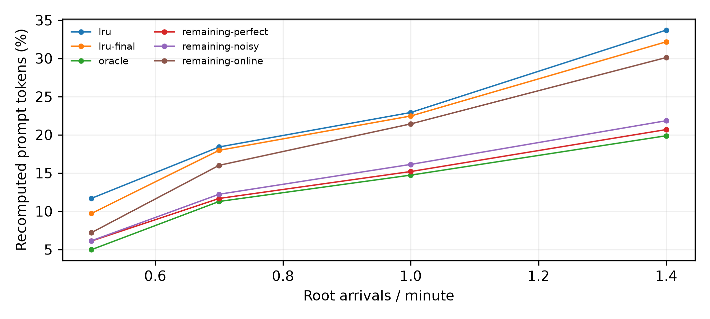
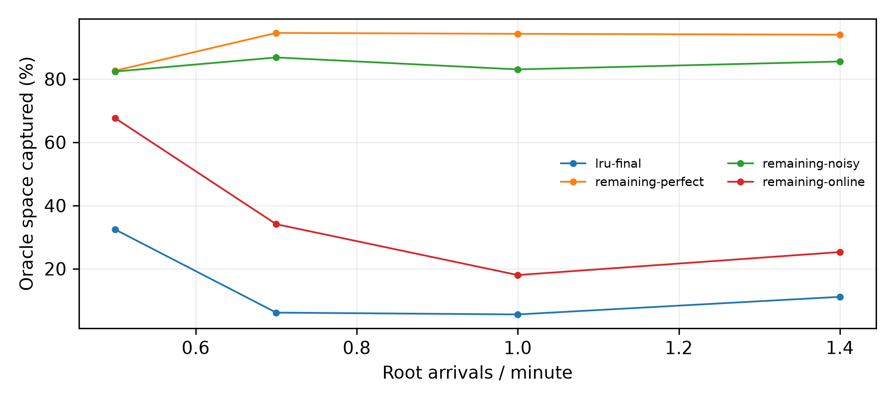

# M5 打分选型：最终留出评估：仅种子3/4/5

代码 `2764ae0264f0bbab7a100f1968e184c7cfce400d`；预注册 `a41033c`；状态 complete。

config-11、四个λ、T=40分钟/预热10分钟、固定服务0.5秒、零搬运耗时、尾部关闭；原始prompt token加权，排除is_entry，再按三个种子等权。只用CPU，不代表真实vLLM TTFT或策略开销。
开发数据与最终数据分开；本目录所有表图只使用当前组人口。新种子是人口留出，同一100根trace仍被复用，不宣称跨trace泛化。

## 重算比例

| λ | lru | lru-final | oracle | remaining-perfect | remaining-noisy | remaining-online |
|---|---:|---:|---:|---:|---:|---:|
| 0.5 | 11.683% | 9.708% | 4.969% | 6.102% | 6.135% | 7.194% |
| 0.7 | 18.412% | 17.974% | 11.281% | 11.674% | 12.225% | 16.008% |
| 1 | 22.922% | 22.463% | 14.728% | 15.197% | 16.131% | 21.431% |
| 1.4 | 33.706% | 32.175% | 19.879% | 20.688% | 21.848% | 30.115% |

冻结候选 `remaining`，冻结提交 `2764ae0264f0bbab7a100f1968e184c7cfce400d`；仅根据开发组选择。留出结果不反向改变策略，负收益不删除。

## 配对减少百分点与Oracle空间捕获

相对同人口LRU；捕获率先逐人口计算再平均，不截断。括号为三种子的最小–最大，分母0记NA。

| λ | 策略 | 减少百分点均值（范围） | 捕获率均值（范围） | NA |
|---|---|---:|---:|---:|
| 0.5 | lru-final | +1.975 (+0.540–+3.956) | 32.43% (7.56%–70.35%) | 0 |
| 0.5 | remaining-perfect | +5.581 (+4.284–+6.558) | 82.67% (76.18%–91.77%) | 0 |
| 0.5 | remaining-noisy | +5.548 (+4.415–+6.446) | 82.38% (78.44%–90.20%) | 0 |
| 0.5 | remaining-online | +4.490 (+4.344–+4.776) | 67.63% (60.79%–77.33%) | 0 |
| 0.7 | lru-final | +0.439 (+0.306–+0.660) | 6.14% (3.94%–8.34%) | 0 |
| 0.7 | remaining-perfect | +6.739 (+5.471–+7.561) | 94.60% (92.47%–95.82%) | 0 |
| 0.7 | remaining-noisy | +6.187 (+5.014–+6.959) | 86.84% (84.82%–87.91%) | 0 |
| 0.7 | remaining-online | +2.404 (+2.160–+2.801) | 34.11% (28.43%–37.84%) | 0 |
| 1 | lru-final | +0.459 (+0.332–+0.534) | 5.57% (4.92%–6.39%) | 0 |
| 1 | remaining-perfect | +7.726 (+6.421–+8.996) | 94.32% (92.88%–95.27%) | 0 |
| 1 | remaining-noisy | +6.792 (+5.787–+7.897) | 83.06% (80.09%–85.86%) | 0 |
| 1 | remaining-online | +1.492 (+0.836–+2.311) | 18.02% (10.00%–24.35%) | 0 |
| 1.4 | lru-final | +1.531 (+1.415–+1.725) | 11.13% (10.18%–12.17%) | 0 |
| 1.4 | remaining-perfect | +13.018 (+11.027–+14.789) | 94.04% (92.29%–95.26%) | 0 |
| 1.4 | remaining-noisy | +11.858 (+9.924–+13.692) | 85.56% (83.06%–87.56%) | 0 |
| 1.4 | remaining-online | +3.591 (+2.311–+5.420) | 25.30% (19.34%–34.66%) | 0 |

## 逐人口记录

| λ | seed | 策略 | 重算率 | 减少百分点 | 捕获率 |
|---|---|---|---:|---:|---:|
| 0.5 | 3 | lru-final | 4.112% | +3.956 | 70.348% |
| 0.5 | 3 | remaining-perfect | 3.784% | +4.284 | 76.182% |
| 0.5 | 3 | remaining-noisy | 3.653% | +4.415 | 78.509% |
| 0.5 | 3 | remaining-online | 3.720% | +4.349 | 77.327% |
| 0.5 | 4 | lru-final | 14.088% | +0.540 | 7.562% |
| 0.5 | 4 | remaining-perfect | 8.070% | +6.558 | 91.774% |
| 0.5 | 4 | remaining-noisy | 8.182% | +6.446 | 90.205% |
| 0.5 | 4 | remaining-online | 10.284% | +4.344 | 60.791% |
| 0.5 | 5 | lru-final | 10.926% | +1.428 | 19.367% |
| 0.5 | 5 | remaining-perfect | 6.452% | +5.902 | 80.044% |
| 0.5 | 5 | remaining-noisy | 6.570% | +5.784 | 78.441% |
| 0.5 | 5 | remaining-online | 7.577% | +4.776 | 64.778% |
| 0.7 | 3 | lru-final | 20.531% | +0.660 | 8.336% |
| 0.7 | 3 | remaining-perfect | 13.630% | +7.561 | 95.512% |
| 0.7 | 3 | remaining-noisy | 14.232% | +6.959 | 87.909% |
| 0.7 | 3 | remaining-online | 18.941% | +2.250 | 28.429% |
| 0.7 | 4 | lru-final | 14.605% | +0.351 | 6.145% |
| 0.7 | 4 | remaining-perfect | 9.484% | +5.471 | 95.816% |
| 0.7 | 4 | remaining-noisy | 9.942% | +5.014 | 87.802% |
| 0.7 | 4 | remaining-online | 12.795% | +2.160 | 37.835% |
| 0.7 | 5 | lru-final | 18.785% | +0.306 | 3.936% |
| 0.7 | 5 | remaining-perfect | 11.907% | +7.183 | 92.466% |
| 0.7 | 5 | remaining-noisy | 12.502% | +6.589 | 84.817% |
| 0.7 | 5 | remaining-online | 16.289% | +2.801 | 36.057% |
| 1 | 3 | lru-final | 18.399% | +0.332 | 4.922% |
| 1 | 3 | remaining-perfect | 12.309% | +6.421 | 95.266% |
| 1 | 3 | remaining-noisy | 12.943% | +5.787 | 85.859% |
| 1 | 3 | remaining-online | 17.402% | +1.328 | 19.706% |
| 1 | 4 | lru-final | 25.731% | +0.511 | 5.380% |
| 1 | 4 | remaining-perfect | 17.246% | +8.996 | 94.807% |
| 1 | 4 | remaining-noisy | 18.345% | +7.897 | 83.220% |
| 1 | 4 | remaining-online | 23.931% | +2.311 | 24.354% |
| 1 | 5 | lru-final | 23.260% | +0.534 | 6.394% |
| 1 | 5 | remaining-perfect | 16.034% | +7.760 | 92.885% |
| 1 | 5 | remaining-noisy | 17.103% | +6.691 | 80.091% |
| 1 | 5 | remaining-online | 22.959% | +0.836 | 10.004% |
| 1.4 | 3 | lru-final | 29.216% | +1.454 | 12.172% |
| 1.4 | 3 | remaining-perfect | 19.643% | +11.027 | 92.294% |
| 1.4 | 3 | remaining-noisy | 20.746% | +9.924 | 83.061% |
| 1.4 | 3 | remaining-online | 28.359% | +2.311 | 19.341% |
| 1.4 | 4 | lru-final | 33.475% | +1.725 | 11.033% |
| 1.4 | 4 | remaining-perfect | 20.411% | +14.789 | 94.573% |
| 1.4 | 4 | remaining-noisy | 21.508% | +13.692 | 87.558% |
| 1.4 | 4 | remaining-online | 29.781% | +5.420 | 34.660% |
| 1.4 | 5 | lru-final | 33.833% | +1.415 | 10.180% |
| 1.4 | 5 | remaining-perfect | 22.010% | +13.237 | 95.259% |
| 1.4 | 5 | remaining-noisy | 23.290% | +11.958 | 86.051% |
| 1.4 | 5 | remaining-online | 32.206% | +3.042 | 21.888% |

## 运行与H统计

horizon使用最近4096个成功驱逐块的last_access至evict时长均值，每秒刷新；初值1秒。活跃拥有者阻止块被驱逐。概率CDF仅由未抽中的293根校准，online/noisy来源分开，perfect直接使用0/1。下表H分位数按全程驱逐调用采样；原始轨迹在case/horizon.parquet。

| 人口 | 策略 | CPU写入跳过 | H P50/P90(s) | 刷新数 |
|---|---|---:|---:|---:|
| lambda-0.5-seed-3 | lru | 0 | — | 0 |
| lambda-0.5-seed-3 | lru-final | 0 | — | 0 |
| lambda-0.5-seed-3 | oracle | 0 | — | 0 |
| lambda-0.5-seed-3 | remaining-perfect | 0 | — | 0 |
| lambda-0.5-seed-3 | remaining-noisy | 0 | — | 0 |
| lambda-0.5-seed-3 | remaining-online | 0 | — | 0 |
| lambda-0.5-seed-4 | lru | 0 | — | 0 |
| lambda-0.5-seed-4 | lru-final | 0 | — | 0 |
| lambda-0.5-seed-4 | oracle | 0 | — | 0 |
| lambda-0.5-seed-4 | remaining-perfect | 0 | — | 0 |
| lambda-0.5-seed-4 | remaining-noisy | 0 | — | 0 |
| lambda-0.5-seed-4 | remaining-online | 0 | — | 0 |
| lambda-0.5-seed-5 | lru | 0 | — | 0 |
| lambda-0.5-seed-5 | lru-final | 0 | — | 0 |
| lambda-0.5-seed-5 | oracle | 0 | — | 0 |
| lambda-0.5-seed-5 | remaining-perfect | 0 | — | 0 |
| lambda-0.5-seed-5 | remaining-noisy | 0 | — | 0 |
| lambda-0.5-seed-5 | remaining-online | 0 | — | 0 |
| lambda-0.7-seed-3 | lru | 0 | — | 0 |
| lambda-0.7-seed-3 | lru-final | 0 | — | 0 |
| lambda-0.7-seed-3 | oracle | 0 | — | 0 |
| lambda-0.7-seed-3 | remaining-perfect | 0 | — | 0 |
| lambda-0.7-seed-3 | remaining-noisy | 0 | — | 0 |
| lambda-0.7-seed-3 | remaining-online | 0 | — | 0 |
| lambda-0.7-seed-4 | lru | 0 | — | 0 |
| lambda-0.7-seed-4 | lru-final | 0 | — | 0 |
| lambda-0.7-seed-4 | oracle | 0 | — | 0 |
| lambda-0.7-seed-4 | remaining-perfect | 0 | — | 0 |
| lambda-0.7-seed-4 | remaining-noisy | 0 | — | 0 |
| lambda-0.7-seed-4 | remaining-online | 0 | — | 0 |
| lambda-0.7-seed-5 | lru | 0 | — | 0 |
| lambda-0.7-seed-5 | lru-final | 0 | — | 0 |
| lambda-0.7-seed-5 | oracle | 0 | — | 0 |
| lambda-0.7-seed-5 | remaining-perfect | 0 | — | 0 |
| lambda-0.7-seed-5 | remaining-noisy | 0 | — | 0 |
| lambda-0.7-seed-5 | remaining-online | 0 | — | 0 |
| lambda-1-seed-3 | lru | 0 | — | 0 |
| lambda-1-seed-3 | lru-final | 0 | — | 0 |
| lambda-1-seed-3 | oracle | 0 | — | 0 |
| lambda-1-seed-3 | remaining-perfect | 0 | — | 0 |
| lambda-1-seed-3 | remaining-noisy | 0 | — | 0 |
| lambda-1-seed-3 | remaining-online | 0 | — | 0 |
| lambda-1-seed-4 | lru | 0 | — | 0 |
| lambda-1-seed-4 | lru-final | 0 | — | 0 |
| lambda-1-seed-4 | oracle | 0 | — | 0 |
| lambda-1-seed-4 | remaining-perfect | 0 | — | 0 |
| lambda-1-seed-4 | remaining-noisy | 0 | — | 0 |
| lambda-1-seed-4 | remaining-online | 0 | — | 0 |
| lambda-1-seed-5 | lru | 0 | — | 0 |
| lambda-1-seed-5 | lru-final | 0 | — | 0 |
| lambda-1-seed-5 | oracle | 0 | — | 0 |
| lambda-1-seed-5 | remaining-perfect | 0 | — | 0 |
| lambda-1-seed-5 | remaining-noisy | 0 | — | 0 |
| lambda-1-seed-5 | remaining-online | 0 | — | 0 |
| lambda-1.4-seed-3 | lru | 0 | — | 0 |
| lambda-1.4-seed-3 | lru-final | 0 | — | 0 |
| lambda-1.4-seed-3 | oracle | 0 | — | 0 |
| lambda-1.4-seed-3 | remaining-perfect | 0 | — | 0 |
| lambda-1.4-seed-3 | remaining-noisy | 0 | — | 0 |
| lambda-1.4-seed-3 | remaining-online | 0 | — | 0 |
| lambda-1.4-seed-4 | lru | 0 | — | 0 |
| lambda-1.4-seed-4 | lru-final | 0 | — | 0 |
| lambda-1.4-seed-4 | oracle | 0 | — | 0 |
| lambda-1.4-seed-4 | remaining-perfect | 0 | — | 0 |
| lambda-1.4-seed-4 | remaining-noisy | 0 | — | 0 |
| lambda-1.4-seed-4 | remaining-online | 0 | — | 0 |
| lambda-1.4-seed-5 | lru | 0 | — | 0 |
| lambda-1.4-seed-5 | lru-final | 0 | — | 0 |
| lambda-1.4-seed-5 | oracle | 0 | — | 0 |
| lambda-1.4-seed-5 | remaining-perfect | 0 | — | 0 |
| lambda-1.4-seed-5 | remaining-noisy | 0 | — | 0 |
| lambda-1.4-seed-5 | remaining-online | 0 | — | 0 |

所有请求/GPU/调度路径一致，CPU策略只改变CPU命中与重算；Oracle仍是块级未来访问启发式，不保证全局最优。

[run.json](run.json) · [配对数据](paired.csv) · [汇总](aggregate.csv) · [验证](validation.json) · [指纹](artifacts.json) · [预注册](../../docs/m5_scoring_selection_design.md)





复现需先在干净工作区开发、冻结提交后才允许最终评估，不能倒序：

```bash
OMP_NUM_THREADS=1 OPENBLAS_NUM_THREADS=1 python -m agentkv.bench.e1_selection develop --output-dir ../agentkv-runs/new-development
python -m agentkv.bench.e1_selection freeze --development-dir ../agentkv-runs/new-development --freeze-file docs/new-freeze.json
# 单独commit并push冻结文件，然后：
OMP_NUM_THREADS=1 OPENBLAS_NUM_THREADS=1 python -m agentkv.bench.e1_selection evaluate --output-dir ../agentkv-runs/new-evaluation --development-dir ../agentkv-runs/new-development --freeze-file docs/new-freeze.json
python -m agentkv.bench.e1_selection validate --run-dir ../agentkv-runs/new-evaluation
```

## 留出结论与验证

上述表图及本节数值只来自种子3/4/5，未混入开发组。online在全部12个人口上均优于同人口LRU，最小减少0.836个百分点；全组平均Oracle空间捕获率为36.26%（先逐人口求比，再对12个人口等权平均）。全部比例和范围仍以上方分λ表为准。

最终组72次、700710条请求记录的独立复核通过；开发组另有72次、726492条记录复核，两个目录分别保留。CPU写入跳过次数的最终case最大值为0。173项完整仓库测试在测量前通过，测试代码与冻结后的实现文件SHA256相同，见[开发组测试记录](../m5-scoring-development-20261104/tests.json)。

本组冻结候选为remaining，不运行horizon；上方运行统计中的H列为不适用。视界概率的实现、校准与运行轨迹保留在[开发组选型报告](../m5-scoring-development-20261104/README.md)，不用于替换本组数字。perfect在remaining候选中仍走原deadline逻辑，不用经验校准；noisy/online使用各自剩余寿命表。

预注册提交a41033c；实现/开发测量23c2d6d；冻结与最终测量2764ae0。最终评估开始前已单独commit并push冻结文件，评估期间未改变实现或重新选择。

[留出汇总与逐人口门槛检查](final_summary.json) · [软件环境](environment.json) · [冻结快照](freeze.json)

纯CPU依赖：`python -m pip install -e '.[simulation]'`。复现上方命令必须先提交任何工作区改动，冻结后才执行evaluate；每次使用新输出目录。

[发布前完整测试](publication-tests.json)（173项通过，包含新增结果目录与文档后的检查）。
