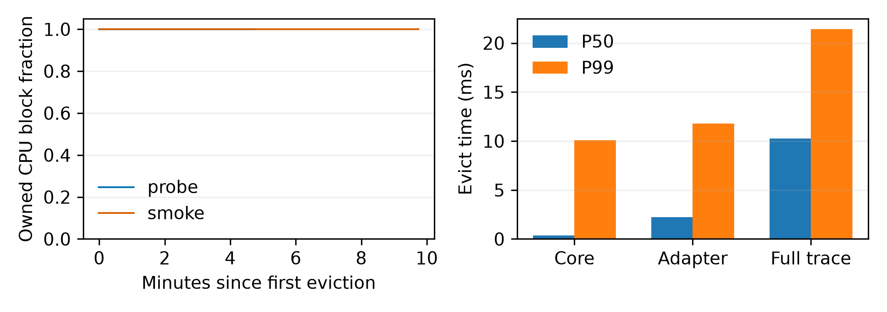

# M5：完整前缀归属、真实回调与GPU冒烟

**完整前缀归属、CPU一致性、5分钟采集和10分钟冒烟的功能门禁已通过。** 全量HintAware实录重放与真实驱逐结果一致。此次是带完整插桩、共享GPU的功能及耗时验证；没有无插桩配对基线，不能据此宣称端到端零开销或正式E1收益。

## 来源与实现

- vLLM fork的`agentkv`分支单独提交：`4749dd5961841243596559b10ba0a22c48980c45`，两仓库启动前均干净。
- `_iter_offload_keys()`供创建与增量更新共用；ReqContext可赋值，新增prompt边界与公开prefix枚举；decode排除，GPU前缀和untracked finished有完整元数据。
- 新旧真实函数在创建、多次调度和decode后的最终位置表一致；后端两种chunk/hash步长均验证。
- 冻结评分代码、表与原E1模拟器未改。适配层补完整前缀归属与深度，原CPU访问参数独立决定recency。真实final共享key最小反例成为通过的回归测试。
- 配置由`AGENTKV_HINT_POLICY_CONFIG`文件传入并打印SHA256；当前为perfect，配置文件通过freeze SHA引用冻结的deadline/final优先/尾部关闭/超时选项。noisy/online校准路径同样支持指纹校验，本次GPU仅验证perfect。

| 阶段 | AgentKV源码提交 | vLLM提交 |
|---|---|---|
| 适配实现及首段失败采集 | `2e88a9e` | `4749dd5961` |
| 正常关闭修复、有效采集/冒烟及完整回放 | `a736e2b` | `4749dd5961` |
| 统计与绘图 | `11fc9d2` | `4749dd5961` |

## 原有测试

[后端验证](backend-validation/README.md)：connector scheduler、CPU manager、worker、tiering及simple offload所列原有单元范围 **1395 passed / 10 skipped / 0 failed**，原有平台条件跳过保留；pre-commit通过。AgentKV **197 passed / 3 skipped**，三个跳过是仅适用于旧后端的历史审计，替代测试在新后端已通过。

额外尝试的实模型`test_offloading_connector.py`模块因本机缺失Llama-3.2-1B-Instruct快照未通过；首次在线还遇到镜像TLS错误。两份原始失败日志保留，**不将该模块说成通过，也未替换模型绕开**。已完成的Qwen3实跑不等于覆盖该模块所有模型。

## 固定运行

Qwen3-8B，config-11：16K、8槽位、GPU182880/CPU274320 token，perfect、λ=0.7根/分钟、人口种子0、稳态初始化；预热0，仅用于功能门禁。GPU1显存/算力共享，两卡dmon均保存，未干预外部进程。

| 指标 | 5分钟native LRU探针 | 10分钟HintAware冒烟 |
|---|---:|---:|
| 实际发送 / 成功 / 失败 | 1284 / 1284 / 0 | 2259 / 2259 / 0 |
| 有效hint / prefix核对请求 | 1284 / 1284 | 2259 / 2259 |
| 实录回调次数 | 1216174 | 2349756 |
| 驱逐决策数 | 1128 | 2005 |
| 每次驱逐CPU块已归属比例 min / P50 / P99 | 100% / 100% / 100% | 100% / 100% / 100% |
| 未归属块观测总数 | 0 | 0 |
| 有效close footer | 1 | 1 |
| 安全阀触发 | 否 | 否 |

上表包含初始化is_entry请求；回放统计窗口会按设计排除它们。客户端hint、前端接收与策略按message_id去重三者相等。LRU探针列的归属比例来自候选适配层在记录的LRU状态上的决策回放，不宣称native LRU自己维护链归属。

## 五项不变量与回放边界

1. 所有evict输出恰好n或None，None时成员不变；ref_cnt=-1、ref_cnt>0与protected从未被选中。
2. 每个带hint的finished后，链均为waiting或final，waiting deadline等于对应实录评分clock加expected_gap_ms。
3. resident完整前缀的链归属和深度逐项正确；独立测试验证分批store与一次登记相同；原final父链/等待子链反例通过。
4. 每次驱逐均输出已归属/总CPU块计数和比例；两段实录路径观测均为100%。没有hint时与native LRU一致的CPU测试另行通过；本次实录无未归属块可用于现场比较LRU回退。
5. 全序列无异常，参数、ref_cnt、返回值和结束计数核对通过；每个上下文snapshot完整prefix长度均为floor(prompt_len/16)。

[LRU回放](probe-replay/run.json)精确复原native LRU，两个候选适配层在记录的LRU缓存路径上进行决策预览后回滚，再明确采用记录的LRU victims；这是回调/安全性验证，不能用来估计候选闭环命中率。

[HintAware回放](smoke-replay/run.json)则逐个重用实录内部clock，两个适配层的真实evict结果、全部成员/ref_cnt状态均等于实录，**没有替换victim或跳过insert**。

## 单次耗时

以下单位ms，均为 P50 / P99：

| 范围 | 5分钟探针 | 10分钟冒烟 |
|---|---:|---:|
| `_create_req_context`函数本身 | 0.241 / 1.279 | 0.297 / 1.356 |
| evict评分核心段 | 不适用 | 0.345 / 10.105 |
| evict适配层段，含归属比例扫描 | 不适用 | 2.239 / 11.803 |
| 完整插桩回调，含状态扫描/日志 | 5.904 / 10.729 | 10.252 / 21.419 |

函数构造计时在日志输出前结束；核心段仍包含内部clock的记录成本。适配层计时在输出指标日志前结束；完整回调入口到出口覆盖日志和全部ref快照扫描。三者不能混为无插桩策略成本。

冒烟evict批量块数P50/P99为3.0/512.0，完整插桩单次最大值40.655ms。当前结果证明功能正确并量化了开销；**不支持‘不会拖慢调度’的零回归结论**，还需要关闭完整插桩后的配对测量，且两段时长和闭环请求序列不同，不能直接把P99比值解释成策略因果开销。



图为双栏7.1英寸宽，PNG 300dpi及[PDF](ownership_and_cost.pdf)。左图probe为LRU缓存路径上的候选归属；smoke为实际HintAware归属，两线重合。

## 关闭修复与原始数据

首段采集因进程组SIGTERM与API管理器再次SIGTERM导致的退出竞态未封闭gzip，已[原样归档](../../docs/EVIDENCE.md#archives)，不计通过。修复只通知API主进程正常退出，135秒超时后才对自建进程组强制清理；服务shutdown timeout120秒。有效两段均有完整gzip/close footer，没有补写结束标记。

全部方法参数、完整key字典、hint、prefix/深度、ref_cnt/chunk_id、protected和返回结果已保存；manager包装额外记录真实引用变化：

| 变化 | LRU探针 | HintAware冒烟 |
|---|---:|---:|
| `-1->0` | 116679 | 148401 |
| `0->1` | 77841 | 215308 |
| `1->0` | 77841 | 215308 |

[probe](probe/README.md) · [smoke](smoke/README.md) · [汇总run.json](run.json) · [AgentKV测试](agentkv-tests.json) · [产物SHA256](artifacts.json)

完整requests.parquet含原prompt数组，仅本机保留并登记SHA256；紧凑元数据只删除该列。完整原始回调gzip入Git，未复制实现代码到结果目录。

## CPU复现

输入为本目录完整实录，无需模型权重或GPU；需要已打补丁的vLLM环境与冻结源码：

```bash
python -m agentkv.analysis.replay_callbacks \
  --run-dir results/m5-vllm-integration-20261104/probe --output-dir ../agentkv-runs/m5-probe-replay-new
python -m agentkv.analysis.replay_callbacks \
  --run-dir results/m5-vllm-integration-20261104/smoke --output-dir ../agentkv-runs/m5-smoke-replay-new
python -m agentkv.analysis.summarize_vllm_integration \
  --probe results/m5-vllm-integration-20261104/probe --probe-replay ../agentkv-runs/m5-probe-replay-new \
  --smoke results/m5-vllm-integration-20261104/smoke --smoke-replay ../agentkv-runs/m5-smoke-replay-new \
  --output-dir ../agentkv-runs/m5-integration-summary-new
```

本机解释器`../vllm/.venv/bin/python`，`PYTHONPATH=.:../agentkv-runs/agentkv-parquet-tools:../agentkv-runs/agentkv-week1-plot-tools`，`OPENBLAS_NUM_THREADS=1 OMP_NUM_THREADS=1`。各输出目录需全新，正式命令要求两仓库代码干净；GPU重跑入口见[测量前协议](../../docs/m5_vllm_integration_validation.md)。
